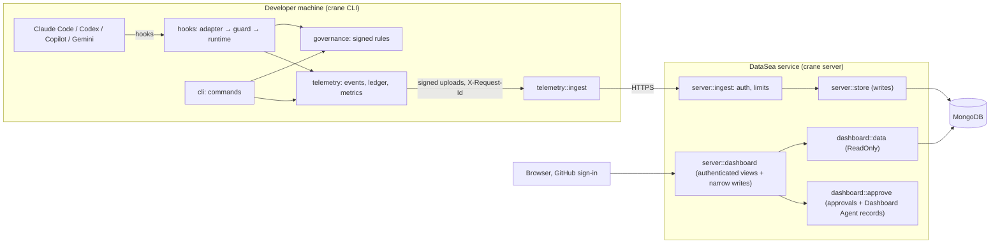

# Contributing to Crane

Thanks for helping make AI agents safer to work with. Bug reports, ideas, documentation, and code
are all welcome. For a vulnerability, follow [SECURITY.md](SECURITY.md) instead of opening an issue.

## Ways to help

- **Report a bug or propose a feature** in
  [Issues](https://github.com/Landscape-Of-Agents/Landscape/issues): what you did, what you expected,
  what happened, and the Crane, Landscape, OS, and agent versions.
- **Improve the docs**: the [guide](docs/GUIDE.md), the extension's README, or the landing page in
  [landing/](landing/).
- **Send a pull request**: for anything larger than a small fix, open an issue first so we can agree
  on the approach.

## Setting up

| Part | Needs | Lives in |
| --- | --- | --- |
| Crane CLI and the hosted service | Rust 1.89+ and Git | `src/`, `tests/` |
| Landscape extension | Node.js 22 | `extensions/foxx/` |
| Landing page | Node.js 22 (Tailwind CSS build) | `landing/` |
| Service tests | A local MongoDB 7 | `tests/ingestion.rs`, `tests/dashboard.rs` |

```bash
git clone https://github.com/Landscape-Of-Agents/Landscape && cd Agentscript
cargo build
cd extensions/foxx && npm install && cd ../..
cd landing && npm install && npm run dev   # rebuilds landing/public/styles.css on change
```

## Checks

Pull requests must pass what CI runs:

```bash
cargo fmt --all -- --check
cargo clippy --locked --all-targets -- -D warnings
cargo clippy --locked --all-targets --features server -- -D warnings
CRANE_INGEST_URL=off cargo test --locked
CRANE_TEST_MONGODB_URI=mongodb://127.0.0.1:27017 cargo test --locked --features server --test ingestion --test dashboard
cargo build --locked && bash scripts/smoke_test.sh
cd extensions/foxx && npm test && npm run package
```

`CRANE_INGEST_URL=off` keeps test runs from uploading to the hosted service. Without
`CRANE_TEST_MONGODB_URI` the live service tests are skipped, so run them before changing anything
under `src/server/`.

Governance commands refuse to run inside an agent session. If you develop with an AI agent, run the
commands that sign rules (`init`, `checkpoint`, `protect`, `target`, `governance sign`) yourself.

## Conventions

- **Doc comments on everything.** Every Rust function, struct, and enum, however small, has a
  `/** */` comment that says what it does and how, in this layout (structs use `Fields`, enums
  `Variants`):

  ```rust
  /** Resolve zones and flows against the repository and validate the configuration
   * Input
      - workspace: &Workspace - repository
   * Output
      - Result<Resolution, String>
      - Error if Git cannot list the files
  */
  ```

  Never put code between a doc comment and its item, and never write a slash-star inside one.
- **Errors are messages for people.** Functions return `Result<T, String>` with a sentence the
  person reading it can act on. `hooks::outcome::block` marks an error that must block the agent
  (exit code 2).
- **Fail closed.** When enforcement cannot decide (unreadable rules, a broken signature, a
  malformed marker), deny the agent's change and say why.
- **Tests come with changes.** Unit tests sit next to the code (`#[cfg(test)]`); behaviour across
  commands and hooks is tested end to end in `tests/*.rs` with the `Fixture` in `tests/common`.
  The extension's editor-independent code lives in `extensions/foxx/src/core` and is tested with
  `node --test`.
- **Keep the extension honest.** Webview scripts are written inside TypeScript template literals,
  where `\n` and `\"` change meaning; `src/test/webviews.test.ts` checks that every page's script
  parses.

## Architecture



| Layer | Modules | Responsibility |
| --- | --- | --- |
| Platform | `platform` | Git, files and locks, processes, curl, rendering |
| Trust | `trust` | Keys, SHA-512 digests, Ed25519, rollback anchors, upload key |
| Selections | `selection` | Anchor comments, signed registry, location tracking |
| Governance | `governance` | State and integrity, admins, policies, verification, zones and flows, the governance graph |
| Enforcement | `hooks` | `adapter/` (one module per agent), `enforce` (the guard), `shell` (command analysis), `runtime/` (session and tool-call phases), `outcome` (the blocking exit-code convention) |
| Telemetry | `telemetry` | Events, ledger, metrics, compliance, redaction, alerts, upload (`ingest`, `sync`) |
| Integrations | `integrations` | One `Provider` per service (`jira`, `slack`, `whatsapp`, `github`): prompts, verification, alert delivery |
| Landscape (local) | `foxx` | The repository status for the dashboard, the live agent context for the editor |
| CLI | `cli` | Dispatch and command audit; `governance/` has one file per command group |
| Service | `server` | `http` (replies, correlation ids), `ingest` (signed upload API), `limits`, `store`, `log` (JSON lines), `dashboard/` (`auth`, read-only evidence `data`, narrow `approve` writes, `api/` by view) |

**Extending.** A new service is one module implementing `integrations::Provider` plus one entry in
`PROVIDERS`. A new agent is one module implementing `hooks::adapter::AgentAdapter`. A new dashboard
view is one function in `server/dashboard/api/` and one route in `api::route`.

**Tracing.** The service logs one JSON object per line on stderr with a `request_id`; Crane sends an
`X-Request-Id` with every upload, the service returns it on every response, and client error
messages include it, so a failure can be traced end to end.

## Pull requests

1. Branch from `main` and keep the change focused.
2. Add or update tests and docs with the change.
3. Run the checks above, then open the pull request describing the problem and the fix.
4. A maintainer reviews it; `.crane/` changes need a code owner's review.

By contributing you agree that your contribution is licensed under the
[Apache License 2.0](LICENSE.md), like the rest of the project.

## Releasing (maintainers)

Bump `version` in `Cargo.toml`, commit, then tag and push (`git tag vX.Y.Z && git push origin
vX.Y.Z`). The release workflow builds Crane for Linux, Windows, and macOS, packages Landscape with the
tag's version, and publishes Landscape to the VS Code Marketplace (secret `VSCE_PAT`) and Open VSX
(optional secret `OVSX_PAT`) when `extensions/foxx` changed since the previous release. The landing
page reads releases from GitHub, so it shows the new downloads without redeploying.
