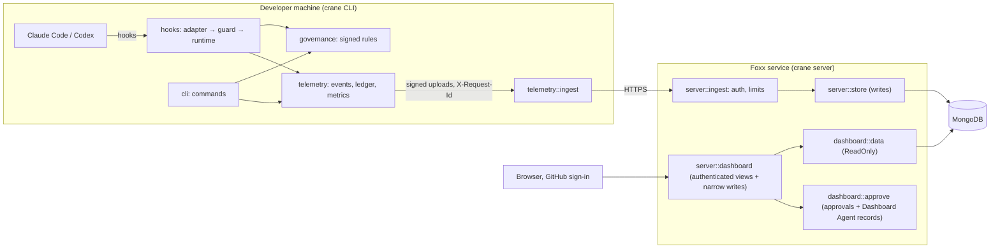

# Crane

Crane enforces **AgentScript** contracts on AI coding agents. You mark lines of code an agent must
**preserve** or must **change** (target); Crane checks every agent action at the hook boundary,
verifies what actually changed on disk, and records tamper-evident security evidence that the
**Foxx** dashboard turns into metrics, action graphs, and reports.

- Works with any language that has comments: selections are marked with anchor comments such as
  `# @crane:selection:K7M2P9RX:start` that move with the code.
- A signed registry (Ed25519, SHA-512) is the authority, so forged, copied, or edited markers and
  registry files are detected.
- Selections can be fully nested: partial overlaps and crossed markers fail closed, and each
  nested selection keeps its own preserve/target behavior.
- Claude Code, Codex, GitHub Copilot CLI, and Gemini CLI hooks deny edits to protected code,
  `.crane/`, and the markers before they run, and detect shell bypasses after they run.
- Hash-chained events, an autonomy-credit ledger, and metrics that say how each value is known.

## Install

```bash
cargo install --path .        # requires Rust 1.89+ and Git
crane --version
```

`gh` is needed for `crane github`; `curl` for Slack, Jira, and WhatsApp delivery.

The **Foxx** VS Code extension sets up Crane, creates policies, and marks selections from the
editor: install it from the
[Marketplace](https://marketplace.visualstudio.com/items?itemName=agentscript.foxx)
(`code --install-extension agentscript.foxx`), or from the `.vsix` on each release.

## Quick start

```bash
crane repo --https https://github.com/OWNER/REPO    # connect the clone to its GitHub repository
crane init                                          # create .crane/ and a signing key
crane checkpoint baseline                           # trusted baseline = current HEAD

crane protect app/payments.py start-line 12 end-line 30
crane target  app/refunds.py  start-line 5 end-line 18 change_type logical_bn

crane validate          # integrity, syntax, and markers
crane test .            # run every preserve/target command
crane agent install --profile claude
```

Then open the dashboard at <https://agentscript-service.onrender.com> and sign in with GitHub.

Commit `.crane/` with your code. Policies live in `.crane/policies/*.crane`:

```text
policy payments {
    preserve K7M2P9RX;
    target 4QZ8M2LD change_type logical_bn;
}
```

A policy passes only if every command passes. `change_type` is one of `logical_bn` (business
logic), `logical_cn` (loops or branches), `logical_sn` (structure), or `semantic` (names or
comments); whitespace-only changes never satisfy a target.

## Commands

| Area | Commands |
| --- | --- |
| Basic | `--version`, `init`, `checkpoint [NAME]`, `protect FILE ...`, `target FILE ...`, `--set default policy\|checkpoint NAME`, `parse file FILE`, `validate`, `test .`, `add policy-context file FILE [policy NAME]`, `policy-context NAME --view` |
| Repository | `repo --ssh\|--https\|--gh-cli REMOTE [privileges]`, `repo status`, `repo --view`, `repo del`, `github`, `github days DAYS` |
| Policies | `create policy NAME FILENAME`, `add policy NAME marker MARKER`, `policy NAME status` |
| Runtime | `task current [ID]`, `task .`, `session current [ID]`, `session .` |
| Agents | `agent install\|uninstall\|hooks --profile claude\|codex\|copilot\|gemini`, `agent link` |
| Admins | `admin list`, `admin register`, `admin add PUBLIC_KEY [name NAME]`, `admin del PUBLIC_KEY` |
| Zones and flows | `governance sign`, `governance graph [--json]` (zones, flows, and selections as an acyclic graph, with the agents active in each) |
| Integrations | `integrate jira\|slack\|whatsapp\|github` |

`protect` and `target` options: `policy NAME`, `checkpoint NAME`, `start-line N`, `end-line N`,
`name LABEL`. Run `crane help` for details. Governance commands refuse to run inside an AI agent
session, and the hooks deny them.

## Teams

The person who runs `crane init` first is the **owner**; `crane init` prints the owner key.

1. **Teammates join.** On their machine: `crane repo --https URL`, then `crane init`. Crane shows
   the owner key's fingerprint and asks whether to trust it; compare it with the owner's
   `crane admin list`. Until the key is trusted, the rules cannot be verified and agent changes are
   blocked. After it is, enforcement works normally. Teammates who are not admins cannot change
   the rules.
2. **More admins.** A teammate sends the key `crane init` printed for them; the owner runs
   `crane admin add KEY name NAME` and commits `.crane`. Admins can then protect, target,
   checkpoint, and change policies from their own machines. Every teammate trusts them through
   the owner's signature. `crane admin del KEY` removes an admin; machines that saw the removal
   reject an older admin list.
3. **Two admins changed the rules on different branches.** Git reports a conflict in `.crane`.
   Keep one side for the whole directory (`git checkout --theirs .crane`), commit, run
   `crane init` to accept that signed state, then re-apply your change with crane.

CI machines can trust the owner without a prompt: set `CRANE_TRUSTED_PUBLIC_KEYS` to the owner key.

**GitHub vouches for the owner key.** The owner runs `crane admin register` (a new repository's
`crane init` offers it) and opens the printed address; a GitHub admin of the repository confirms
the key there. A teammate's `crane init` then shows "confirmed by @admin" next to the fingerprint,
or a warning when the repository's key is not the confirmed one. Also protect `.crane` on GitHub:
add `/.crane/ @OWNER` to `CODEOWNERS` and require code-owner review on the default branch.

**Machines are linked to people.** Each teammate runs `crane agent link` once per machine and opens
the printed address; GitHub must show them access to the repository. Once any machine is linked,
the dashboard shows only linked machines by default, so an upload key nobody linked (anyone can
create one for a public repository) cannot pass as a teammate.

## Zones, flows, and context packs

Optional `.crane/governance.yaml` adds boundaries that only ever restrict:

```yaml
version: 1
zones:
  - id: payment-core
    selectors: { paths: ["app/payments/**"] }
    criticality: critical          # routine | sensitive | critical | restricted
    autonomy_ceiling: assisted     # observe | assisted | delegated | autonomous
flows:
  - id: checkout
    entry_points: ["app/service.py:submit"]   # files reached by its calls are covered
    autonomy_ceiling: delegated
context_packs:
  - id: payment-invariants
    version: 1
    content: ["Payment processing must be idempotent."]
```

After editing the file, an admin runs `crane governance sign` (Foxx does this for you). The file is
covered by the signed manifest, so an edit nobody signed fails `crane validate` and stops agent
changes until it is signed or restored. Criticality adds credit cost per edit (sensitive +1,
critical +3, restricted +5), and restricted code always needs human approval.

Zones and flows can also name exact source blocks with comment markers. Use the file's ordinary
comment syntax and the governance entity's ID:

```python
# @crane:zone:payment-core:start
def capture(order):
    ...
# @crane:zone:payment-core:end
```

```javascript
// @crane:flow:checkout:start
function submit(order) {
  ...
}
// @crane:flow:checkout:end
```

For block-comment languages, wrap the marker text in the language's normal block comment (for
example `<!-- @crane:zone:payment-core:start -->`). Source markers must resolve to a declared zone
or flow, occur once as a matching start/end pair, and be properly nested; malformed, crossed,
duplicate, and orphan markers prevent governance validation/signing. An entity's source block
enforces limits only when a proposed edit intersects the lines between its markers. Existing path,
file, directory, symbol, selection, flow-entry, and flow-include selectors retain their existing
file-level behavior. Marker edits themselves are always denied to agents.

On every tool call that reaches an active zone, flow, or selection, Crane sends its attached
guidance to the agent and displays it in the agent window. Selection notices include the relevant
policy context files; zone and flow notices include their context packs.

## Integrations and alerts

- `crane integrate slack|jira|whatsapp|github` stores settings outside the repository and can test
  the connection. Security alerts go to Slack and WhatsApp, and to the Jira issue in
  `CRANE_TASK_ID`.
- `.github/workflows/pr-notify.yml` posts pull-request activity to Slack and comments on the Jira
  issue named in the PR title or branch. Set the repository secrets `SLACK_WEBHOOK_URL`,
  `JIRA_BASE_URL`, `JIRA_EMAIL`, and `JIRA_API_TOKEN`.

## Dashboard

One dashboard for individuals and teams: <https://agentscript-service.onrender.com>. Sign in with
GitHub, then choose an account, a repository, and optionally one team member.

- **Personal account:** the repositories your GitHub account owns.
- **Organization:** the organization's repositories with every teammate's activity, and a member
  filter. Organizations appear when they allow this app (organization settings, third-party
  access).
- **Views:** overview, agents and sessions, the action graph of every session, the event timeline
  with filters, governance (policies, selections, checkpoints, audit trail), the autonomy ledger,
  every metric with how it is known, compliance controls, alerts, members, health, session reports,
  and evidence bundles.
- **Stale sessions:** a session with no hook activity for `CRANE_STALE_SESSION_MINUTES` (120) and
  no signed end is flagged and alerted: the agent was stopped, its hooks removed, or its evidence
  is not arriving.
- **Broken evidence chains:** the service checks that every upload continues the machine's event
  chain where it left off, and records a critical alert for a rewrite, a gap, or a fork.
- **Scoped access:** telemetry and evidence views read MongoDB through a handle that cannot write.
  Dashboard writes are limited to repository-scoped agent/incident actions and GitHub-confirmed
  approvals. Signed machine requests can read only active quarantine rules needed by local hooks;
  they cannot read telemetry or incident records. Dashboard API access requires a signed-in person
  with access to the selected repository. A repository appears only after an upload proves its
  GitHub remote, so nobody can attach their uploads to someone else's repository.

### Dashboard Agents

Dashboard Agents are repository-scoped monitors configured in the Dashboard Agents page. Each rule
has a name and purpose, one or more `all`, `flow`, `zone`, or `selection` assignments, a supported
event metric, a threshold, and a lookback window. Supported metrics are critical events, denials,
prompt/injection signals, bypass attempts, tool failures, and event volume. `active` monitors all
matching evidence; `idle` considers only HIGH and CRITICAL evidence; `inactive` and `sleep` pause
evaluation. The service evaluates enabled agents after successful telemetry uploads and runs a
60-second recovery sweep (also on startup); dashboard page views only read results. A repository
lease prevents duplicate work across service instances, and threshold incidents are persisted
idempotently.

An incident can produce a pending quarantine request for a provider agent ID, a Crane session ID,
or an exact provider tool name. A fresh GitHub authorization check must confirm repository-admin
access before a request becomes active or a quarantine is released. Active quarantines persist until
an admin approves release. Local hooks query the signed ingestion service before every tool call;
matching calls are denied, and a service/policy error also denies the call. `CRANE_INGEST_URL=off`
therefore disables this enforcement and causes tool calls to fail closed. Tool quarantines match
the exact provider tool name only within the incident's Crane session.

Incident response/decision context can be proposed for a flow. It contains the incident reason,
event references, and 3A timeline, and is visible to agents through the Dashboard Agents API only
after a fresh GitHub-confirmed repository admin approves it. Dashboard Agent notifications are
delivered by the hosted service (not a developer's local integration): configure Slack and Resend
email credentials in the Render service environment as listed below. Recipients are the configured
email distribution list, which should include the responsible agent creators and repository owners.
Delivery outcomes are recorded in the service event log; missing or failed delivery configuration is
not represented as a successful send.

The Incidents view supports status/severity/text filtering, human notes, mitigation, quarantine
requests, flow-context proposals, and a chronological 3A record that includes linked quarantine and
context approval decisions. Flow-context proposals include the incident evidence and the related
response-action audit trail captured when proposed. The Agent Activity view traces agent
creation/edits, state changes, evaluations, incident actions, and policy actions; detailed activity
records are retained for 30 days.

Signed-in clients can read the agent view with
`GET /api/dashboard-agents?repository=REPOSITORY_ID` and make bounded changes with JSON
`POST /api/dashboard-agents?repository=REPOSITORY_ID`. POST actions include `save-agent`,
`set-state`, `evaluate`, `open-incident`, `annotate-incident`, `resolve-incident`,
`request-quarantine`, `request-quarantine-release`, and `propose-flow-context`. Admin approvals use
the short-lived signed `/auth/agent-action` GitHub OAuth flow and support approval or rejection of
quarantine, release, and flow-context requests. The OAuth token is used once to check repository
permissions and is not stored. The API returns active/proposed quarantines and proposed or approved
flow context along with agent data.

For the hosted service, set these variables under **Render → Environment**. Never commit their
values or paste them into issue/chat messages:

| Variable | Purpose |
| --- | --- |
| `CRANE_DASHBOARD_AGENT_SLACK_WEBHOOK_URL` | Slack incoming webhook URL (`https://hooks.slack.com/services/...`) |
| `CRANE_DASHBOARD_AGENT_RESEND_API_KEY` | Resend API key used to send incident email |
| `CRANE_DASHBOARD_AGENT_EMAIL_FROM` | Verified sender address configured in Resend |
| `CRANE_DASHBOARD_AGENT_EMAIL_TO` | Comma-separated notification recipients; configure the responsible agent creators/repository owners or their team list |

When both notification providers are unset, incident creation still succeeds and the service records
that delivery is not configured. A configured provider failure is recorded as a failed delivery and
does not roll back the incident.

### Filtered dashboard data for agents

Signed-in users and agents acting with the same browser session can request compact, filtered
event context:

```text
GET /api/agent-context?repository=REPOSITORY_ID&since=...&until=...&filter=...
GET /api/events.csv?repository=REPOSITORY_ID&since=...&until=...&filter=...
```

Both routes require the existing `foxx_session` cookie and enforce the viewer's repository and
member permissions. `agent-context` returns minified JSON in the `foxx-agent-context/v1` format:
component metadata, the applied filter (identity values shortened for display), bounded summary
counts, token totals, and at most 500 newest matching events. Timestamps are integer Unix
milliseconds. The request filter uses the dashboard's normal `filter` JSON clauses (AND by default,
same-group OR, and optional NOT); component metadata can be supplied as `section`, `subsection`,
`component`, `kind`, and `context`. `events.csv` returns at most 500 newest matching event rows as
RFC 4180 CSV. These endpoints return filtered data only; they do not provide access to data outside
the selected repository/member scope. Dashboard component “AI” controls open the corresponding
filtered context and API URL for copying or download.

## Telemetry upload (Foxx service)

Crane uploads events, metrics, sessions, tool calls, alerts, and governance history to the Foxx
ingestion service (`https://agentscript-service.onrender.com`), which stores them in MongoDB.
Nothing needs to be set up: uploads happen when a tool call ends, when a session ends, after every
command, and every 60 seconds. Hooks never wait for the network, and the local evidence stays
authoritative when the service is unreachable.

- Tool-call telemetry retains the exact tool name reported by Claude, Codex, Copilot, Gemini, or
  an MCP server instead of collapsing unrecognized names to `OTHER`. Crane does not ask a separate
  model to guess a tool's identity. Token measurements are observed only when a provider supplies a
  readable transcript with usage; unsupported providers are shown as unmeasured, never estimated.
- From a repository clone, a human CODEOWNER can permanently clear its hosted records with
  `crane data clear`. The command requires GitHub CLI authentication (`gh auth login`) and an exact
  typed confirmation. The service independently checks the caller's GitHub identity against a
  direct account entry in the default-branch `CODEOWNERS` file, then deletes that repository's
  records across all members and installations. Team entries alone do not authorize this command.
  The supplied GitHub token is used for that check only and is not stored. Future uploads will
  create new repository records again.

- Each request is signed with the machine's own upload key (`~/.crane-trust/installation.key`,
  created automatically). Its public key identifies the installation, and an installation can only
  add to and read its own records. Every teammate's machine uploads, not only the one that ran
  `crane init`, and the upload key grants no authority over the repository's rules.
- Crane never holds database credentials. Only the service has the MongoDB connection string.
- Each machine also reports its repository status (policy results, integrity, compliance inputs,
  connection, non-secret integration settings) every two minutes or on `crane agent sync`, for the
  dashboard's governance and compliance views.
- **Limits** protect the shared database: 120 requests a minute per machine, at most 2,000 records
  of each kind per upload, 250,000 stored events and 50 repositories per machine, and no uploads
  while the database is over 450 MB. A refused upload stays on the machine and is retried.
- Set `CRANE_INGEST_URL=off` to keep everything local, or set it to your own service.

Run the service yourself:

```bash
docker build -t crane-ingest .
docker run -p 8080:8080 -e CRANE_MONGODB_URI='mongodb+srv://...' crane-ingest
# or: cargo run --release --features server -- server --listen 0.0.0.0:8080
```

For dashboard sign-in, create a GitHub OAuth app (GitHub, Settings, Developer settings, OAuth
Apps) with the callback URL `https://your-host/auth/callback`, and set `CRANE_GITHUB_CLIENT_ID` and
`CRANE_GITHUB_CLIENT_SECRET` on the service. The public address is detected (or set
`CRANE_PUBLIC_URL`), and the session key is created and kept in the database.

Put it behind HTTPS, then point Crane at it with `CRANE_INGEST_URL=https://your-host`, or build
with `CRANE_DEFAULT_INGEST_URL=https://your-host` to change the default (the release workflow reads
the repository variable `CRANE_INGEST_URL`).

## Environment variables

All optional. Crane does not read `.env` files; set them in your shell or CI. Credentials for
Slack, Jira, WhatsApp, and GitHub are set with `crane integrate NAME` instead.

| Variable | Purpose | Default |
| --- | --- | --- |
| `CRANE_HOME` | Trust directory (keys, evidence, secrets); use an absolute path | `~/.crane-trust` |
| `CRANE_TRUSTED_PUBLIC_KEYS` | Trusted owner keys (hex, comma separated), for CI without the `crane init` prompt | none |
| `CRANE_GITHUB_HOSTS` | GitHub Enterprise hosts accepted by `crane repo` | `github.com` only |
| `CRANE_GH` | Path of the GitHub CLI | `gh` |
| `CRANE_TASK_ID`, `CRANE_TASK_NAME` | Link agent sessions to a tracker task (Jira alerts use the ID) | none |
| `CRANE_SESSION_ID` | Session id when the agent reports none | generated |
| `CRANE_ENVIRONMENT` | Environment label on events | `local` (`ci` when `CI` is set) |
| `CRANE_ALERTS_DRY_RUN` | `1` records alerts without delivering them | `0` |
| `CRANE_INGEST_URL` | Foxx ingestion service; `off` keeps telemetry local | the release's service |
| `CRANE_SYNC_SECONDS` | Periodic upload interval | `60` |
| `CRANE_KEY_PROTECTION` | Signing keys at rest: `prompt` (a passphrase typed on the console for every signing command), `plain` | Windows Data Protection on Windows, plain (owner-only file) elsewhere |
| `CRANE_STALE_SESSION_MINUTES` | `crane server`: minutes without hook activity before an unfinished session is stale | `120` |
| `CRANE_MONGODB_URI`, `CRANE_MONGODB_DB`, `CRANE_MONGODB_EVENT_RETENTION_DAYS` | `crane server` only (never on developer machines) | required, `foxx`, `30` |
| `CRANE_GITHUB_CLIENT_ID`, `CRANE_GITHUB_CLIENT_SECRET` | `crane server`: dashboard sign-in (GitHub OAuth app) | sign-in off |
| `CRANE_PUBLIC_URL` | `crane server`: public address, when it cannot be detected | `RENDER_EXTERNAL_URL` or the request host |
| `CRANE_SERVER_REQUESTS_PER_MINUTE`, `CRANE_SERVER_ADDRESS_REQUESTS_PER_MINUTE` | `crane server`: rate per machine and per client address | `120`, `600` |
| `CRANE_SERVER_MAX_BATCH_RECORDS`, `CRANE_SERVER_MAX_EVENTS_PER_INSTALLATION`, `CRANE_SERVER_MAX_REPOSITORIES_PER_INSTALLATION`, `CRANE_SERVER_MAX_STORAGE_MB` | `crane server`: upload limits | `2000`, `250000`, `50`, `450` |
| `CRANE_ALLOW_LOCAL_REMOTE`, `CRANE_TEST_MONGODB_URI` | Offline mirrors and the live ingestion test suite | unset |

## Security notes

Signing keys and runtime evidence live in `CRANE_HOME` (default `~/.crane-trust`), never in the
repository. On Windows signing keys are sealed with the Data Protection API (tied to your Windows
login); `CRANE_KEY_PROTECTION=prompt` seals them under a passphrase typed on the console, which a
process running as you (such as an agent's shell) cannot supply. Hooks never unseal a signing key.
An agent with an unrestricted shell running as your user can still read the rest of that
directory; run agents in a sandbox or separate account for a hard boundary.

Before a shell command runs a script (`python x.py`, `node x.js`, `./x.sh`, `npm run NAME`, inline
`-c`/`-e` code), Crane reads it: code that names Crane's files, changes files holding preserved
selections, runs downloaded or decoded code, or is encoded PowerShell is denied; reading credential
files while using the network, rewriting Git history, and deleting directory trees need approval.
At stop, files changed outside every recorded tool call are reported as unattributed changes. Network, CPU, memory, and token
usage are not observed by hooks and are reported as unsupported.

## Architecture



| Layer | Modules | Responsibility |
| --- | --- | --- |
| Platform | `platform` | Git, files and locks, processes, curl, rendering |
| Trust | `trust` | Keys, SHA-512 digests, Ed25519, rollback anchors, upload key |
| Selections | `selection` | Anchor comments, signed registry, location tracking |
| Governance | `governance` | State and integrity, admins, policies, verification, zones and flows |
| Enforcement | `hooks` | `adapter/` (one module per agent), `enforce` (the guard), `shell` (command analysis), `runtime/` (session and tool-call phases), `outcome` (the blocking exit-code convention) |
| Telemetry | `telemetry` | Events, ledger, metrics, compliance, redaction, alerts, upload (`ingest`, `sync`) |
| Integrations | `integrations` | One `Provider` per service (`jira`, `slack`, `whatsapp`, `github`): prompts, verification, alert delivery |
| CLI | `cli` | Dispatch and command audit; `governance/` has one file per command group |
| Service | `server` | `http` (replies, correlation ids), `ingest` (signed upload API), `limits`, `store`, `log` (JSON lines), `dashboard/` (`auth`, read-only evidence `data`, narrow `approve` writes, `api/` by view) |

**Extending.** A new service is one module implementing `integrations::Provider` plus one entry in
`PROVIDERS`. A new agent is one module implementing `hooks::adapter::AgentAdapter`. A new dashboard
view is one function in `server/dashboard/api/` and one route in `api::route`.

**Conventions.** Errors are `Result<T, String>` messages written for the person reading them;
`hooks::outcome::block` marks an error that must block the agent (exit code 2). The service logs one
JSON object per line on stderr with a `request_id`; Crane sends an `X-Request-Id` with every upload,
the service returns it on every response, and client error messages include it, so a failure can be
traced end to end.

## Development

```bash
cargo fmt --all -- --check
cargo clippy --all-targets --features server -- -D warnings
cargo test --features server   # set CRANE_TEST_MONGODB_URI to include the MongoDB and dashboard tests
bash scripts/smoke_test.sh
```

The VS Code extension lives in [extensions/foxx](extensions/foxx).

**Releasing.** Bump `version` in `Cargo.toml`, commit, then tag and push (`git tag vX.Y.Z && git
push origin vX.Y.Z`). The release workflow builds Crane for every platform and packages Foxx with the
tag's version. When `extensions/foxx` changed since the previous release, it publishes Foxx to the
VS Code Marketplace (repository secret `VSCE_PAT`) and to Open VSX (optional secret `OVSX_PAT`);
VS Code then updates installed copies automatically.

## License

Apache-2.0
