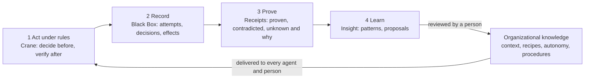
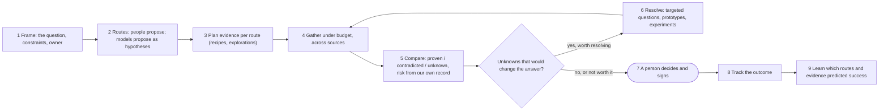

# Landscape Intelligence: Making Agents Smarter for Business Intelligence and Operations

This document describes the system as one product: an intelligence layer that makes an
organization's AI agents, and the people who work with them, smarter about the organization itself.
It answers ten questions:

1. [How is this a product?](#1-how-is-this-a-product)
2. [What does the customer interact with?](#2-what-does-the-customer-interact-with)
3. [How should the product be judged?](#3-how-should-the-product-be-judged)
4. [How easily does it integrate with an organization?](#4-how-easily-does-it-integrate-with-an-organization)
5. [What is the moat?](#5-what-is-the-moat)
6. [Who are the first customers?](#6-who-are-the-first-customers)
7. [Which decisions does it take, and which does it only propose?](#7-which-decisions-does-it-take-and-which-does-it-only-propose)
8. [How does it serve every role in the organization?](#8-how-does-it-serve-every-role-in-the-organization)
9. [Where is the product really heading?](#9-where-is-the-product-really-heading)
10. [Which subcomponents must be built?](#10-which-subcomponents-must-be-built)

It builds on [PRODUCTS.md](PRODUCTS.md) (the three products that cannot easily be copied: Crane, Black
Box, Evidence Receipts), [OVERVIEW.md](OVERVIEW.md) (what exists), [TERMINOLOGY.md](TERMINOLOGY.md), and
[FLOWS.md](FLOWS.md). Every capability below is marked **exists**, **partial**, or **to build**.

---

## The idea in one paragraph

Every organization now has agents that write code, change systems, and answer questions, and every one
of those agents starts each session knowing nothing about the organization: which code is audited,
what broke last time, what "done" means here, which procedures work. People are in the same position
about their agents: they cannot see what agents attempted, what is proven about their work, or where
they can be trusted with more. **Landscape Intelligence is the layer that learns the organization from
verified evidence of work, and gives that knowledge back to agents at the moment they act and to people
at the moment they decide.** It learns from what agents *attempted* (not only what they produced), it
says what is proven, contradicted, and unknown, and nothing it learns changes how agents behave until a
person approves it.

---

## 1. How is this a product?

### 1.1 The job it is hired for

| Customer's job | Today | With Landscape Intelligence |
|---|---|---|
| "Make our agents behave like experienced colleagues" | each agent rediscovers the codebase; prompts and wikis are ignored | agents receive the organization's reviewed knowledge for the exact code they touch, from any vendor |
| "Know what our agents are doing and whether it is safe" | vendor consoles, per tool, after the fact | one record of every attempt, decision, and effect, across vendors |
| "Know whether agent work is actually done" | "the agent said so", green CI | a receipt per change: proven, contradicted, unknown and why |
| "Decide where agents can be trusted with more" | gut feeling, global switches | autonomy per area, earned from evidence, signed by a person |
| "Run operations when agent changes break things" | reconstruct from logs | the change's agent trail and evidence gaps assembled before anyone asks |

### 1.2 The product as a loop, not a dashboard

The product is a closed loop with four stages. Each stage already has working code; the loop as a whole
is what customers buy.



| Stage | What it does | Code | Status |
|---|---|---|---|
| Act under rules | signed rules enforced before and after every agent action | [hooks/](../src/hooks/), [governance/](../src/governance/) | exists (local agents); pull-request and tool-gateway points to build |
| Record | tamper-evident events of every attempt and effect | [telemetry/](../src/telemetry/), [server/](../src/server/) | exists; near-miss classification to build |
| Prove | evidence packs with reasons for every gap | [capture/](../src/capture/) | exists; receipt renderer and runtime connectors to build |
| Learn | patterns and proposals across all work | [insight/](../src/insight/), [capture/broker/proposals.rs](../src/capture/broker/proposals.rs) | exists (CLI); unified review and delivery to build |
| Deliver | knowledge back to agents and people | session context, [foxx/live.rs](../src/foxx/live.rs), `/api/agent-context` | partial |

### 1.3 Packaging

One product, sold as one platform, with three entry points from [PRODUCTS.md](PRODUCTS.md):

| Tier | Contains | For |
|---|---|---|
| **Free** | Crane rules and enforcement, the editor extension, the personal view, receipts for public repositories | individual developers and evaluation |
| **Team** | Black Box (recorder, near misses, barriers), Receipts for private repositories, Insight patterns, the proposal inbox, Slack | engineering teams |
| **Business** | earned autonomy, feature rollups for product managers, verification debt, the context server for agents, the incident view | product and operations |
| **Enterprise** | compliance, security, and board exports, SSO, retention, self-hosting, verified procedure export | regulated organizations |

"Intelligence" is not a separate paid module: it is what turns the record into value at every tier, so
it is part of every tier above Free.

---

## 2. What does the customer interact with?

The product meets people **where they already work** and agents **where they already act**. The
dashboard is for exploration, not the main interface.

| Surface | Who | What they do there | Status |
|---|---|---|---|
| **The agent itself** | every agent (Claude Code, Codex, Copilot, Gemini, others) | receives reviewed context for the code it touches at session start and before each tool call; asks the organization questions through a context server; receives its own change's receipt at stop | session context exists; context server and receipt-at-stop to build |
| **The pull request** | reviewers, tech leads | reads the receipt as a check; sees gaps and routes them | to build (engine exists) |
| **Slack or Teams** | everyone | daily digest per role; incident summaries; approval and review requests; "ask" in natural language | alerts exist (Slack, WhatsApp); digests, reviews, and ask to build |
| **The editor** | developers, tech leads | authors rules; sees what agents were told; sees zone patterns next to the code | exists for rules and live context; patterns to build |
| **The proposal inbox** | tech leads, admins, owners | accepts or rejects everything the system learned: recipes, zone context, autonomy changes, procedures | partial (CLI review exists per kind); unified inbox to build |
| **The dashboard** | managers, security, compliance, platform | explores the record, role lenses, near misses, trends | exists (record); lenses to build |
| **Reports** | CEO, board, auditors, insurers | signed monthly and period reports | to build |
| **The tracker** (Jira, Linear) | product and project managers | a comment on each item with its proof status | Jira alerts exist; proof comments to build |
| **The incident tool** | on-call | the change's agent trail and evidence assembled in the incident channel | to build |

### 2.1 The flagship interaction: "ask the organization"

The single interaction that best expresses the product is a question, asked by a person in Slack or by
an agent through the context server:

> "What do I need to know before changing the refund worker?"

The answer is assembled deterministically from the record and the reviewed knowledge, under the asker's
own access:

```
Refund worker (zone refunds v3, critical, ceiling: assisted; flow refund-flow)
- Preserved: the fee rule K7M2P9RX ("Fees are audited; keep the rate.")
- Reviewed context: jobs queued before a deploy may lack idempotency_key (accepted 2026-09-14)
- History: 3 agent attempts to edit the fee rule this month, all stopped by edit simulation
- Evidence: 62% of recent changes here had no test report (empty); CI passes consistently
- Outcomes: work touching migrations/ failed 4 of 6 times against 2 of 10 overall (co-occurrence)
- Procedure: "refund schema migration" v2, published, verified on 5 episodes
Unknown: runtime metrics (the metrics source has been unavailable since Tuesday)
```

How it works and why it is safe:
- A model may translate the words into a question class and references (task, zone, deployment). That
  translation is shown and audited; it never decides what is retrieved.
- Retrieval is a recipe or an exploration ([capture/broker/run.rs](../src/capture/broker/run.rs)),
  under the asker's access policy, with gaps and reasons.
- Knowledge comes only from reviewed sources: signed rules, accepted contributions, published
  procedures, and Insight patterns with minimum support.
- An agent receives the same answer a person would, which is what makes agents smarter without letting
  them write their own memory.

---

## 3. How should the product be judged?

### 3.1 North star

**Verified, rule-conforming agent changes per week**: agent-made changes that merged with a receipt
showing no `contradicted` evidence and no unresolved `unknown` on required evidence, and with no rule
violation in the session that produced them. It rises only when agents do more work *and* that work is
both safe and proven, which is exactly the promise.

### 3.2 "Agents are getting smarter" metrics

| Metric | Definition | Why it proves smartness | Source |
|---|---|---|---|
| **Repeat near-miss rate** | attempts against the same rule and zone after reviewed context was delivered, per thousand actions | agents learning the organization's rules shows up as fewer repeat attempts | Black Box |
| **First-pass receipt completeness** | share of agent changes whose first receipt has no gaps the agent could have closed itself (tests not run, task not linked) | agents learning what "done" means here | Receipts |
| **Context effectiveness** | denials and rework in a zone before versus after context was added | knowledge actually changing behavior | Black Box, Insight |
| **Approvals needed per verified change** | human approvals divided by verified changes | autonomy earned where safe | decision events |
| **Question answer rate** | share of questions answered `sufficient` by a recipe (not exploration) | the organization's playbook growing | Work Capture, Insight |
| **Procedure reuse** | share of recurring work done through a published procedure | learning compounding into reuse | capability pipeline |

### 3.3 Operations metrics

| Metric | Definition |
|---|---|
| **Mean time to understand** (on-call) | from incident open to the change's agent trail and evidence being in front of the responder |
| **Verification debt** | open evidence gaps on critical code, weighted by affected changes |
| **Barrier performance** | share of near misses stopped before the effect, per barrier |
| **Accidents per thousand agent actions** | bypasses linked to failed deployments |
| **Approval latency** | time an agent waits for a human answer |

### 3.4 Business metrics

| Metric | Definition |
|---|---|
| **Cost per verified change** | tokens and spend divided by verified changes |
| **Earned autonomy** | share of agent actions running without approval in zones whose ceilings were widened on evidence |
| **Governed coverage** | share of critical code under signed rules |
| **Compliance evidence coverage** | controls `SATISFIED` versus `NO_EVIDENCE` |

### 3.5 Product health (how we judge ourselves)

| Metric | Target to aim for |
|---|---|
| Time to first value (first denial with context, first receipt) | under one hour for a team |
| Weekly active reviewers (people acting in the inbox, on receipts, on near misses) | rising with team size |
| Proposal acceptance rate | high enough to show the proposals are good (a low rate means noise) |
| "Rule in the way" rate | falling; a rising rate means rules are too strict and adoption is at risk |
| Retention of free teams converting to Team | the core commercial signal |

Every metric follows the honesty rules in [PRODUCTS.md §11](PRODUCTS.md#11-the-honesty-rules-every-number-follows):
unmeasured is never zero, every rate shows its denominator and unknowns, and aggregates respect the
viewer's access.

---

## 4. How easily does it integrate with an organization?

### 4.1 Adoption path

| Step | Who | Effort | What they get | Status |
|---|---|---|---|---|
| Install the binary and the editor extension | a developer | minutes | local rules and enforcement | exists |
| `crane repo`, `crane init`, `crane agent install` | the repository owner | about 15 minutes | signed rules, hooks in their agent tools | exists |
| Protect the first critical code, draw a zone | a tech lead | under an hour, in the editor | the first denials with context | exists |
| Teammates join and confirm the owner key | each developer | minutes | the same rules on every machine | exists |
| Sign in to the dashboard with GitHub, link machines | the team | minutes | the team record | exists |
| Add the pull-request check | the platform team | about an hour | receipts on every change, cloud agents included | to build |
| Connect Slack, Jira | an admin | minutes | alerts and tracker links | exists (alerts); digests to build |
| Connect CI test reports, deployments, logs, metrics | the platform team | hours per source | complete receipts and incident views | GitHub and CI checks exist; others to build |

### 4.2 What makes it easy

- **No code leaves the machine by default for enforcement.** Enforcement is local; upload is optional
  (`CRANE_INGEST_URL=off`), and secrets are redacted before anything is written.
- **Rules live in the repository.** They are reviewed in pull requests like code; no new system of
  record for rules.
- **GitHub decides visibility.** No user administration for GitHub teams.
- **Vendor-neutral.** Adding or switching agent tools does not change the rules.
- **Read-only to sources.** Work Capture never writes to the systems it reads.

### 4.3 What makes it hard, honestly

| Friction | Why | Mitigation |
|---|---|---|
| Keys and signing are unfamiliar | authority must be a signature | the extension's setup flow; GitHub confirmation of the owner key; organization-level admin statements (to build) |
| Agents in cloud runtimes bypass local hooks | sessions run outside the developer's machine | the pull-request check and the tool gateway (to build) |
| GitHub only | the dashboard's identity model | GitLab and other providers (to build) |
| Value from intelligence needs volume | minimum support of 3, weeks of history | immediate value from enforcement and receipts; intelligence follows |
| Regulated customers need self-hosting and retention | data policies | the same binary self-hosts; retention tiers (to build) |
| Outcomes are recorded by hand | ground truth for learning | proposed outcomes from verified assertions (to build) |

---

## 5. What is the moat?

The moat is not a feature. It is a position and a body of data, each of which a competitor would need
to rebuild from zero:

1. **Neutral position across agent vendors.** The organization's rules and knowledge apply to every
   agent. An agent vendor will not build the layer that governs its competitors, and the customer will
   not accept a vendor as the auditor of its own agent.
2. **Decision-time presence.** Only a system that decides before actions run sees the attempts that
   never happened. Near misses and barrier performance are invisible to observability, analytics, and
   CI.
3. **People-signed knowledge.** Rules, context, recipes, autonomy, and procedures change only through a
   person's signature or review. This is the reason an organization lets the system teach its agents.
4. **Evidence with honest unknowns and a chain of custody.** Every claim is traceable; every gap has a
   reason; nothing can be edited after the fact. Reports built on it survive audits and incidents.
5. **Organization-specific learned knowledge.** Learned recipes, reviewed context, near-miss history,
   earned autonomy, and verified procedures are specific to each customer and accumulate from the day
   of installation. Leaving means starting over.
6. **An open standard for the rules and events.** Publishing AgentScript and the event specification as
   a standard (see [PRODUCTS.md](PRODUCTS.md)) makes the reference implementation hard to displace.

What would destroy the moat: building our own agent (ends neutrality), letting anything change
knowledge without a person (ends trust), estimating unknowns (ends honesty), or becoming a log reader
that misses attempts (ends decision-time presence).

---

## 6. Who are the first customers?

### 6.1 The ideal first customer

| Attribute | Why |
|---|---|
| 30 to 300 engineers | big enough to need team intelligence, small enough to decide quickly |
| at least two agent tools in use | neutrality matters immediately |
| a regulated or high-cost domain: fintech, payments, healthtech, insurance, infrastructure | the cost of an agent mistake is real and audited |
| a platform or developer-experience team | someone owns the rollout and the integration |
| a trigger: a recent agent incident, an upcoming audit, or a security team blocking agent rollout | urgency |
| GitHub-hosted | the current identity model |

### 6.2 The first ten

- **Five design partners** matching the profile above, each starting with one critical repository and
  one zone, with a weekly review of near misses and receipts for eight weeks.
- **Two software consultancies or agencies** delivering client work with agents, who need to prove
  progress and safety to clients.
- **Two companies whose security team blocked agent rollout**, for whom the product is the condition of
  adoption.
- **One AI-native startup** with heavy agent use, to stress volume and the learning loop.

### 6.3 What they get, and what we ask

They get the product free during the program and a founding price afterwards. We ask for weekly use of
the inbox and near-miss review, permission to use anonymized aggregates, and a case study. Success
criteria agreed up front: the first prevented change with context in week one, receipts on every pull
request by week three, the first accepted learned recipe or context by week six.

---

## 7. Which decisions does it take, and which does it only propose?

The product sorts every decision into three tiers. The tier is part of the design, not a setting.

| Tier | Meaning | Examples |
|---|---|---|
| **Takes automatically** | bounded, reversible, and already authorized by signed rules | deny an action that breaks a signed rule; ask a person under an assisted ceiling; degrade or quarantine a session after a violation or bypass; run an investigation; attach a receipt; route a gap to its owner; open an incident when a monitor's threshold is crossed; deliver reviewed context |
| **Proposes for a person** | changes what agents may do or know | learned recipes; zone context; autonomy ceilings and credit costs; capability publication; outcome of a work episode; new rules from near misses; quarantine of a teammate's session |
| **Never decides** | would remove the human authority the product is built on | weakening or removing a rule; publishing a capability; accepting its own proposals; releasing a quarantine; changing who is an admin |

### 7.1 Decisions by domain

| Domain | Decisions it takes | Decisions it informs or proposes |
|---|---|---|
| **Product** | marks each feature's proof status from evidence | whether a feature is done (proposed outcome); which acceptance criteria are unmet; release readiness |
| **Engineering** | enforces rules; attaches receipts; routes gaps | where to add tests or connectors (verification debt); which rules are in the way; which code to protect next |
| **Engineering management** | — | autonomy per zone (widen, narrow, expire); credit costs; where approvals are wasted |
| **On-call and operations** | assembles the change's trail and evidence when an incident opens; replays investigations; opens incidents from monitors | whether to quarantine the sessions still touching the code; incident context for the flow; rollback candidates (by change, from evidence) |
| **Security** | denies attacks on the control plane; quarantines on confirmed bypass | new script-check rules from attempts; whether to release a quarantine |
| **Finance** | — | cost per verified change; where agent spend is wasted |
| **Leadership** | — | where to invest (assets versus liabilities on the board report); which areas have earned autonomy |
| **Compliance** | evaluates controls from evidence | which controls lack evidence and what would close them |

---

## 8. How does it serve every role in the organization?

### 8.1 The generalization mechanism

One record, read through role lenses, answered through one question interface, under each person's own
access:

1. **One record.** Every role reads the same evidence, so the CEO's number and the developer's view
   never disagree.
2. **Role lenses.** Each role sees the record through its own questions and metrics.
3. **One question interface.** Anyone can ask in their own words; the answer is assembled
   deterministically and says what is unknown.
4. **Access by default.** The Insight read model already restricts aggregates to what the viewer could
   open ([insight/read.rs](../src/insight/read.rs)); every lens inherits that.
5. **The surface each role already uses.** Developers in the editor and the pull request, managers in
   Slack, executives in a report, auditors in an export.

### 8.2 Every role, its pain, and what it gets

| Role | Pain today | What it gets | Surface |
|---|---|---|---|
| **Developer** | agents ignore house rules; rework; reviews slowed by doubt | agents told the rules for the exact code; receipts that pass first time; a private view of where rules helped | editor, pull request |
| **Tech lead** | cannot review all agent pull requests deeply | receipts that say what is proven; near misses per zone; proposals to accept | pull request, inbox |
| **Engineering manager** | autonomy settings are guesses; approval fatigue | earned-autonomy proposals with evidence and effect tracking | inbox, Slack |
| **Product manager** | "done" means "the agent said so" | proof status per feature with acceptance criteria checked | tracker, Slack |
| **Project or delivery manager** | blockers are invisible until a meeting | approvals waiting, quarantines, and evidence gaps per project | Slack digest |
| **QA lead** | no view of which changes lack evidence and why | verification debt ranked by risk and routed by reason | dashboard, tracker |
| **On-call engineer** | reconstructing an agent change at 3 a.m. | the change's agent trail, evidence gaps, and reached flows, assembled | incident channel |
| **SRE / platform** | agent rollout across tools and teams | one rulebook, one record, monitors | dashboard, CLI |
| **Security / CISO** | agents are unknown processes with developer rights | attempts against the control plane, bypasses, barrier performance, SIEM export | dashboard, SIEM |
| **Compliance / GRC** | no evidence of control over AI-assisted change | signed control evidence mapped to frameworks | export |
| **Finance** | agent spend per seat says nothing about value | cost per verified change; waste | report |
| **CTO** | is the agent program safe and paying off | near misses, earned autonomy, verified throughput, accidents | report, dashboard |
| **CEO and board** | AI strategy reported by anecdote | a signed monthly report of assets and liabilities of agent work | report |
| **Sales and customer success** | security questionnaires about AI use | answers backed by exported evidence | export |
| **Legal** | EU AI Act and contractual AI obligations | evidence of human oversight and control | export |

Not every role is a daily user. Developers, tech leads, and on-call use it daily; managers weekly; the
executive, compliance, and legal roles monthly or per period. Designing for that frequency is what keeps
the product from becoming a dashboard nobody opens.

---

## 9. Where is the product really heading?

The direction is from **guardrails for coding agents** to **the trust layer between an organization and
all of its agents**.

| Stage | What the product is | What becomes true | Trigger to move on |
|---|---|---|---|
| **1. Guardrails** (today) | signed rules enforced for local coding agents, with a tamper-evident record | agents cannot change what must not change | design partners rely on it daily |
| **2. Proof** | receipts on every change, at the pull request, for every agent including cloud agents | "done" means "proven" | receipts become a required check |
| **3. Memory** | the learning loop delivers reviewed knowledge to every agent and person | agents start sessions knowing the organization | repeat near misses fall measurably |
| **4. Earned autonomy** | autonomy per area granted from evidence, signed, with expiry | agents get more freedom exactly where they have earned it | approvals per verified change fall without accidents rising |
| **5. All agents, not only coding** | the same rules, record, and proof for agents acting through tools (the gateway): operations, data, support, finance agents | one control plane for every agent action in the organization | the gateway carries non-coding traffic |
| **6. The trust record** | the record becomes the reference for audits, insurers, and an open standard | agent risk is measurable and insurable | auditors and insurers accept the export |

Two forces push in this direction. Agents are moving beyond code into systems that act on the business
(through MCP and similar tool protocols), and every one of those actions needs the same "decide before,
verify after, prove, learn" loop. And regulation and insurance will require evidence of human oversight
that only a decision-time record can provide.

---

## 10. Which subcomponents must be built?

### 10.1 The component map

| # | Component | Purpose | Status | Code to extend |
|---|---|---|---|---|
| **Enforcement points** |||||
| 1 | Pull-request check | rules and receipts for every change, cloud agents included | to build | [cli/governance/checks.rs](../src/cli/governance/checks.rs), [capture/](../src/capture/) |
| 2 | Tool gateway (MCP) | the same guard for tool calls, coding and non-coding | to build | [hooks/enforce.rs](../src/hooks/enforce.rs) |
| 3 | Sandbox profile | confidential trust directory, mediated network | to build | [trust/mod.rs](../src/trust/mod.rs) |
| **Record** |||||
| 4 | Counterfactual fields and barrier codes | severity and barrier analysis of near misses | to build | [hooks/enforce.rs](../src/hooks/enforce.rs), [telemetry/events.rs](../src/telemetry/events.rs) |
| 5 | Near-miss classifier and replay viewer | the Black Box | to build | [server/](../src/server/) |
| 6 | OpenTelemetry and SIEM export; retention tiers | fit into existing tools; audits | to build | [telemetry/spec.rs](../src/telemetry/spec.rs), [server/database.rs](../src/server/database.rs) |
| **Evidence** |||||
| 7 | Receipt renderer and check publisher | receipts where reviewers work | to build | [capture/ingest/pack.rs](../src/capture/ingest/pack.rs) |
| 8 | Connectors: test reports, deployments, logs, metrics | complete receipts and incident views | to build | [capture/resources/](../src/capture/resources/) |
| 9 | Service identity and automatic investigations | receipts without anyone running a command | to build | [capture/broker/run.rs](../src/capture/broker/run.rs) |
| 10 | Hosted capture store | scale beyond local JSON lines | to build | [capture/store.rs](../src/capture/store.rs) |
| **Intelligence** |||||
| 11 | Insight read models over every store, including hosted events | learning from all evidence | partial (capture store only) | [insight/read.rs](../src/insight/read.rs) |
| 12 | Proposed outcomes from verified assertions | ground truth without manual entry | to build | [capture/ingest/episode.rs](../src/capture/ingest/episode.rs) |
| 13 | Multi-episode compilation and procedure export to vendor formats | reusable verified procedures | to build | [compiler/](../src/compiler/) |
| 14 | Signed, per-repository thresholds | tune learning without code changes | to build | [insight/mod.rs](../src/insight/mod.rs) |
| **Delivery to agents** |||||
| 15 | Reviewed knowledge in session context | agents start knowing the organization | to build | [hooks/runtime/session.rs](../src/hooks/runtime/session.rs) |
| 16 | Context server ("ask the organization") over MCP | any agent can ask before it acts | to build | `/api/agent-context` ([server/dashboard/api/](../src/server/dashboard/api/)) |
| 17 | Receipt at stop | agents close their own evidence gaps | to build | [hooks/runtime/session.rs](../src/hooks/runtime/session.rs) |
| **Delivery to people** |||||
| 18 | Proposal inbox | one place to accept or reject what the system learned | to build | [capture/broker/proposals.rs](../src/capture/broker/proposals.rs), [capture/ingest/contributions.rs](../src/capture/ingest/contributions.rs) |
| 19 | Question interface (natural language to a deterministic request) | "ask" for people and agents | to build | [capture/broker/run.rs](../src/capture/broker/run.rs) |
| 20 | Role lenses and digests | each role's view and rhythm | to build | [server/dashboard/](../src/server/dashboard/) |
| 21 | Signed reports (board, compliance, insurer) | period evidence | to build | [telemetry/compliance.rs](../src/telemetry/compliance.rs) |
| 22 | Earned-autonomy proposals with expiry and simulation | autonomy from evidence | to build | [governance/zones.rs](../src/governance/zones.rs), [insight/](../src/insight/) |
| **Platform** |||||
| 23 | Shared metric layer | one definition of every number | partial (evals, Insight counts) | [telemetry/evals.rs](../src/telemetry/evals.rs) |
| 24 | Integrations: Teams, Linear, PagerDuty or incident.io, GitLab, SSO | meet roles where they work | partial (Slack, WhatsApp, Jira, GitHub) | [integrations/](../src/integrations/) |
| 25 | Organization-level admin statement and onboarding wizard | adoption across many repositories | to build | [governance/admins.rs](../src/governance/admins.rs) |

### 10.2 Build order

| Phase | Components | Outcome |
|---|---|---|
| **1. Cover every agent** | 1, 7, 9, 4 | receipts and rules on every pull request; near-miss data captured with severity |
| **2. Show what only we can show** | 5, 18, 15, 20 (developer, tech lead, security) | the Black Box and the inbox; agents receive reviewed knowledge |
| **3. Complete the evidence** | 8, 12, 10, 11 | complete receipts, outcomes without manual entry, learning from all stores |
| **4. Let agents ask** | 16, 17, 19 | "ask the organization" for people and agents |
| **5. Earn autonomy and report it** | 22, 21, 23, 6 | autonomy from evidence; board, compliance, and insurer reports |
| **6. Reach every agent** | 2, 3, 13, 24, 25, 14 | the gateway for non-coding agents, the sandbox, procedures, enterprise readiness |

Each phase ships something a design partner can use the week it lands, and each one depends only on the
phases before it. The first two phases are mostly new surfaces over data that already exists, which is
why they come first.

---

# Part II. Intelligence for the entire organization

Part I describes the product as it starts: intelligence about engineering work, because that is where
agents act today and where the system already records evidence. Part II answers what it would take to
be intelligence for the **whole** organization: sales, customers, architecture, hiring, finance,
operations, and decision-making itself.

11. [The honest starting point](#11-the-honest-starting-point)
12. [What kinds of problems it solves, and in which domains](#12-what-kinds-of-problems-it-solves-and-in-which-domains)
13. [How it solves problems for the non-technical side](#13-how-it-solves-problems-for-the-non-technical-side)
14. [Who uses it first, technical or non-technical, and why](#14-who-uses-it-first-technical-or-non-technical-and-why)
15. [What the organization can ask](#15-what-the-organization-can-ask)
16. [Integrating third-party applications](#16-integrating-third-party-applications)
17. [Decision intelligence: research, explore every route, then decide](#17-decision-intelligence-research-explore-every-route-then-decide)
18. [Risks of going organization-wide, and the lines not to cross](#18-risks-of-going-organization-wide-and-the-lines-not-to-cross)
19. [The additional subcomponents](#19-the-additional-subcomponents)

---

## 11. The honest starting point

**Today the product solves problems related to code only.** The rules govern code (selections, zones,
flows), the hooks sit in coding agents, and the evidence sources are Git, CI, GitHub, DataSea events,
Landscape, and Crane. It does not yet read a CRM, a support desk, an applicant tracking system, or a
finance system, and it does not govern agents acting in them.

What makes organization-wide intelligence a natural extension rather than a new product is that **every
part of the loop is domain-neutral**:

| Part of the loop | Why it is not specific to code | Code |
|---|---|---|
| Resource registry and connector contract | resource types already include `Tracker` and `InternalApi`; a connector is any read-only source with `discover`, `fetch`, `query` | [capture/resources/registry.rs](../src/capture/resources/registry.rs), [connector.rs](../src/capture/resources/connector.rs) |
| Recipes, explorations, budgets | any question class over any registered source | [capture/broker/](../src/capture/broker/) |
| Access policy | resources, environments, evidence types, sensitivity, per actor | [capture/mod.rs](../src/capture/mod.rs) |
| Evidence model | proven, contradicted, unknown and why, for any fact | [capture/ingest/pack.rs](../src/capture/ingest/pack.rs) |
| Decision before, verification after | any action an agent proposes through a tool, once the tool gateway exists | [hooks/enforce.rs](../src/hooks/enforce.rs) |
| Insight and proposals | patterns over any kept evidence, under the viewer's access | [insight/](../src/insight/) |

The extension therefore needs **three things**, not a rewrite:

1. **Connectors** for business systems, read-only, through the existing contract.
2. **The tool gateway (MCP)**, so agents acting in business systems pass through the same
   "decide before, verify after" loop as coding agents.
3. **Domain recipes and evidence types**, so questions in each domain have a known plan and facts have
   a known shape.

---

## 12. What kinds of problems it solves, and in which domains

### 12.1 The five kinds of problems (in any domain)

| Kind | The question it answers | Example in code (today) | Example beyond code (to build) |
|---|---|---|---|
| **Control** | may this agent do this, here, now? | an agent may not change the fee rule | a sales agent may not send a discount above 15% without approval |
| **Proof** | what is actually proven about this piece of work? | the receipt of a pull request | whether a customer commitment in a contract was delivered |
| **Memory** | what does the organization already know about this? | context for a zone; learned recipes | what we promised this customer; why we chose this vendor |
| **Autonomy** | where can agents be trusted with more? | widen a zone's ceiling on evidence | let the support agent issue refunds below a limit after a clean record |
| **Decision** | which route should we take, with what evidence and what unknowns? | which commit caused a failed deployment | build or buy; which market to enter; how to scope new infrastructure (section 17) |

### 12.2 Domain by domain

Each domain is described by the same five columns: the agents that act there, what Control and Proof
mean, the sources to connect, the questions people ask, and what is honestly possible.

| Domain | Agents acting there | Control and proof | Sources to connect | Questions it answers |
|---|---|---|---|---|
| **Engineering** (today) | coding agents | signed rules per code block; receipts per change | Git, GitHub, CI, DataSea, Landscape, Crane (exist); deployments, logs, metrics (to build) | is this change proven? what did agents attempt? where are we exposed? |
| **Operations and SRE** | operations agents, runbook automation | actions on infrastructure through the gateway, under zone-like rules for environments and services; incident receipts | cloud audit logs, incident tools (PagerDuty, incident.io), observability (Datadog, Grafana) | what changed before this incident? which agent touched production? what is our blast radius? |
| **Architecture** | design and refactoring agents | rules on boundaries (flows, dependencies) | the flow call graph (exists), service catalogs (Backstage), architecture decision records, dependency manifests | what depends on this service? which boundaries do changes keep crossing? what did we decide last time and why? |
| **Product** | spec-writing and analysis agents | acceptance criteria as checkable targets; proof of done | trackers (Jira, Linear), product analytics, feedback tools | is this feature proven done? what do customers say about this area? which features keep failing after release? |
| **Sales** | sales agents drafting emails, quotes, proposals | rules on what an agent may promise or send (discounts, terms, roadmap claims); proof that a sent quote matches policy | CRM (Salesforce, HubSpot), CPQ, contract tools, email | what did we promise this account? which deals are blocked on security reviews, and can our evidence answer them? |
| **Customer support and success** | support agents answering and acting (refunds, credits) | limits on actions per customer and amount; proof of resolution | support desks (Zendesk, Intercom), billing, product telemetry | which issues trace to a recent change? what did our agent tell this customer? which accounts are at risk and why? |
| **People and hiring** | recruiting assistants (scheduling, summarizing) | strict rules: agents never decide or rank candidates; every agent action on candidate data is recorded and reviewable | applicant tracking systems (Greenhouse, Lever), HRIS | which roles are blocked and on what? is our process consistent? which skills does our codebase need (from ownership and work patterns)? |
| **Finance** | finance and procurement agents | approval limits; proof that a payment or purchase followed policy | ERP, spend tools, cloud billing | what does agent work cost per verified outcome? which purchases bypassed policy? |
| **Legal and compliance** | contract review agents | agents may suggest, never sign; every clause change recorded | contract lifecycle tools, policy repositories | which controls lack evidence? where did AI act without human oversight? |
| **Security** | all agents | attacks on the control plane; bypasses; data access | SIEM, identity provider | which agent accessed what? what did agents attempt that they should not? |

### 12.3 Where the value really comes from in non-code domains

Not from analytics on business data (CRM and analytics vendors already do that well, and section 8 of
[PRODUCTS.md](PRODUCTS.md) rules it out). The value comes from the same position as in code: **when an
organization lets agents act in a business system, it needs the same control, record, proof, and
learning it needs for code**, and only a neutral, decision-time layer provides it. The business systems
remain the source of truth for business data; Landscape Intelligence is the source of truth for **what
agents did in them, under which rules, with what evidence, and what the organization learned**.

---

## 13. How it solves problems for the non-technical side

### 13.1 Today (without new connectors)

Non-technical roles already benefit from what engineering produces:

| Role | What they get today or soon | How |
|---|---|---|
| **Executives and board** | a signed monthly report: governed coverage, near misses, earned autonomy, accidents, cost per verified change | Black Box report (to build on existing data) |
| **Compliance and legal** | evidence of human oversight of AI-assisted change, mapped to frameworks and EU AI Act obligations | compliance controls (exist) plus export (to build) |
| **Sales** | answers to customer security questionnaires about AI use, backed by evidence ("all AI-written changes to payment code require human approval; here is the evidence for last quarter") | the same export, scoped per question |
| **Product managers** | proof status per feature | Receipts' feature rollup (to build) |
| **Customer success** | a changelog where each customer-facing change links to its proof | Receipts subproduct (to build) |
| **Finance** | cost per verified change; agent spend that produced nothing | Black Box cost lens (to build) |

### 13.2 With connectors and the gateway

Once agents act in business systems, non-technical teams get exactly what engineers get today:

- **Their own rules, signed.** A head of sales signs "agents may not offer discounts above 15% or commit
  roadmap dates"; a head of support signs "refunds above 200 need a person". Authored in plain forms on
  the dashboard, stored and signed like AgentScript, enforced at the gateway.
- **A record of what agents did** with customers, candidates, money, and contracts, with near misses
  ("the agent tried to promise a feature date; stopped").
- **Receipts for business work.** A refund, a quote, or a contract change carries proof that it followed
  policy, and what is unknown.
- **Memory.** Reviewed facts about customers, deals, and decisions delivered to every agent that works
  on them.
- **Earned autonomy.** The support agent's refund limit rises only when its record supports it, signed by
  the head of support.

---

## 14. Who uses it first, technical or non-technical, and why

**Technical people first, then the non-technical roles that carry risk, then operations-heavy business
teams.**

| Order | Who | Why them first |
|---|---|---|
| **1** | developers, tech leads, platform engineers | agents already act in their domain at scale; the evidence sources exist; setup lives in the repository; the cost of a mistake is visible and immediate |
| **2** | security, compliance, and the CTO | they consume what engineering produces without setup of their own; they hold the budget for risk; audits and the EU AI Act give them deadlines |
| **3** | product managers and engineering managers | proof of done and earned autonomy are direct pains, and their data comes from engineering |
| **4** | customer support and operations | the first business functions where agents take actions with money and customers (refunds, credits, account changes); the gateway makes them governable |
| **5** | sales, finance, legal, people | agents there mostly draft rather than act today; value grows as they gain the ability to act |

The reasoning: intelligence follows actions. A domain becomes valuable when agents take consequential
actions in it, because that is when control, proof, and learning become necessary. Engineering is there
now; support and operations are next; drafting-only domains follow.

---

## 15. What the organization can ask

Every question below is answered the same way: a model may translate the words into a question class
and references (shown and audited); retrieval is a recipe or an exploration under the asker's access;
the answer states proven, contradicted, and unknown, and links to its evidence. Status says whether the
data exists.

| Asked by | Question | Answered from | Status |
|---|---|---|---|
| Developer | "What do I need to know before changing the refund worker?" | rules, reviewed context, near misses, gaps, outcomes, procedures | data exists; context server to build |
| Tech lead | "Which agent pull requests this week lack test evidence, and why?" | receipts | engine exists; renderer to build |
| Engineering manager | "Where are approvals always granted and nothing ever goes wrong?" | decision events, outcomes | data exists; lens to build |
| On-call | "What changed before this incident, who or what made it, and what was unproven?" | packs, agent trail, flows | partial (runtime connectors to build) |
| Architect | "What depends on the payment flow, and which boundaries do changes keep crossing?" | flow call graph, governance links | partial |
| Security | "What did agents attempt against our controls this month, and which barrier stopped it?" | Black Box | data exists; classifier to build |
| Product manager | "Is the partial-refund feature proven done?" | targets, receipts, tracker join | to build |
| Project manager | "What is blocking this release right now?" | approvals waiting, quarantines, gaps | partial |
| CTO | "Is our agent program safer and more productive than last quarter?" | near misses per thousand actions, verified throughput, accidents | to build |
| CEO | "What is agent work worth to us, and what are we exposed to?" | the board report | to build |
| Compliance | "Show evidence of human oversight of AI changes to regulated code in Q3." | compliance controls, approvals, audit chain | data exists; export to build |
| Sales | "Can we answer this customer's AI security questionnaire with evidence?" | compliance export | to build |
| Support (with connectors) | "Which open tickets trace to last week's changes?" | support connector joined to receipts | to build |
| Sales (with connectors) | "What has our agent promised this account?" | gateway record over CRM actions | to build |
| Finance (with connectors) | "Which agent-initiated purchases or refunds bypassed policy?" | gateway record over billing and spend tools | to build |
| Leadership | "Should we build or buy the payments ledger, and what do we not know?" | a Decision Pack (section 17) | to build |

---

## 16. Integrating third-party applications

### 16.1 Three ways in, three ways out

| Direction | Mechanism | What it is for | Status |
|---|---|---|---|
| **In: read** | connectors through the connector contract (`discover`, `fetch`, `query`, `get_metadata`, `health_check`), registered with an explicit scope and a credential reference, never the credential | evidence from business systems | contract exists; business connectors to build |
| **In: act** | the tool gateway: agents call business tools through Crane, which decides before and verifies after | control and record of agent actions in business systems | to build |
| **In: ask** | the context server over MCP; Slack and Teams; the dashboard | questions from people and agents | partial (`/api/agent-context` exists) |
| **Out: notify** | Slack, WhatsApp, email, Jira; Teams and PagerDuty to add | alerts, digests, review requests | partial |
| **Out: export** | OpenTelemetry, SIEM, CSV, signed reports | existing tools keep working with our record | partial (CSV exists) |
| **Out: write back** | comments in trackers and pull requests, check runs | results where people work | to build (Jira alerts exist) |

### 16.2 Setup, step by step, for a business system

| Step | Who | Effort |
|---|---|---|
| Choose the connector (for example, Zendesk) and register it with its scope (which workspaces) and a credential reference (`integration:zendesk`) | an admin | minutes |
| Grant the connector's resources to the roles that may use them (access policy) | an admin | minutes |
| Optionally route the support agent's tools through the gateway | platform team | an hour |
| Sign the first business rules ("refunds above 200 need a person") on the dashboard | head of support | minutes |
| Pick or accept domain recipes ("ticket to change", "refund review") | the team | minutes; learned recipes follow from use |

### 16.3 Why it stays safe

- Connectors are **read-only** by contract; writing happens only through the gateway, under rules.
- Credentials stay in the trust directory or the service's secret store, referenced, never copied into
  configuration, events, or packs.
- Every connector is registered with an explicit scope with no wildcards, and every record passes the
  access policy before anything uses it.
- A new kind of source is reviewed code (a compiled connector), not a configurable script, so
  registering a source can never run arbitrary code.

### 16.4 First connectors by value

GitHub Actions test reports, a deployment source, Datadog or Grafana, PagerDuty or incident.io, Linear,
Zendesk or Intercom, Salesforce or HubSpot, Stripe, Backstage, Greenhouse. Order them by where agents act
first (section 14).

---

## 17. Decision intelligence: research, explore every route, then decide

### 17.1 The idea

The system already knows how to answer a question honestly: plan retrieval, run it under a budget,
keep disagreeing evidence on both sides, and say what is unknown and why. **A decision is a question
with several possible answers.** Decision intelligence applies the same machinery to choices: build or
buy, which architecture, which infrastructure, which market, which feature next.

The output is a **Decision Pack**, the decision-making counterpart of the Evidence Pack:

| Part | What it holds |
|---|---|
| The question and its constraints | the decision to make, with signed constraints (budget, policies, deadlines) |
| Routes | every option considered, including "do nothing", each marked as proposed by a person or by a model (a hypothesis) |
| Evidence plan per route | which recipes and explorations gather evidence for and against it, across all connected sources |
| Evidence per route | proven, contradicted, unknown and why, with links |
| Risk per route | from the organization's own record: zones and flows touched, past outcomes and near misses in those areas, verification debt, dependencies |
| Cost and effort estimates | marked as estimates, with what they rest on |
| Unknowns that matter | the questions that would change the answer if resolved, with the cheapest way to resolve each |
| The decision | made and signed by a person, with the reason |
| The outcome | recorded later, so the organization learns which decisions worked |

### 17.2 The lifecycle



### 17.3 What "exploring every possible route" means, honestly

- **Routes are generated widely, then verified narrowly.** Models are good at proposing options and bad
  at knowing which are true. The system lets a model propose as many routes as it can, labels each as a
  hypothesis, and then requires evidence for each from the organization's own sources.
- **Exploration is bounded.** Every route has a budget (calls, records, time), so "every possible route"
  means every *proposed* route explored up to a stated budget, with the remaining unknowns listed, not
  an unbounded search.
- **Disagreement is kept.** When evidence supports two routes, both stay open with their evidence; the
  pack never fakes a winner.
- **Exploit what is known.** Routes that reuse published procedures, earned-autonomy areas, and code with
  a clean record are cheaper and safer; the pack shows that from the record.
- **Unknowns are ranked by value.** "If we knew the peak write rate of the ledger, the answer would flip"
  is worth more than ten facts that change nothing.

### 17.4 Examples

**Scoping new infrastructure: "Move the refund ledger to its own database."**
- Routes: keep it in the shared database; a dedicated Postgres; a managed ledger service; do nothing.
- Evidence the system already has: which flows reach the ledger code (the call graph), the zones and
  their criticality, the selections that are preserved there, near misses and failure co-occurrences in
  `migrations/`, verification debt (no test reports in that zone), owners and recent agent activity.
- Evidence from connectors: current load and error rates (observability), incident history (incident
  tool), cost (cloud billing).
- Unknowns: peak write rate (the metrics source is unavailable), the effort of the data migration.
- Output: a Decision Pack; the person decides; the decision becomes reviewed context for the zone, so
  every future agent working there knows it.

**Creating a product: "Should we build partial refunds for marketplace sellers?"**
- Evidence: support tickets mentioning refunds (support connector), deals that cite the gap (CRM), the
  engineering cost and risk of touching the refund zone (our record), similar past features and their
  outcomes (episodes, receipts).
- Unknowns: willingness to pay; regulatory constraints per country.
- Output: routes (build, partner, defer) with evidence and the cheapest experiments to resolve unknowns.

**Architecture: "Split the payments monolith?"**
- Evidence: flow graph and boundaries crossed by recent changes, zones with the most near misses and
  failures, ownership, change frequency, verification debt, incident history.
- Output: candidate boundaries ranked by evidence, each with its risks.

**Hiring: "Which skills do we need next quarter?"**
- Evidence (no candidate data): which zones and flows have the most work, the most verification debt,
  and the fewest reviewers; which procedures fail most; where approvals wait on one person.
- Output: capability gaps of the organization, not judgments about people.

### 17.5 Why this is ours to build

Generic research agents can browse and summarize. They cannot ground a decision in **the organization's
own verified record**: its rules, its near misses, its proven and unproven work, its past decisions and
their outcomes, under each person's access. That grounding, plus the honesty rules (unknowns, no fake
winners, no causal claims), is what turns research into decision intelligence an executive can sign.

---

## 18. Risks of going organization-wide, and the lines not to cross

| Risk | Why it matters | The line |
|---|---|---|
| **Becoming a copyable analytics product** | CRM, support, and BI vendors analyze their own data better | analyze **what agents did and what is proven**, never replace business analytics |
| **People decisions** | AI used for recruitment and employment decisions is high-risk under the EU AI Act and similar laws | agents never rank, score, or decide on candidates or employees; the product records and constrains agent actions on people data, and its hiring intelligence is about the organization's capability gaps, not individuals |
| **Customer and personal data** | privacy law and customer contracts | sensitivity levels and redaction apply to every connector; personal data is excluded from aggregates; data stays in the customer's region or self-hosted deployment |
| **Decision packs read as recommendations to follow blindly** | executives may over-trust a polished pack | packs never pick a winner; they show routes, evidence, unknowns, and require a signed human decision |
| **Scope sprawl** | a small team cannot build every connector | connectors only where agents act; the connector contract lets partners and customers build their own, reviewed |
| **Surveillance perception** | non-technical staff may see a record of agent actions as monitoring of people | team-level views by default; person-level views opt-in; the record is about agents' actions, not people's productivity |

---

## 19. The additional subcomponents

Continuing the numbering of section 10.

| # | Component | Purpose | Status | Builds on |
|---|---|---|---|---|
| 26 | Business connectors (support desk, CRM, incident tool, observability, billing, service catalog, applicant tracking) | evidence from business systems | to build | [capture/resources/connector.rs](../src/capture/resources/connector.rs) |
| 27 | Business evidence types and payload shapes (ticket, deal, quote, contract clause, invoice, incident) | facts with a known shape | to build | [capture/format/record.rs](../src/capture/format/record.rs) |
| 28 | Business rules: plain-language forms that compile to signed rules for the gateway (limits, forbidden promises, required approvals) | non-technical people govern their agents | to build | [governance/policy.rs](../src/governance/policy.rs), the gateway (component 2) |
| 29 | Domain recipes (ticket to change, refund review, deal promise check, incident to change) | known plans for common questions | to build | [capture/broker/recipe.rs](../src/capture/broker/recipe.rs) |
| 30 | Business receipts (refunds, quotes, contract changes) | proof that agent actions followed policy | to build | [capture/ingest/pack.rs](../src/capture/ingest/pack.rs) |
| 31 | Decision Packs: framing, routes, evidence plans, comparison, signed decision, outcome tracking | decision intelligence | to build | Work Capture broker and packs, Insight |
| 32 | Decision ledger and learning (which routes and evidence predicted good outcomes) | the organization gets better at deciding | to build | [insight/](../src/insight/) |
| 33 | Questionnaire answering from evidence (security, AI use, compliance) | sales and legal use the record | to build | compliance export (component 21) |
| 34 | Privacy controls for people and customer data (exclusion from aggregates, regional storage) | safe organization-wide use | to build | [capture/format/artifact.rs](../src/capture/format/artifact.rs), [insight/read.rs](../src/insight/read.rs) |
| 35 | Partner connector program (a test harness and review process for third-party connectors) | scale integrations without a large team | partial (contract harness exists in tests) | [capture/tests.rs](../src/capture/tests.rs) |

### 19.1 Build order for organization-wide intelligence

| Phase | Components | Outcome |
|---|---|---|
| **7. Operations next to engineering** | 26 (incident tool, observability), 29 (incident to change), 30 | on-call and operations agents governed and proven |
| **8. Support and customers** | 26 (support desk, billing), 27, 28, 30 | support agents act with limits, records, and receipts |
| **9. Decisions** | 31, 32 | Decision Packs for infrastructure, architecture, and product choices |
| **10. Sales, finance, legal, people** | 26 (CRM, ERP, contracts, applicant tracking), 28, 33, 34 | the remaining domains, as their agents gain the ability to act |
| **Throughout** | 35 | partners and customers build connectors under review |

These phases follow phases 1 to 6 of section 10: the organization-wide product is built on the
engineering product, not beside it, because the tool gateway, the proposal inbox, the context server,
and the metric layer are what every domain reuses.

---

# Part III. The human in the loop

Parts I and II describe what the system knows and does. This part describes how people stay in
control while doing as little as possible, which is the condition for agents being both effective and
trusted.

20. [The principle: minimize interaction, never authority](#20-the-principle-minimize-interaction-never-authority)
21. [How the system keeps human interaction minimal](#21-how-the-system-keeps-human-interaction-minimal)
22. [Where a human is always needed](#22-where-a-human-is-always-needed)
23. [What the system may and may not do](#23-what-the-system-may-and-may-not-do)
24. [Measuring the human load](#24-measuring-the-human-load)
25. [The additional subcomponents](#25-the-additional-subcomponents-1)

---

## 20. The principle: minimize interaction, never authority

The human-in-the-loop problem is usually framed as "how do we remove people from the loop". That is the
wrong goal: an agent system nobody can stop or correct is not trusted, and an untrusted system is
turned off. The right goal has two parts:

1. **People decide classes of decisions once, instead of each instance every time.** A head of support
   does not approve every refund; they sign "refunds up to 200 for customers with no prior refund this
   month", and the system acts inside that envelope and reports.
2. **Every remaining interaction is worth a person's attention.** It arrives with the evidence, the
   options, a recommended default, and the consequence of each answer, so it takes seconds and changes
   something.

Authority stays entirely human: every envelope is signed by a person, can be narrowed or revoked at any
time, and expires. What shrinks is the number of times a person has to look.

This is already the shape of the code: signed rules decide most actions without anyone
([hooks/enforce.rs](../src/hooks/enforce.rs)); people are asked only under `assisted` ceilings, on
restricted code, in degraded sessions, or when credits run out; and earned autonomy widens ceilings from
evidence through a signed change. Part III generalizes that shape to every domain.

---

## 21. How the system keeps human interaction minimal

### 21.1 Decision envelopes

A **decision envelope** is a signed, pre-authorized class of decisions the system may take on its own.

| Field | Meaning | Example |
|---|---|---|
| Scope | where it applies | support workspace EU; zone `refunds` |
| Action class | which actions | issue refund; merge a pull request; restart a service |
| Limits | quantitative bounds | amount at most 200; at most 20 per day; only `routine` zones |
| Evidence required | what must be proven first | receipt with no `contradicted` and no `unknown` on required evidence |
| Reversibility | the undo path and its window | refund reversible within 24 hours; merge revertible |
| Expiry | when it must be renewed | 90 days, renewed only if the record still supports it |
| Signed by | the accountable person | head of support |

Envelopes are the business-domain form of what exists for code today: autonomy ceilings, criticality,
and credits are envelopes over code actions, signed in `.crane/` ([governance/zones.rs](../src/governance/zones.rs),
[governance/config.rs](../src/governance/config.rs)).

### 21.2 Risk tiers decide how a person is involved

Every action is placed in a tier from three properties: **reversibility**, **blast radius** (criticality,
money, customers, people affected), and **evidence confidence** (what the receipt proves).

| Tier | When | Human involvement |
|---|---|---|
| **T0 Act** | inside an envelope, reversible, evidence complete | none; recorded |
| **T1 Act and notify** | inside an envelope, reversible, low blast radius, evidence partly unknown | after the fact, in a digest, with an undo window |
| **T2 Batch review** | outside an envelope but low risk and not urgent | queued; reviewed in batches as patterns ("approve all 14 like these") |
| **T3 Ask now** | outside an envelope and either irreversible, high blast radius, or urgent | a synchronous, decision-ready request to the right person |
| **T4 Never alone** | in the permanent-human list (section 22) | a person decides; the system prepares |

The tier is computed from the record, not chosen by the agent, and a tier can only move down (fewer
humans) through a signed envelope, never by the system itself.

### 21.3 Ten mechanisms that cut interaction without cutting control

| # | Mechanism | How it reduces interaction | Status |
|---|---|---|---|
| 1 | **Envelopes** | instances inside a signed class need nobody | exists for code (ceilings, credits); general envelopes to build |
| 2 | **Evidence instead of eyes** | a receipt that proves the required evidence replaces a person's check | receipts engine exists; gate to build |
| 3 | **Pattern approvals** | approving one decision can approve its class going forward, as a proposed envelope the person signs | to build |
| 4 | **Learning from approvals** | when the same approval is always granted quickly, with clean outcomes, the system proposes an envelope (earned autonomy) | partial (trust patterns in [insight/](../src/insight/)) |
| 5 | **Batching** | low-risk decisions wait for one review session instead of interrupting | to build (proposal inbox) |
| 6 | **Decision-ready requests** | evidence, options, a recommended default, and each answer's consequence in one message; one tap in Slack | partial (decision reasons exist) |
| 7 | **Undo windows** | reversible actions proceed and notify, with a time-bound undo | to build |
| 8 | **Routing** | the request goes to the one person who owns that area (zone owner, account owner), with a backup | partial (CODEOWNERS-style ownership) |
| 9 | **Escalation with safe timeouts** | if nobody answers, the request escalates; **silence never means yes**: a timeout parks or denies the action | to build |
| 10 | **Explain once** | denials carry the rule and its context, so the agent fixes the cause instead of asking again | exists |

### 21.4 Why silence must never mean approval

A system that treats an unanswered request as approval turns every busy afternoon into a security hole
and every vacation into unbounded autonomy. Timeouts therefore always fail safe: the action is parked or
denied, the agent is told why and continues with other work, and the request escalates. This matches the
system's existing rule: when Crane cannot decide, the answer is deny.

---

## 22. Where a human is always needed

These decisions stay human permanently. Envelopes cannot cover them; the system prepares them and
records them, and nothing more.

| Decision | Why it must stay human | Can the interaction be reduced? |
|---|---|---|
| **Granting or widening authority**: signing rules, envelopes, autonomy ceilings, admin changes | authority that can widen itself is no authority; this is the root of trust ([governance/state.rs](../src/governance/state.rs)) | yes, by making it rarer (expiring envelopes renewed from evidence in one review), never by automating it |
| **Weakening or removing a rule or control** | the system must never be able to loosen its own constraints | no |
| **Publishing anything reusable**: capabilities, learned recipes, reviewed context | what is published is taught to every agent | yes, by batching proposals and showing their evidence, never by auto-acceptance |
| **Irreversible, high-blast actions**: deleting production data, money above limits, signing contracts, public statements, first communication of a new kind to customers | mistakes cannot be undone | partly: envelopes for well-understood, bounded subsets; first-of-kind always human |
| **Releasing containment**: lifting a quarantine, closing a security incident | the agent under containment is the party least trusted at that moment | no |
| **Decisions about people**: hiring, performance, discipline, compensation, termination | legal (EU AI Act high-risk employment uses; GDPR Article 22 on solely automated decisions; works councils) and ethical | no; the system may not even prepare individual assessments (section 23.6) |
| **Accountable sign-offs**: regulatory filings, audit attestations, financial approvals, safety cases | law and contracts require a named accountable person | no, but evidence assembly is automated |
| **Strategy and value trade-offs**: which market, which risk to accept, what the company stands for | these are choices, not facts | no; Decision Packs prepare them (section 17) |
| **Conflicting evidence on a consequential decision** | when proven facts disagree, choosing a side is judgment | partly: low-stakes conflicts can follow a signed rule ("prefer the deployment system over the smoke check") |
| **Changes to the system itself**: its rules, miners, thresholds, envelopes, metric definitions | no self-modification; a system that redefines its own measures can make any result look good | no |

---

## 23. What the system may and may not do

### 23.1 Summary

| Capability | Allowed? | Under which condition |
|---|---|---|
| Recommend changes | **Yes** | as proposals with evidence; never applied by the system itself |
| Provide insights | **Yes** | under the viewer's access, with denominators, unknowns, minimum support, no causal claims |
| Complete deliverables | **Yes, within envelopes** | every deliverable carries a receipt; external, irreversible, or first-of-kind deliverables need sign-off |
| Manage KPIs | **Track, alert, and act within envelopes: yes. Set targets or change definitions: no** | people own targets and definitions |
| Provide insight about an individual employee | **No** for evaluation, ranking, or comparison; **yes** for a person's own private view and for team-level aggregates | detailed in 23.6 |

### 23.2 Recommending changes

- **Allowed.** Rules, context, recipes, autonomy, architecture, priorities, process.
- **How.** Every recommendation is a proposal object with its evidence, the expected effect, the
  counter-evidence, and what would prove it wrong; it lands in the proposal inbox
  ([capture/broker/proposals.rs](../src/capture/broker/proposals.rs) and
  [capture/ingest/contributions.rs](../src/capture/ingest/contributions.rs) are today's forms).
- **Never.** Accept its own recommendation; recommend weakening a control as a way to remove friction
  (it may report that a rule is in the way, with evidence, and leave the remedy to a person).

### 23.3 Providing insights

- **Allowed** for every role, through the honesty rules: unmeasured is never zero, every rate shows its
  denominator and unknowns, aggregates respect the viewer's access and minimum support, co-occurrence is
  never presented as cause ([insight/miners.rs](../src/insight/miners.rs)).
- **Never** an insight built from data the viewer could not open, and never a single score that hides
  its parts.

### 23.4 Completing deliverables

- **Allowed** within envelopes: a pull request, a fix, a runbook, a report, a refund, a draft proposal,
  a Decision Pack.
- **Every deliverable carries a receipt**: what it was based on, what is proven, what is unknown, which
  rules applied.
- **Needs sign-off** when it leaves the organization, cannot be undone, is above an envelope's limits, or
  is the first of its kind. Internal, reversible, receipt-complete deliverables inside an envelope (for
  example, a dependency update in a `routine` zone with passing tests) can complete without anyone.
- **Never** a deliverable whose receipt shows `contradicted` evidence on a required item, delivered as if
  complete.

### 23.5 Managing KPIs

- **Allowed:** tracking KPIs from evidence, alerting on movement, explaining what moved them, proposing
  targets with evidence, and taking actions inside envelopes that are expected to improve them (for
  example, closing verification debt).
- **Not allowed:** setting or changing targets, changing a metric's definition, or excluding data from a
  metric. People own targets and definitions, and definitions are versioned.
- **Why:** an agent optimizing a number it can redefine will hit the number and miss the goal
  (Goodhart's law). Separating "who measures" from "who acts" is the defense; the system measures under
  fixed, signed definitions and acts under envelopes, and neither can change the other.

### 23.6 Insight about an employee

- **Not allowed:**
  - evaluating, scoring, ranking, or comparing individual employees, including through agent metrics
    (an agent's near misses are not its user's performance);
  - preparing material for hiring, promotion, discipline, or compensation decisions about a person;
  - showing a manager a named person's activity without that person's consent.
- **Allowed:**
  - **a person's own private view** (their agents, their friction, their evidence gaps), visible only to
    them;
  - **team-level aggregates** with minimum support, so no individual can be singled out;
  - **process insights** that involve people without assessing them: "approvals in zone `payments` wait
    on one person, and nine pull requests are blocked; add a second reviewer";
  - **the organization's capability gaps** (which areas lack reviewers or knowledge), never individuals'.
- **Why:** legal exposure (EU AI Act classification of employment uses as high-risk, GDPR Article 22,
  works-council rules in several countries), and adoption: the moment developers believe the record is
  used to judge them, they turn it off, and the system loses the data it depends on.

---

## 24. Measuring the human load

A human-in-the-loop design must be measured like any other part of the product.

| Metric | Meaning | Healthy direction |
|---|---|---|
| **Human decisions per verified outcome** | how much attention each unit of verified work costs | falling |
| **Share of actions by tier** (T0 to T4) | how much runs inside envelopes | T0 and T1 rising without accidents rising |
| **Decision latency** | how long a request waits | falling |
| **Rubber-stamp rate** | approvals given in under a few seconds, or granted every time for the same class | falling: a frequent rubber stamp means the request should be an envelope, or the person is not reviewing |
| **Override rate** | how often people reverse a system default or an envelope action | low and stable; a spike means an envelope is wrong |
| **Timeout rate** | requests that expired unanswered | low; a rising rate means routing is wrong |
| **Accidents inside envelopes** | harm from actions nobody approved individually | zero tolerance; any accident narrows the envelope automatically to "ask" until a person re-signs it |

The last row is the one automatic move the system makes on authority: it may **narrow** an envelope on
evidence of harm (fail safe), never widen one.

---

## 25. The additional subcomponents

Continuing the numbering of section 19.

| # | Component | Purpose | Status | Builds on |
|---|---|---|---|---|
| 36 | Decision envelopes (scope, action class, limits, evidence required, reversibility, expiry, signer) | pre-authorized classes of decisions | partial (ceilings, criticality, credits for code) | [governance/zones.rs](../src/governance/zones.rs), [governance/config.rs](../src/governance/config.rs) |
| 37 | Risk-tier classifier (reversibility, blast radius, evidence confidence) | decides how a person is involved | to build | [hooks/enforce.rs](../src/hooks/enforce.rs), receipts |
| 38 | Decision-ready requests in Slack and Teams with one-tap answers | seconds per interaction | to build | [integrations/slack.rs](../src/integrations/slack.rs) |
| 39 | Pattern approvals and approval-to-envelope proposals | one decision covers its class | to build | Insight trust patterns |
| 40 | Routing, escalation, and safe timeouts | the right person, and silence never means yes | to build | ownership data, alerts |
| 41 | Undo windows for reversible actions | act now, correct later | to build | the tool gateway (component 2) |
| 42 | Automatic narrowing of envelopes on harm | fail safe on evidence of accidents | to build | Black Box accident classification |
| 43 | Human-load metrics and rubber-stamp detection | measure the loop itself | to build | metric layer (component 23) |
| 44 | People-data guard: blocks individual assessments, enforces private-by-default views and minimum support for people-related aggregates | the employee-insight rules, enforced in code | partial (Insight read model, minimum support) | [insight/read.rs](../src/insight/read.rs) |

These come after the proposal inbox (component 18) and the tool gateway (component 2), which they
depend on, and before organization-wide rollout (phases 7 to 10), because every business domain needs
envelopes, tiers, and safe timeouts before its agents are allowed to act.
