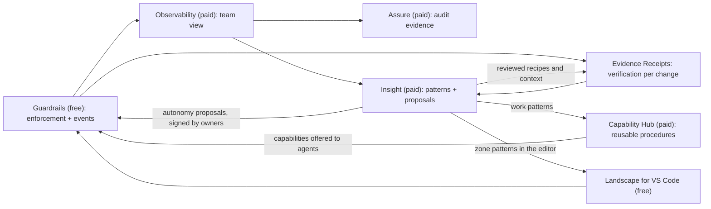

# Landscape of Agents: Products, Customers, and Strategy

What can be sold or given away from what this repository already contains, who would use it, why
they would keep using it, and how each product delivers business and agentic intelligence. Each
product answers the same questions:

1. **The product** in detail
2. **End customers**, and why them
3. **Why it is needed**, the competition, and how it differs
4. **What keeps customers using it**, stated without enthusiasm
5. **Near-future implementations**
6. **Subproducts**
7. **Customer base, first customers, and pricing** (paid or free)
8. **What makes it recurring**
9. **Business and agentic intelligence** it provides now, and what to add if it does not
10. **Drawbacks, limitations, and iterations needed**, with reasons
11. **Radical improvements**, with the reasoning

Grounding: [OVERVIEW.md](OVERVIEW.md) (what exists), [TERMINOLOGY.md](TERMINOLOGY.md) (every term),
[FLOWS.md](FLOWS.md) (every flow). Competitor names are examples of categories as known at the time of
writing; this market changes monthly, so verify each before using it externally.

## Contents

1. [The portfolio at a glance](#1-the-portfolio-at-a-glance)
2. [Crane Guardrails](#2-crane-guardrails)
3. [Landscape for VS Code](#3-landscape-for-vs-code)
4. [DataSea Agent Observability](#4-datasea-agent-observability)
5. [Crane Assure (agent compliance evidence)](#5-crane-assure-agent-compliance-evidence)
6. [Evidence Receipts (Work Capture)](#6-evidence-receipts-work-capture)
7. [Capability Hub](#7-capability-hub)
8. [Insight](#8-insight)
9. [How the products reinforce each other](#9-how-the-products-reinforce-each-other)
10. [Pricing and go-to-market summary](#10-pricing-and-go-to-market-summary)

---

## 1. The portfolio at a glance

| Product | Built from | Maturity today | One-line value |
|---|---|---|---|
| **Crane Guardrails** | CLI, hooks, AgentScript ([src/hooks/](../src/hooks/), [src/governance/](../src/governance/), [src/selection/](../src/selection/)) | Live | Agents cannot change what must not change, and every action is checked before and after |
| **Landscape for VS Code** | [extensions/foxx/](../extensions/foxx/) | Live | Govern code and see what agents were told, inside the editor |
| **DataSea Agent Observability** | [src/server/](../src/server/), [src/telemetry/](../src/telemetry/) | Live, hosted | Every teammate's agents, decisions, denials, costs, and incidents in one view |
| **Crane Assure** | [telemetry/compliance.rs](../src/telemetry/compliance.rs), audit chains | Evidence exists; no packaged export | Audit evidence for AI-assisted change, produced as a side effect |
| **Evidence Receipts** | [src/capture/](../src/capture/) | Engine live; no receipt renderer yet | Every pull request and deployment carries a receipt of what is proven and what is not |
| **Capability Hub** | [src/capability/](../src/capability/) … [src/evolution/](../src/evolution/) | Logic complete; few live inputs; one adapter | Verified work becomes reusable, governed procedures for agents |
| **Insight** | [src/insight/](../src/insight/) | New, CLI-only | The system learns where work goes unverified, what keeps being asked, and what agents keep doing |

---

## 2. Crane Guardrails

1. **The product.** A single binary that installs into Claude Code, Codex, GitHub Copilot CLI, and
   Gemini CLI through their hooks. People mark code with `crane protect` and `crane target`, group it
   into zones and flows with a criticality and an autonomy ceiling, and sign the rules. Before every
   tool call the guard decides from the real files (edit simulation, shell and script analysis, zone
   limits, credits); after it, the files are re-checked, and bypasses quarantine the session. Works
   offline; fails closed.
2. **End customers.** Engineering teams using coding agents on code that matters: fintech, healthtech,
   insurance, infrastructure, security vendors, and any team that already has "do not touch" code
   (billing, auth, migrations). Platform and developer-experience teams that roll agents out to an
   organization. They carry the risk and own the rollout decision.
3. **Why it is needed; competition.** Prompts are requests; agent tools' own permission prompts are
   per-tool, per-user, and not tied to specific code. Alternatives: the agent tools' built-in
   permissions and hooks (Claude Code, Copilot, Cursor rules), repository controls (CODEOWNERS, branch
   protection), static scanners run after the fact (Semgrep, Snyk), and LLM guardrail libraries focused
   on prompts and outputs (NeMo Guardrails, Guardrails AI, Lakera-style prompt-injection filters).
   Crane differs on four points: rules are **signed by people and bound to the repository**; enforcement
   is **at the code-block level, before the edit, from the real file**; **one rulebook across four agent
   tools**; and every decision is **tamper-evident evidence**. None of the alternatives combine
   pre-action, code-precise enforcement with a signed rule set.
4. **What keeps them using it.** Once protected blocks, zones, and flows exist, removing Crane means
   losing the enforcement and the audit trail that compliance and incident review now rely on. The
   rules live in the repository and grow with it; switching cost rises with every signed rule.
   Denials that save an incident are remembered.
5. **Near future.** Sandbox profile so the trust directory is confidential against the agent's shell;
   passphrase key protection by default; hook-installation status reported to the dashboard; more
   AgentScript verbs ("may change only together with a test change", "only these agents",
   time-bound targets); a `governance merge` for concurrent rule changes; adapters for more agent tools
   (Cursor, Windsurf, Aider) as their hooks mature.
6. **Subproducts.** A CI mode (`crane test .` as a required check); an "AgentScript policy pack"
   marketplace (shared rule templates for common frameworks: Stripe integration, auth flows,
   database migrations); a self-hosted enforcement server for regulated environments.
7. **Customer base, first customers, pricing.** Base: every team running coding agents on a shared
   repository. First customers: 5 to 10 design partners with 10 to 200 engineers in regulated
   industries already using Claude Code or Copilot at scale, reached through platform-engineering
   leads. **Free and open source** (Apache 2.0, as today): adoption must be frictionless and the trust
   argument requires inspectable code. Monetize through the team products (sections 4 to 8).
8. **Recurring.** Enforcement itself is continuous; recurrence comes from the paid team layer
   (observability, assurance) that consumes its evidence.
9. **Intelligence today.** Business: denials, approvals, and bypass attempts per zone show where agents
   push against rules. Agentic: agents receive the exact context of the code they touch, which reduces
   wasted tokens. **To add:** feed reviewed, learned context (accepted Insight zone context) into the
   session-start context, and let trust patterns propose autonomy-ceiling changes for owner signature,
   so autonomy is earned from evidence.
10. **Drawbacks and iterations.** Same-user shells can read the trust directory (sandbox needed, as
    documented). Shell and script analysis is lexical (the after-check is the backstop). Enforcement
    exists only where agent tools provide hooks. Setup asks people to understand keys and signing, which
    is a real adoption cost; the extension softens it but does not remove it.
11. **Radical improvements.** Make the sandbox the default runtime, not an option: an agent that cannot
    read the trust directory or the network without mediation turns "detected after the effect" into
    "prevented". Reasoning: every residual weakness listed above is a consequence of sharing an
    operating-system user with the agent.

---

## 3. Landscape for VS Code

1. **The product.** The editor face of Crane: select code and protect or target it, draw zones and
   flows on a graph (cycles refused), edit `governance.yaml` with previews and signing, see failing
   policies as diagnostics, and see, next to the code, the context an agent received while working.
   It talks to Crane only through the CLI.
2. **End customers.** The developers in the teams above, and the tech leads who define zones. They are
   the daily users; the CLI alone does not reach them.
3. **Why it is needed; competition.** Governance in YAML and terminals is not adopted by most
   developers. Editor AI extensions (Copilot, Cursor, Continue, Cline) generate code; none govern it at
   this precision or show what an agent was told about a block. Code-ownership and architecture tools
   (CODEOWNERS editors, dependency graph tools) map code but do not enforce agent behavior.
4. **What keeps them using it.** It is the cheapest way to create and maintain rules; once a team draws
   its zones there, the graph becomes the shared map of risky code. Live agent context makes agent
   behavior understandable at the place of work.
5. **Near future.** Views for Evidence Receipts, Insight patterns per zone, and capability
   recommendations, all read-only over `--json` outputs; a "repair unresolved selection" assistant; a
   JetBrains plugin on the same CLI contract.
6. **Subproducts.** A web version of the governance graph on the dashboard (read-only, with a "propose
   change" path); a review mode that shows a pull request's governance impact.
7. **Customer base, first customers, pricing.** Same base as Guardrails. **Free.** It is the adoption
   funnel and its value depends on the free CLI.
8. **Recurring.** Daily use is the recurrence; it drives rule growth, which drives paid usage.
9. **Intelligence today.** Shows the context agents received and where agents are working. **To add:**
   show Insight's zone patterns ("62% of investigations here lack test reports", "work touching
   `migrations/` fails 4 of 6 times") as editor annotations, so intelligence meets the developer at
   the code.
10. **Drawbacks and iterations.** VS Code family only; disabled in untrusted workspaces by necessity; it
    depends on a working Crane install, so a broken install blocks it (the sidebar explains how to fix).
11. **Radical improvements.** Make the editor the place where agents ask for permission and people
    grant it (approvals inline, with the simulated diff), instead of terminal prompts. Reasoning:
    approval fatigue is the main reason teams loosen guardrails; making approval precise and fast keeps
    them tight.

---

## 4. DataSea Agent Observability

1. **The product.** A hosted dashboard (and the `crane server` that powers it) showing every teammate's
   agents: sessions, tool calls, decisions and their reasons, denials, bypass attempts, violations,
   tokens per tool call (where measurable), credits, compliance posture, and incidents. Evidence
   chains are verified per machine; viewing is read-only; GitHub ownership decides who sees what.
   Dashboard Agents monitor metrics and open incidents; an admin can quarantine a session remotely.
2. **End customers.** Engineering managers, platform teams, security and risk teams, and CTOs who must
   answer "what are our agents doing, what did they cost, and were they stopped when they should have
   been".
3. **Why it is needed; competition.** LLM observability tools (LangSmith, Langfuse, Arize Phoenix,
   Helicone, Datadog LLM Observability, AgentOps) trace prompts, completions, and latency of
   applications a team builds. They do not see coding agents' tool calls against a repository, and
   they do not tie events to signed rules. Agent vendors' admin consoles show usage per vendor, not
   across vendors, and not enforcement. DataSea differs by being **cross-vendor**, **enforcement-aware**
   (decision, assessment, enforcement outcome kept apart), **tamper-evident**, and **honest about
   unknowns** (unmeasured is never zero).
4. **What keeps them using it.** It becomes the record of agent activity the organization relies on for
   incident review and cost questions. History, incidents, and monitors accumulate; leaving means
   losing them. Quarantine is a capability teams do not want to lose once they have used it.
5. **Near future.** Custom domain as the default ingest; GitLab and other identity providers; longer
   retention tiers with export; Work Capture receipts and Insight report summaries as new uploaded
   streams; monitors over those patterns; a signed, cached quarantine answer for outages.
6. **Subproducts.** Cost management (token and credit budgets per team, per zone, per task); an
   incident timeline export for postmortems; an agent-context API product for other tools
   (`/api/agent-context` already exists).
7. **Customer base, first customers, pricing.** Base: organizations with more than one developer using
   agents. First customers: the Guardrails design partners. **Free tier** (one repository, short
   retention, a few members) and **paid per active developer** for teams (more repositories, longer
   retention, monitors, quarantine, SSO). Price must be well below agent seat costs.
8. **Recurring.** A subscription justified by retention, monitors, and incident workflows; weekly
   digests to managers; usage-based tiers by stored events.
9. **Intelligence today.** Business: denials per rule, bypass attempts, tool failure rates, cost per
   tool call, session health, compliance posture. Agentic: the agent-context API lets agents read
   filtered evidence under a person's permissions. **To add:** show Insight patterns team-wide (evidence
   gaps by zone, trust by zone, recurring agent sequences), and an "autonomy dial" per zone that
   recommends widening or narrowing ceilings from the record, for an admin to sign.
10. **Drawbacks and iterations.** GitHub-only sign-in; thirty-day default retention; one hosted
    topology; token usage measured only for Claude Code; network egress not observable from hooks.
    Each limits a specific segment (non-GitHub shops, regulated audits, large enterprises, cost-focused
    buyers).
11. **Radical improvements.** Sell the dashboard as the system of record for AI-assisted change,
    not as monitoring: every merged change carries who (person and agent), under which rules, with
    which evidence. Reasoning: monitoring is a crowded, price-pressured category; a system of record
    for change is sticky and becomes required once auditors accept it.

---

## 5. Crane Assure (agent compliance evidence)

1. **The product.** A packaged, signed evidence export per period: compliance controls with their
   outcomes (`SATISFIED`, `PARTIAL`, `NO_EVIDENCE`, `NOT_APPLICABLE`), the evidence references behind
   each, chain verification results, governance change history, and framework mappings (OWASP LLM and
   agentic guidance, NIST AI RMF, SOC 2, ISO/IEC 27001:2022, GDPR). The controls and evidence exist
   today ([telemetry/compliance.rs](../src/telemetry/compliance.rs)); the export does not.
2. **End customers.** Compliance, GRC, and security teams, and the auditors they work with, in
   organizations that must show control over AI-assisted change.
3. **Why it is needed; competition.** Compliance automation platforms (Vanta, Drata, Secureframe)
   collect evidence from cloud and HR systems; they have no evidence about what coding agents did. AI
   governance platforms focus on model inventories and policies on paper. Assure differs by producing
   **evidence of enforcement at the code level**, generated as a side effect of normal work.
4. **What keeps them using it.** Audits repeat every year; once auditors accept the export, replacing
   it means re-arguing controls. It integrates as an evidence source into the platforms above.
5. **Near future.** The signed export itself; connectors that push it into Vanta or Drata; a
   control-mapping review with an auditor partner; retention to match audit periods.
6. **Subproducts.** An "AI change management policy" template set mapped to the controls; an auditor
   read-only portal.
7. **Customer base, first customers, pricing.** Base: companies under SOC 2, ISO 27001, or sector
   regulators that use coding agents. First customers: fintech design partners facing their next
   audit. **Paid**, as an add-on to the team plan, priced per audit period.
8. **Recurring.** Audit cycles (annual, quarterly for some regulators).
9. **Intelligence today.** Shows which controls have evidence and which do not. **To add:** trend each
   control over time and highlight controls drifting toward `NO_EVIDENCE` (for example, a zone whose
   investigations stopped producing test evidence), using Insight's evidence-gap patterns.
10. **Drawbacks and iterations.** Mappings show what evidence supports, not certification, and must say
    so; acceptance depends on auditors, which takes time; retention must exceed the audit period.
11. **Radical improvements.** Partner with one audit firm to publish an "AI-assisted change" control
    set with this evidence as the reference implementation. Reasoning: the category has no standard
    yet, and the first credible standard defines the market.

---

## 6. Evidence Receipts (Work Capture)

1. **The product.** For every pull request and deployment, an Evidence Receipt: what is proven
   (`ci_passed`, `deployment_succeeded`, `policies_hold`, …) and by which evidence, what is
   contradicted, what is unknown and *why* (empty, unavailable, denied, not queried, parse failed),
   which zones and policies were touched, and integrity (manifest digest, replay fidelity). Posted as a
   check run; gate rule "pass only if sufficient and verified, block on any No, ask a human on any
   Unknown". The engine exists ([src/capture/](../src/capture/)); the renderer and check-run publisher do
   not.
2. **End customers.** Reviewers and release managers who approve agent-made changes; on-call engineers
   investigating incidents; teams that merge agent pull requests daily.
3. **Why it is needed; competition.** A CI badge is green or red; it has no color for "nobody checked".
   Code-review assistants (CodeRabbit, Copilot code review, Graphite reviewers) comment on the diff;
   supply-chain provenance (SLSA, Sigstore) proves who built what. None reports **which verification
   evidence exists for the change, which is missing, and why**, with three-valued truth.
4. **What keeps them using it.** Once reviewers rely on receipts to approve agent work faster, removing
   them slows every merge. Receipts accumulate into history that Insight mines.
5. **Near future.** Receipt renderer and GitHub check-run publisher; live connectors for test reports
   (GitHub Actions artifacts), deployments, logs, and metrics; automatic investigation on pull-request
   and deployment events; per-commit verification for multi-commit pull requests.
6. **Subproducts.** Incident investigation packs ("why did deployment X fail") for on-call; a receipt API
   for other review tools; evidence debt tracking per zone.
7. **Customer base, first customers, pricing.** Base: teams merging agent pull requests. First
   customers: design partners already on Guardrails, starting with one critical repository each.
   **Free for public repositories and a small number of private receipts; paid per repository or per
   receipt volume** for teams.
8. **Recurring.** Every pull request and deployment produces a receipt; usage scales with activity.
9. **Intelligence today.** Business: which changes are verified, which are not, and why. Agentic: an
   agent can be given the receipt of its own change, so it knows what evidence is still missing
   (for example, "no test report: run the tests"). **To add:** feed the receipt back to the agent
   automatically at `STOP`, so the agent closes its own evidence gaps before a person looks.
10. **Drawbacks and iterations.** Without live deployment and test connectors, most receipts say
    "unknown" for those parts; outcomes are recorded by hand; the store must scale beyond local JSON
    lines for hosted use.
11. **Radical improvements.** Make "unknown" a first-class merge state across the industry: a receipt
    that cannot prove tests ran does not block, it routes to a person, and that routing is measured.
    Reasoning: gates that block on every gap get switched off; gates that route keep running, and the
    routing data is the product.

---

## 7. Capability Hub

1. **The product.** A registry of verified, reusable procedures ("capabilities") learned from real
   work: compiled from an episode's evidence, checked by a non-executing lab, published by a person,
   discovered for a task with explanations, invoked through typed operations with approvals, and
   evolved from outcomes. Components 2 to 7 ([src/capability/](../src/capability/) to
   [src/evolution/](../src/evolution/)).
2. **End customers.** Platform teams that want agents to do recurring work (dependency upgrades,
   migrations, incident runbooks, release chores) the organization's way; agent-forward engineering
   organizations.
3. **Why it is needed; competition.** Agents rediscover procedures every session. Alternatives: prompt
   libraries and custom instructions, agent "skills" and tool registries (vendor skill systems, MCP
   server registries), workflow automation (GitHub Actions, internal runbook tools). These package
   *instructions* or *tools*; the Hub packages **evidence-backed procedures with applicability,
   dependencies, verification contracts, and a human publication gate**, and refuses to run anything
   that is not a registered, typed operation.
4. **What keeps them using it.** Each published capability is organizational knowledge that improves
   with use (evolution); the registry becomes the place agents are told "how we do this here".
5. **Near future.** Typed invocation adapters beyond read-only `git.commit` (open a pull request, run a
   workflow, create a ticket); multi-episode compilation driven by Insight work patterns; offering
   discovered capabilities at session start; review delivery for evolution packets.
6. **Subproducts.** A capability marketplace between organizations (shared, versioned procedures with
   their verification contracts); a runbook product for incidents built on the same registry.
7. **Customer base, first customers, pricing.** Base: organizations with repeated agent work across
   many repositories. First customers: design partners with a concrete recurring task (for example,
   framework upgrades across 50 services). **Paid**, enterprise tier, priced by published capabilities
   or invocations.
8. **Recurring.** Invocations and evolution cycles; capabilities need revalidation as dependencies
   drift.
9. **Intelligence today.** Agentic: discovery explains which capability applies and why; evolution
   detects repeated failures and drift. **To add:** close the loop from Insight work patterns to
   compilation, and from discovery to the agent's session context, so agents are offered proven
   procedures automatically.
10. **Drawbacks and iterations.** Few live inputs (deployment and test evidence are mostly fixtures);
    one invocation adapter; single-episode compilation; thin outcome history. The logic is ahead of the
    data; it needs the receipts product to feed it.
11. **Radical improvements.** Treat capabilities as the unit of agent autonomy: an agent may act
    autonomously only through published capabilities, and freely-composed actions stay under
    guardrails. Reasoning: this converts "how much do we trust the agent" into "how much do we trust
    this procedure", which is testable, versioned, and revocable.

---

## 8. Insight

1. **The product.** Patterns across all kept work, computed under the viewer's own access: evidence
   gaps by zone and reason, questions no recipe serves and how explorations were judged, trust per
   zone, zones or directories whose work fails more often than the rest, and agent tool sequences that
   recur. Each pattern leads to a reviewed proposal (a learned recipe, zone context) or to the person
   who can act (compile a capability, decide autonomy). Counts below 3 are suppressed; every rate shows
   its denominator and unknowns; nothing is causal. ([src/insight/](../src/insight/))
2. **End customers.** Engineering leadership and platform teams deciding where to invest (tests,
   connectors, autonomy), and the agents themselves through the context and recipes it produces.
3. **Why it is needed; competition.** Engineering intelligence platforms (LinearB, Jellyfish, Swarmia,
   DX, Faros) measure delivery from Git and ticket metadata; they do not see agent tool calls,
   enforcement, or evidence gaps. Agent analytics show usage, not verification. Insight differs by
   mining **verified evidence and its gaps**, not activity counts, and by turning findings into
   **reviewed changes to how the system works**.
4. **What keeps them using it.** It gets better with every investigation, feedback, and outcome; learned
   recipes and context are assets that stay in the system. Leaving means losing what the system has
   learned about the codebase.
5. **Near future.** Read models over the capability registry, invocation ledger, evolution store, and
   hosted events; proposed outcomes derived from verified assertions; reports uploaded to the dashboard;
   signed thresholds per repository; scheduled reports with reviewer notifications.
6. **Subproducts.** Evidence debt burndown; an autonomy dial per zone; investment recommendations
   ("adding a test-report connector would resolve 40% of open gaps").
7. **Customer base, first customers, pricing.** Base: teams already on Guardrails and Receipts (Insight
   needs their data). First customers: the same design partners after a few weeks of data. **Paid**,
   included in the team or enterprise tier; the free tier shows counts without proposals.
8. **Recurring.** Weekly reports and the steady flow of proposals to review.
9. **Intelligence today.** Business: where verification is missing and why, which zones have earned
   trust, where failures cluster. Agentic: unanswered questions become learned recipes after review, so
   the next investigation of that class is complete; zone patterns become reviewed context. **To
   add:** feed accepted context into agents' session-start context, and route work patterns to
   multi-episode compilation, so agents both know more and are offered proven procedures.
10. **Drawbacks and iterations.** It needs volume: below the minimum support it shows nothing, so a new
    team sees little for weeks. Outcome patterns need recorded outcomes. It currently reads only the
    capture store and runs from the CLI.
11. **Radical improvements.** Make Insight the decision engine for autonomy: ceilings, credit costs, and
    approval requirements are proposed from each zone's evidence record and signed by an owner, so
    autonomy grows where evidence earns it and shrinks where it does not. Reasoning: autonomy settings
    today are guesses; with evidence they become a measurable, auditable policy, which is the core of
    agentic intelligence that an organization can trust.

---

## 9. How the products reinforce each other

The free products produce evidence; the paid products turn it into visibility, assurance, and
learning; and what is learned flows back into how agents are guided and governed. Each paid product
depends on the free ones being installed, which is why the free ones must stay free.

## 10. Pricing and go-to-market summary

| Product | Model | First buyer |
|---|---|---|
| Crane Guardrails | Free, open source | Developers and platform teams |
| Landscape for VS Code | Free | Developers |
| DataSea Observability | Free tier; paid per active developer | Engineering managers, platform leads |
| Crane Assure | Paid add-on per audit period | Compliance and security |
| Evidence Receipts | Free for public repositories; paid per repository or volume | Tech leads, release managers |
| Capability Hub | Enterprise, by capabilities or invocations | Platform engineering |
| Insight | Included in team and enterprise tiers | Engineering leadership |

**Sequence.** Win developers with Guardrails and the extension; convert teams with Observability;
prove value per change with Receipts; then sell Assure to compliance and Insight and the Capability Hub
to leadership once data has accumulated. Design partners in regulated industries are the first
customers for every paid tier, because they feel the risk first and their audits create the deadline.
