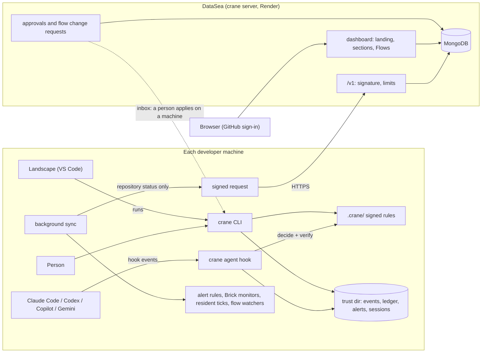

# Landscape of Agents: the complete system reference

Everything built so far, the words it uses, what changed and when, and every workflow broken
down step by step: what the person does, what the system does, how it answers, and what happens
when something goes wrong. Status as of 2026-11-19 (Crane 0.5.21, commit `f352277`).

Shorter entry points: [README](../README.md) (the vision), [docs index](README.md),
[CLI guide](surfaces/cli.md), [terminology](TERMINOLOGY.md), [event specification](../DASHBOARD.md).

## Contents

1. [Status board](#1-status-board)
2. [Technologies](#2-technologies)
3. [Terminology](#3-terminology)
4. [Architecture](#4-architecture)
5. [Changes and features, in order](#5-changes-and-features-in-order)
6. [How to read the workflows](#6-how-to-read-the-workflows)
7. [Workflows: setup and rules](#7-workflows-setup-and-rules) (W1–W10)
8. [Workflows: agents at work](#8-workflows-agents-at-work) (W11–W19)
9. [Workflows: Bricks](#9-workflows-bricks) (W20–W23)
10. [Workflows: flow knowledge](#10-workflows-flow-knowledge) (W24–W27)
11. [Workflows: resident agents](#11-workflows-resident-agents) (W28)
12. [Workflows: skills, runbooks, controls](#12-workflows-skills-runbooks-controls) (W29–W31)
13. [Workflows: alerts, integrations, secrets](#13-workflows-alerts-integrations-secrets) (W32–W33)
14. [Workflows: evidence and learning](#14-workflows-evidence-and-learning) (W34–W36)
15. [Workflows: DataSea and Landscape](#15-workflows-datasea-and-landscape) (W37–W41)
16. [Every failure and how the system behaves](#16-every-failure-and-how-the-system-behaves)
17. [Limits, numbers, and defaults](#17-limits-numbers-and-defaults)
18. [What is not built yet](#18-what-is-not-built-yet)

---

## 1. Status board

### Products

| Product | Price | What it is | State |
|---|---|---|---|
| **Crane** | free, Apache 2.0 | One signed rulebook for Claude Code, Codex, Copilot CLI, Gemini CLI. Every agent action is checked before it runs and verified after. | **Released** (0.5.21) |
| **Evidence Receipts** | paid | Proof per pull request: proven, contradicted, unknown and why | Evidence engine built; receipt renderer and PR check **to build** |
| Black Box | — | Dropped 2026-11-16 (its hosted record no longer exists) | Removed |

### Surfaces

| Surface | Who uses it | State |
|---|---|---|
| `crane` CLI (Rust) | developers, admins; hooks run it for agents | Released for Windows, Linux, macOS |
| Agent hooks | run automatically for Claude Code, Codex, Copilot CLI, Gemini CLI, generic | Live, fail-closed |
| Landscape for VS Code (`agentscript.foxx`) | developers, tech leads | Published (Marketplace, Open VSX) |
| DataSea service + dashboard | the organization | Hosted on Render + MongoDB; landing page, 8 sections, **Engineering › Flows** |
| Landing site (agentslandscape.cloud) | visitors | Static site on Render |
| Operator dashboard (`crane operator serve`) | the operator only | Built and tested; defined in `render.yaml` as `crane-operator` |

### Size and health

| Measure | Value |
|---|---|
| Rust source | about 165,000 lines in 24 modules |
| Extension | about 10,400 lines of TypeScript, 32 tests |
| Tests | 361 unit tests in the binary, 24 integration suites through the real binary, live-MongoDB suites in CI |
| CI | format, clippy (warnings are errors, with and without `server`), tests, MongoDB tests, smoke test, extension build and test |
| Commands | about 45 top-level command groups; 14 control families (72 commands); Brick, flow, resident, capture, insight, capability families |

### Built vs. proven

| Area | Built | Proven live |
|---|---|---|
| Signed rules, selections, policies, zones, flows, teams | yes | yes |
| Hooks for four agent tools | yes | yes |
| Scope commands | yes | yes |
| Bricks (12 kinds) | yes | unit + integration tests; not yet through the extension against a real Crane |
| Flow knowledge, subagents, scenarios | yes | tests; live third-party calls never made |
| Resident agents | yes | tests; Jira and GitHub Actions never called live |
| Landscape panels | yes | type-checked and unit-tested only |
| DataSea Flows | yes | stubbed browser harness only |
| Work Capture, Insight, capability pipeline | yes | tests and demos; most external connectors are fixtures |

The step-by-step manual test plan is in `../CRANE-TEST-GUIDE.md` (next to this repository).

---

## 2. Technologies

| Layer | Technology | Used for |
|---|---|---|
| Language | **Rust 1.89**, edition 2021 | The whole CLI, hooks, and service: one binary `crane` |
| Serialization | `serde`, `serde_json` (`float_roundtrip`), `serde_yaml` | Every file and message; floats round-trip exactly so chained digests verify |
| Hashing | `sha2` (SHA-512) | Digests of records, files, events, manifests |
| Signatures | `ed25519-dalek` | Signing keys of owners and admins; per-machine upload keys |
| Key sealing | DPAPI (Windows), `argon2` + `chacha20poly1305` (passphrase) | Signing keys at rest |
| Randomness | `getrandom` | Ids, keys, approval codes |
| Passphrase input | `rpassword` | Console prompt for sealed keys |
| HTTP client | `ureq` (TLS) | Machine → DataSea requests |
| HTTP server | `tiny_http` (feature `server`) | The DataSea service |
| Database | **MongoDB** (`mongodb` 3, sync, rustls) | DataSea storage (service only) |
| External tools | Git (run without a shell), `curl` (config on stdin), `gh` | Repository facts, alert delivery, GitHub |
| Editor extension | **TypeScript**, VS Code API, webviews | Landscape |
| Dashboard front end | plain JavaScript, HTML, SVG | DataSea pages (`app.js`, `flows.js`) |
| Landing site | static HTML, **Tailwind CSS** 3.4 | agentslandscape.cloud |
| Hosting | **Render** (web service + static site), MongoDB | DataSea, landing |
| Identity | **GitHub OAuth** (`read:org`), GitHub API, CODEOWNERS | Who may see and request what |
| CI/CD | **GitHub Actions** (`ci.yml`, `release.yml`, `pr-notify.yml`) | Tests, releases, PR notifications |
| Diagrams | Mermaid | Docs |
| Integrations | Slack, WhatsApp, Jira, GitHub, Datadog, Grafana, Google Calendar/Meet, PagerDuty, Opsgenie | Alerts, subagent and resident actions |

Rules the code follows everywhere: every Rust item has an Input/Output doc comment; nothing reads
a secret into a command line; Git runs without a shell; every child process has a time limit.

---

## 3. Terminology

### Products and places

| Term | Meaning |
|---|---|
| **Landscape of Agents** | The organization and the whole system |
| **Crane** | The CLI and rule layer |
| **Landscape** | The VS Code extension (internal id `foxx`) |
| **DataSea** | The hosted service and dashboard (MongoDB database `foxx`) |
| **AgentScript** | The rule language: `preserve ID;`, `target ID change_type T;` |
| **`.crane/`** | The repository folder holding the signed rules. Agents can never write it |
| **Trust directory** | `~/.crane-trust` (or `CRANE_HOME`): keys, secrets, runtime evidence, per repository under `repos/<id>/` |

### Rules

| Term | Meaning |
|---|---|
| **Owner** | The key that ran the first `crane init` |
| **Admin** | A key the owner signed into the admin list; may change rules |
| **Signing key** | Ed25519 key in the trust directory; signs every rule change |
| **Upload key** | Per-machine key (`installation.key`) that signs requests to DataSea; no authority over rules |
| **Manifest** | Signed summary (digests) of every rule file; `registry.json` holds it |
| **Generation** | Rule version number; +1 per change |
| **Rollback anchor** | This machine's memory of the latest generation, to detect rollback and forks |
| **Audit chain** | `.crane/audit.jsonl`, hash-chained history of rule changes |
| **Checkpoint** | A trusted commit; "unchanged" means unchanged since it |
| **Selection** | Lines a person chose, with an 8-character id (e.g. `K7M2P9RX`) |
| **Marker** | The two comment lines around a selection; they follow the code |
| **Preserve (protect)** | These lines must not change |
| **Target** | These lines must change in a stated way: `logical_bn` (business logic), `logical_cn` (control flow), `logical_sn` (structure), `semantic` (names, comments) |
| **Policy** | A named list of preserve/target commands in `.crane/policies/*.crane` |
| **Context** | Guidance attached to a rule, shown to agents. Never a permission |
| **Unresolved** | A selection Crane cannot locate; changes to it are refused until repaired |
| **Zone** | An area of code (paths, files, directories, symbols, selections, or marked blocks) with limits |
| **Flow** | A call path from entry points, governed as one thing |
| **Context pack** | Reusable guidance for zones and flows; every flow needs one |
| **Criticality** | routine, sensitive, critical, restricted (restricted always needs a person) |
| **Autonomy ceiling** | observe (look only), assisted (ask first), delegated, autonomous |
| **Strictest wins** | Overlapping rules: the strictest limit applies; rules only restrict |
| **Proposed / active / deprecated** | Lifecycle of zones and flows; only active ones enforce |

### Agents at work

| Term | Meaning |
|---|---|
| **Hook** | The program an agent tool runs before and after each action: `crane agent hook --event E --profile P` |
| **Adapter** | Turns one tool's payload into a neutral action |
| **Guard** | Decides each action from the real files |
| **Decision** | ALLOW, REQUIRE_APPROVAL (ask a person), DENY, QUARANTINE, ERROR |
| **Rule code** | Reason name on a decision, e.g. `PRESERVED_SELECTION` (full list in §8) |
| **Edit simulation** | The proposed edit is applied in memory to the file's current text first |
| **After-check** | After the tool ran, Crane looks at what really changed on disk |
| **Bypass** | Protected code changed outside the edit tools; the session is quarantined |
| **Coverage gap** | Something Crane could not see or decide; reported, never counted as clean |
| **Safety state** | active, degraded (changes need a person), quarantined (reads only) |
| **Autonomy mode** | The session's own dial; can only tighten |
| **Credits** | Per-session budget for risky actions; running out asks a person, never grants |
| **Session / task** | `ses_…` one agent session; `tsk_…` one piece of work inside it |
| **Stale session** | No hook activity for 2 hours and no proper end |
| **`crane-request`** | The one shell command agents may "run": the hook answers it and it never executes |

### Bricks

| Term | Meaning |
|---|---|
| **Brick** | A reusable module of one fixed kind, attached to a flow, zone, or runbook |
| **Kinds (12)** | knowledge, identity, access, approval, limits, environment, precondition, verification, action, recovery, provenance, watch |
| **Draft** | Unsigned Brick in `.crane/drafts/bricks/`; grants and restricts nothing |
| **Active version** | Signed into `.crane/bricks.json` (`ID@N`) |
| **Stack** | A named set of Bricks (one level) |
| **Attachment** | A Brick or Stack bound to a target, with its **Current Context** |
| **Common Context** | The Brick's own guidance text |
| **Assignment (Brick)** | `crane brick assign AGENT --targets …`: the signed authority resident agents act under |
| **Fail closed pin** | An attachment whose Brick was revoked: the target drops to assisted until fixed |
| **Vault** | Local credential store (`crane secret`); Bricks hold names only |
| **Catalog** | Organization-wide published Brick versions on DataSea |
| **Inbox** | Requests made on DataSea, waiting for a person to apply on a machine |

### Flow knowledge

| Term | Meaning |
|---|---|
| **Trace** | Deterministic call graph from an entry symbol; drafts have revisions |
| **Approve** | Writes the flow and a generated context pack into `governance.yaml` and signs |
| **Flow knowledge** | Signed `.crane/flows.json`: context items, priority, people, tests |
| **Priority** | P0–P3; routes changes to model tiers (frontier, balanced, fast) |
| **`enforce_model`** | Changes from models outside the routed tiers are held for a person |
| **Subagent (watcher)** | A Crane-run, model-free monitor or incident worker bound to one flow |
| **Scenario** | A rule-generated test scenario saved in `.crane/scenarios/` |
| **Proposal** | Something an agent suggested via `crane-request`, waiting for a person |

### Resident agents

| Term | Meaning |
|---|---|
| **Definition** | Versioned description: purpose, triggers, allowed step types, limits |
| **Assignment (resident)** | One definition version on one target, 1–90 days, with trigger subscriptions |
| **Activation** | One wake-up: trigger → investigation → plan → steps → verified outcome |
| **RCA graph** | Signals, causes, checks, remediations, verifications, reviewed by a person |
| **Tick** | One pass of the worker during a background sync or `crane resident tick` |
| **ACTIVE_IDLE** | Active, waiting, zero model cost |
| **DEGRADED** | Crane would not admit it now (authority revoked, target inactive) |

### Evidence and learning

| Term | Meaning |
|---|---|
| **Work episode** | One unit of work evidence is collected for |
| **Evidence Pack** | Sealed answer of an investigation; every gap has a reason (`empty`, `unavailable`, `denied`, `not_queried`, `parse_failed`) |
| **Assertion** | A claim such as `ci_passed`, valued yes / no / unknown with evidence each side |
| **Checklist** (code: recipe) | A versioned plan of evidence queries |
| **Exploration** | The plan built when no checklist serves a question; its pack is `exploratory` |
| **Capability / skill** | A reusable governed procedure that runs only through typed operations |
| **Runbook** | Skills in order, with approvals, branches, budgets |
| **Insight pattern** | A recurring finding (gaps, questions, trust, outcomes, work) turned into a proposal |

### Results and exit codes

| Exit code | Meaning |
|---|---|
| 0 | ok / passed |
| 1 | usage or internal error |
| 2 | a hook blocked the tool call (what the agent tool sees) |
| 3 | denied, failed, or blocked |
| 4 | a person's approval is required |
| 5 | unknown or unresolved (never success) |

---

## 4. Architecture

### Module map (`src/`)

| Module | Lines | Responsibility |
|---|---|---|
| `platform` | 1.9k | Git without a shell, atomic files and locks, timed processes, curl on stdin, globs, URL probe |
| `trust` | 1.6k | Keys, SHA-512, Ed25519, rollback anchors, upload key, vault |
| `selection` | 2.2k | Markers, signed registry, location tracking |
| `governance` | 7.3k | State and manifest (`commit()`), admins, policies, checkpoints, zones and flows, verification, rebind, graph |
| `hooks` | 7.4k | Adapters, guard (`enforce.rs`), shell and script analysis, runtime (session, tools, stop) |
| `scope` | 3.2k | The effective boundary (same guard) |
| `telemetry` | 9.0k | Events, ledger, identity, redaction, evals, alerts, rules, sync, status upload |
| `foxx` | 0.5k | Repository status, live agent context, session views |
| `integrations` | 3.1k | Provider registry, settings schema, Slack, Jira, WhatsApp, GitHub, observability |
| `brick` | 14.1k | Kinds, config, validation, store, compose, effect, guard rules, usage, trial, share, requests, runtime |
| `flow` | 7.0k | Trace, store, context, watch, subagents, scenarios, actions, agent channel, report |
| `resident` | 12.2k | Model, triggers, RCA, plans, authority, store, worker, report |
| `capability`, `invocation`, `runbook` | 18.9k | Skills, typed operations, invocation engine, runbooks |
| `capture`, `insight` | 21.5k | Work Capture, evidence packs, checklists, Insight miners |
| `compiler`, `capability_lab`, `discovery`, `evolution` | 15.3k | The capability pipeline |
| `cli` | 25.0k | One file per command over the services; shared result envelope |
| `server` | 4.6k | DataSea ingest, store, schema, dashboard, approvals, probe |

### Where data lives

| Place | What |
|---|---|
| `.crane/` (in Git) | `registry.json` (selections + manifest), `config.json`, `checkpoints.json`, `context.json`, `audit.jsonl`, `map`, `policies/*.crane`, `governance.yaml`, `bricks.json`, `flows.json`, `skills.json`, `drafts/`, `traces/`, `scenarios/` |
| Trust directory | `keys/`, `installation.key`, `repos/<id>/` (anchor, trusted keys, `runtime/`: `events.jsonl`, ledger, sessions, alerts, `sync-state.json`, Brick usage, resident store, watchers, capture store, insight reports), `secrets/`, `integrations/` |
| MongoDB (DataSea) | `repositories`, `repository_status`, `ingestion_checkpoints` (only for released clients' streams), approvals, `member_links`, `brick_requests`, `brick_catalog`, `service_settings`, `schema_migrations` |

---

## 5. Changes and features, in order

| Date | Version | Change |
|---|---|---|
| before 2026-10 | 0.3 | First prototype (sources since deleted) |
| 2026-10-10 | 0.4.0 | **Rewrite**: signed selection registry, reduced command set, hooks, telemetry, Foxx dashboard, zones and flows, VS Code extension |
| 2026-10-11 | 0.4.x | Zero-setup uploads to a hosted service (only the service holds Mongo credentials); per-machine upload keys; teams (owner key, admins, epoch revocation); hosted GitHub-OAuth dashboard |
| 2026-10-12 | 0.4.3 | Refactor (hooks runtime/adapter split, integrations registry, server split), correlation ids |
| 2026-10-17 | 0.4.19+ | `governance graph`, flow stage cycle checks; docs restructured (README = vision) |
| 2026-10-18 | 0.4.2x | Move to org **Landscape-Of-Agents**; Foxx → **Landscape**, dashboard → **DataSea**; `repo rebind`; no crane under an agent environment |
| 2026-10-19 | — | Capability pipeline components 4–5 (Validation Lab, Discovery) completed |
| 2026-10-26 | 0.5.x | **Command catalog**: 14 families, 72 commands, shared envelope and exit codes; skills, runbooks; **Bricks** (16 types) |
| 2026-10-27 | — | **Resident agents** (2 rounds); Bricks and Resident Agents panels in Landscape |
| 2026-10-28 | — | **Brick redesign**: 12 kinds, per-call guard rules, vault, `brick migrate`; all questions in Landscape dialogs |
| 2026-10-29 | — | DataSea Brick requests + inbox; `brick test --call`; Recipe → **Checklist**; Brick catalog; CODEOWNERS for signed requests; **Flow knowledge** + `crane-request` |
| 2026-10-30 | — | Flows page redesign; subagents (monitor, incident) with bounds; scenarios; connections from DataSea with URL checks; real subagent API calls |
| 2026-11-01 | — | Brick config audit fixes (draft review tokens, refused programs, private addresses, daily caps); `brick destroy`, `selection remove` |
| 2026-11-02 | 0.5.20 | **DataSea revamp**: landing + 8 sections, only Flows remains; telemetry, metric pages, Dashboard Agents, grants, resident decisions removed (schema 14) |
| 2026-11-06 | 0.5.21 | CI fix for the revamp |
| 2026-11-19 | — | **Operator switch**: a separate operator dashboard (only listed GitHub logins) turns on agents running plain read-only Crane commands; machines trust only answers signed by the operator key, valid 15 minutes |
| 2026-11-16 | — | **Cleanup**: Black Box dropped; hooks no longer ask DataSea before tool calls; machines upload only the repository status (flows, Bricks); write-back code, compliance module removed; docs and event spec updated |

---

## 6. How to read the workflows

Every workflow is a table:

- **Step**: in order.
- **Person**: what the customer does (command or click). "—" means the system acts alone.
- **System**: what Crane does inside.
- **Answer**: what the person (or agent) sees.
- **If it fails**: the behavior on that step's failure.

Conventions that hold for **every** workflow, so they are not repeated:

1. Every `crane` command is refused inside an agent session (`crane cannot be executed by an AI
   agent (CLAUDECODE is set): …`), except `agent hook` and `agent sync`, and plain read-only
   commands while the operator switch is on (W41).
2. Every command that changes rules goes through `commit()`: refuse if run by an agent → take the
   governance lock (10 s) → refuse if the current rules fail verification → refuse if this key is
   not an admin → apply in memory → generation + 1 → audit entry → sign manifest → write each
   file atomically → append audit → advance the rollback anchor. A failure before the writes
   changes nothing on disk.
3. Every family command accepts `--format json` (the envelope) and returns the exit codes in §3.
4. Every command is recorded as an F13 event in the local event store.
5. Commands with `--dry-run` run the same path and write nothing.

---

## 7. Workflows: setup and rules

### W1. Connect a repository and initialize

| Step | Person | System | Answer | If it fails |
|---|---|---|---|---|
| 1 | `crane repo --https URL` (or `--ssh`, `--gh-cli`) | Normalizes the remote (`github.com/OWNER/NAME`), computes the repository identity from the remote + root commits, saves `connection.json` | "connected …", privileges | Unknown URL form → usage error; no Git repo → error |
| 2 | `crane init` | Creates `.crane/` with default config, policy `default`, empty registry; creates the signing key (sealed by DPAPI on Windows, or passphrase with `CRANE_KEY_PROTECTION=prompt`); signs generation 1; prints the owner key | Owner key fingerprint; offer to register it with GitHub | Already initialized → re-checks and trusts the signed state; a teammate's repo → W2 |
| 3 | `crane checkpoint baseline` | Records HEAD as a trusted checkpoint; signs | "checkpoint baseline = <sha>" | Dirty selected lines later → protect refuses |
| 4 | `crane admin register` (optional) | Creates a 12-character one-time code; sends the owner-key request signed by the key to DataSea | An address to open | Service unreachable → error; nothing else affected |
| 5 | Open the address, sign in to GitHub | DataSea checks the person administers the repository, stores the confirmation | "confirmed" | Not an admin → refused; code expires after 10 minutes |
| 6 | Commit `.crane/` | — | — | — |

### W2. A teammate joins

| Step | Person | System | Answer | If it fails |
|---|---|---|---|---|
| 1 | `crane repo --https URL` then `crane init` | Finds a signed state; shows the owner key fingerprint; if GitHub confirmed it, "confirmed by @admin", else a warning when the key differs | Prompt "trust this key? [y/N]" | Answer no → nothing trusted; rules cannot verify; **agent changes are blocked** on this machine |
| 2 | Answer `y` | Pins the owner key in the trust directory | "trusted" | — |
| 3 | `crane agent link` | Creates a code, sends a link request signed by the upload key | Address to open | — |
| 4 | Open it, sign in | DataSea checks GitHub access to the repository and links the machine to the person | "linked" | No access → refused |
| CI | Set `CRANE_TRUSTED_PUBLIC_KEYS` | Trusts the owner without a prompt | — | — |

### W3. Admins and rule conflicts

| Step | Person | System | Answer | If it fails |
|---|---|---|---|---|
| 1 | Teammate sends their key; owner runs `crane admin add KEY name NAME` | Owner-signed admin list updated (commit) | "added" | Not the owner → refused |
| 2 | `crane admin del KEY` | Removed; epoch increases so machines that saw the removal refuse an older list | "removed" | — |
| 3 | `crane admin list` | Reads the signed list | Keys and names | — |
| Conflict | Two admins changed rules on different branches | Git conflict in `.crane` | — | Keep one side for the whole folder (`git checkout --theirs .crane`), commit, `crane init` to accept it, re-apply the other change with Crane. A mix of both sides fails verification. |

### W4. Protect code (`preserve`)

| Step | Person | System | Answer | If it fails |
|---|---|---|---|---|
| 1 | `crane protect FILE start-line A end-line B context "…" [name N] [policy P] [checkpoint C]` | — | — | Missing `context` → refused (guidance is required) |
| 2 | — | Resolves lines A–B against the checkpoint (Myers diff, ignoring markers). **Every selected line must be unchanged since the checkpoint** | — | Changed lines → refused ("cannot protect code that changed since the checkpoint") |
| 3 | — | Generates a unique 8-character id; inserts two marker comments in the file's comment syntax | — | Collision → regenerates |
| 4 | — | Adds `preserve ID;` to the policy; builds the record with three digests; signs through `commit()` | Selection id | Any step fails → source and policy files restored |
| 5 | Commit | — | — | — |
| Later | Agent edits the block | Denied (`PRESERVED_SELECTION`), see W15 | — | — |

### W5. Target code (must change)

Same as W4 with `crane target … change_type logical_bn|logical_cn|logical_sn|semantic`. `crane test .`
fails until the code changed in that way; whitespace-only changes never satisfy it. Agents may edit a
target (that is its purpose) and receive its context.

### W6. Policies and context files

| Person | System | Answer |
|---|---|---|
| `crane create policy NAME FILENAME` | New signed policy file | "created" |
| `crane add policy NAME marker ID` | Moves a selection's command into that policy (signed) | "moved" |
| `crane add policy-context file FILE [policy P]` | Binds a context file by digest; agents receive it with the policy's notices | "bound" |
| `crane policy-context NAME --view` | Shows bound files and whether they are current or stale | list |
| `crane --set default policy\|checkpoint NAME` | Signed default | — |
| `crane parse file FILE` | Parses an AgentScript file, reports syntax errors | ok / errors |

### W7. Validate and test

| Step | Person | System | Answer | If it fails |
|---|---|---|---|---|
| 1 | `crane validate` | Integrity: manifest signature by a trusted key, repository binding, every covered digest, audit chain, rollback/fork against the anchor, markers (forged, crossed, orphan), governance file signed, Brick/flow/skill stores | Findings by severity; exit 0 when no blocking finding | Blocking finding → non-zero; **agents are stopped** until fixed |
| 2 | `crane test .` | Each policy command judged from the file content against the checkpoint: preserve = digest match; target = changed with the declared type; plus configured smoke-test commands (time-limited) and an enforcement self-test | Pass/fail per command and policy | A failing command fails its policy |
| 3 | `crane policy NAME status` | The same for one policy | — | — |
| 4 | `crane selection repair ID [--proposal PATH:LINE]` | For an unresolved selection: proposes candidate locations | Candidates | Applying one is re-protecting (signed); never automatic |

### W8. Zones, flows, context packs, markers

| Step | Person | System | Answer | If it fails |
|---|---|---|---|---|
| 1 | Edit `.crane/governance.yaml` (or draw in Landscape) | — | — | Until signed: `validate` fails with "governance changed" and **agents are stopped** |
| 2 | Optionally add source markers `# @crane:zone:ID:start` / `:end` | — | — | — |
| 3 | `crane governance sign` | Parses (unknown fields refused), resolves selectors, checks markers (declared id, one pair, nested), checks every flow has a context pack, records the marked blocks, discovers flow call graphs, signs | "signed generation N" | Orphan/duplicate/crossed marker, flow without context, cycle → refused |
| 4 | `crane governance graph [--json]` | Builds the acyclic graph of zones, flows, selections, agents active in each | Graph | — |
| Later | A marked block is added, removed, or moved without signing | `validate` blocking finding; agents stopped | — | Sign again |
| Effect | — | Criticality adds credit cost per edit (sensitive +1, critical +3, restricted +5); observe denies; assisted/restricted ask a person | — | — |

### W9. Repository move (rebind)

| Step | Person | System | Answer | If it fails |
|---|---|---|---|---|
| 1 | Transfer or rename the repository on GitHub; `git remote set-url origin NEW` | `validate` now reports the registry belongs to another repository | Finding | — |
| 2 | Owner: `crane repo rebind OLD_REMOTE` | Proves the rules were signed for the old identity, carries the trust over, re-signs selections, admin list, manifest for the new identity | "rebound" | Old remote does not match the signed identity → refused |
| 3 | Commit; teammates pull, run the same, then `crane repo --https NEW` | — | — | — |

### W10. Install agent hooks

| Step | Person | System | Answer | If it fails |
|---|---|---|---|---|
| 1 | `crane agent install --profile claude\|codex\|copilot\|gemini` | Writes the tool's hook settings (e.g. `.claude/settings.local.json`, `.github/hooks/crane.json`) for SessionStart, prompt, PreToolUse, PostToolUse, Stop, SessionEnd; protects them from agent edits | Files written | Unknown profile → usage |
| 2 | `crane agent hooks --profile P` | Validates the installed hooks | valid / problems | Duplicate Crane entries → "remove the duplicates" |
| 3 | Commit the settings with `.crane` | — | — | — |
| Undo | `crane agent uninstall --profile P` | Removes Crane's entries | — | — |

---

## 8. Workflows: agents at work

### W11. Session start

| Step | Agent tool / person | System | Answer to the agent | If it fails |
|---|---|---|---|---|
| 1 | Person starts the agent; tool runs `SessionStart` hook | Adapter reads the payload, records session `ses_…` (provider id kept) | — | Hook error → the tool reports it; next actions fail closed |
| 2 | — | Verifies the rules, attests the starting state (digests of governed files) | — | Rules fail verification → every change denied (`INTEGRITY_FAILED`) |
| 3 | — | Grants session credits (100 by default) in the hash-chained ledger | — | — |
| 4 | — | Builds the session context: the resolved boundary (restricted files and their rule), Brick snapshot index, the boundary text instead of any Crane command | Context text shown in the agent window | — |
| 5 | — | Starts a background sync (§W19) | — | Never waits for the network |

### W12. Prompt submitted

| Step | System | Answer | Notes |
|---|---|---|---|
| 1 | Records an F04 event; the prompt text is **not** stored | — | Suspicious prompts (injection phrases) are flagged as a signal |
| 2 | Tasks follow prompts (`tsk_…`); `CRANE_TASK_ID` links a tracker key | — | — |

### W13. Before every tool call (the decision)

The adapter turns the payload into one neutral action (operation, files, reads, command, hosts). If
the command is `crane-request …`, W17 runs instead. Otherwise the guard checks **in order**; the
first decisive check wins, and later checks can only tighten:

| # | Check | Decision and rule code | What the agent sees |
|---|---|---|---|
| 1 | Rules verify | DENY `INTEGRITY_FAILED`, `ZONE_CONFIG_UNRESOLVED` | "Crane's rules do not verify; a person must run crane validate" |
| 2 | Safety state | quarantined: DENY `SAFETY_QUARANTINED` for changes; degraded: ASK `SAFETY_DEGRADED` | Why the session is restricted |
| 3 | Crane's own files | DENY `CRANE_METADATA_WRITE`, `HOOK_SETTINGS_WRITE`, `TRUST_DIRECTORY_ACCESS`, `TOOL_NAMES_METADATA`, `OTHER_WORKTREE_WRITE`; final even if the agent asks for approval | "Crane's files are not editable by agents" |
| 4 | Shell analysis (lexical) | DENY `CRANE_COMMAND`, `SHELL_NAMES_METADATA`, `SHELL_MODIFIES_PRESERVED_FILE`; `COMMAND_NOT_STATED` | Reason and the file named |
| 5 | Script pre-check | DENY `SCRIPT_RUNS_CRANE`, `SCRIPT_NAMES_METADATA`, `SCRIPT_MODIFIES_PRESERVED_FILE`, `SCRIPT_DOWNLOAD_EXECUTE`, `SCRIPT_DOWNLOAD_EVALUATE`, `SCRIPT_DECODE_EXECUTE`, `SCRIPT_BLOCKED`; ASK `SCRIPT_SECRETS_NETWORK`, `SCRIPT_HISTORY_REWRITE`, `SCRIPT_TREE_DELETION`, `SCRIPT_APPROVAL_REQUIRED`, `SCRIPT_WRITE_APPROVAL_REQUIRED` | What the script does |
| 6 | Edit simulation | DENY `PRESERVED_SELECTION`, `MARKER_CHANGED`, `MARKER_FORGED`, `UNREGISTERED_MARKER`, `SELECTION_FILE_DELETE`, `EDIT_NOT_SIMULATABLE`, `WRITE_NAMES_NO_FILE` | The selection, its context, the policy |
| 7 | Zone and flow limits (strictest wins) | DENY `ZONE_OBSERVE`; ASK `ZONE_ASSISTED`, `ZONE_RESTRICTED` | The zone/flow, its guidance and context pack |
| 8 | Brick rules per call | DENY or ASK: `BRICK_IDENTITY`, `BRICK_ACCESS_MODE`, `BRICK_DENY_READ`, `BRICK_APPROVAL`, `BRICK_LIMIT`, `BRICK_ENV_MISSING`, `BRICK_HIDDEN_ENV`, `BRICK_NETWORK`, `BRICK_PRECONDITION`, `BRICK_ACTION_DIRECT`, `BRICK_PROVENANCE`, `BRICK_RECOVERY_PAUSE`, `BRICK_WATCH_PAUSE` | The Brick whose rule fired (`brick:ID@N`) |
| 9 | Flow model routing | ASK `FLOW_MODEL_ROUTING` (P-priority flow with `enforce_model`, model outside routed tiers) | Which tiers are allowed |
| 10 | Autonomy mode | ASK `MODE_ASSISTED`; DENY `MODE_OBSERVE` | — |
| 11 | Credits | Allowed but balance short: ASK `CREDITS_SHORT` / `CREDITS_EXHAUSTED`; otherwise reserve the cost | Remaining balance |
| — | Anything throws | DENY `HOOK_ERROR` | — |

Then: a decision event (F05) with the tool-call id; credits reserved; guidance of every touched zone,
flow, selection, and Brick sent with the answer; Brick usage counters updated. The hook answers in
the tool's format: allow, ask (the tool shows its own approval prompt), or block (exit 2 with the
reason). Actions whose effect cannot be known in advance (most shell commands) are allowed so the
after-check can judge them.

### W14. After every tool call (verification)

| Step | System | Result |
|---|---|---|
| 1 | Pair the result with its decision by tool-call id | No decision found → `COVERAGE_GAP` event |
| 2 | Consume reserved credits if it ran; release if it failed | Ledger entry |
| 3 | Attribute changed files (working-tree diff against the session's last known state) | Files per tool call |
| 4 | Re-check every protected block on disk | — |
| 5 | Violation through an **edit tool** | `DETECTED_AFTER_EFFECT`: session **degraded**, credits revoked (penalty 10), alert |
| 6 | Protected code changed through a **shell or other tool** | `BYPASS_CONFIRMED`, severity CRITICAL: session **quarantined**, alert |
| 7 | Tell the agent | Feedback that blocks: "Crane detected N violation(s) … restore the protected code" with repair instructions |
| 8 | Start a background sync | — |

After 3 bypass attempts (`quarantine_after_bypass_attempts`) a session is quarantined even if each was denied.

### W15. A worked example: an agent tries to change the fee

| Agent action | Decision | Why |
|---|---|---|
| Reads `payments/service.py` | ALLOW, with the fee rule's context and the payments pack | read costs 0 |
| Edit replacing `// 10` with `// 5` | DENY `PRESERVED_SELECTION` | simulation changes a preserved block |
| `sed -i … payments/service.py` | DENY `SHELL_MODIFIES_PRESERVED_FILE` | the command names a preserved file |
| `python patch.py` (script edits it) | DENY `SCRIPT_MODIFIES_PRESERVED_FILE` | the script was read first |
| An obfuscated command that slips through | ALLOW (unknown effect), then after-check: `BYPASS_CONFIRMED`, quarantined | the after-check is the backstop |
| Next edit anywhere | DENY `SAFETY_QUARANTINED` | reads still work |

### W16. Stop and session end

| Event | System | Result |
|---|---|---|
| `Stop` | Reconciles every change of the session against the rules; reports files changed outside any recorded tool call (unattributed changes) | F07 events; feedback to the agent if something is wrong |
| `SessionEnd` | Attests the final state; expires unused credits | F08 events; session ENDED |
| No end for 2 hours | — | `crane session` shows the session as STALE |

### W17. Agents asking Crane: `crane-request`

| Step | Agent | System | Answer |
|---|---|---|---|
| 1 | Runs `crane-request flows` (or `flow ID`, `route --flow`, `trace`, `test`, `context`, `watch`, `incident`, `help`) | The pre-tool hook recognizes the single command before it would run | — |
| 2 | — | Answers it from the signed flow knowledge, or records a proposal (test, context, watcher, incident) for a person | The answer text |
| 3 | — | Stops the command (it never executes) and records `flow.agent_request` (`FLOW_AGENT_REQUEST`) | Not counted as a denial or a bypass |
| Any other `crane …` | — | DENY `CRANE_COMMAND`, unless the operator switch is on and it is one plain read-only command (W41) | "only a person runs Crane" |

### W18. Credits

| Moment | Ledger | Behavior |
|---|---|---|
| Session start | grant 100 (`session_credits`) | — |
| Allowed action | reserve cost: read 0, write 2, write to a selection's file 3, execute 3, network 5, other 2, + criticality | — |
| After it ran | consume, or release on failure | — |
| Violation | revoke 10 | — |
| Balance ≤ 20 | — | low-credit alert |
| Balance can't cover | — | ASK a person (never a silent deny) |
| Session end / 8 hours | expire | — |

### W19. Scope (a person checks the boundary)

| Person | System | Answer |
|---|---|---|
| `crane scope inspect [PATH…]` | Rules verify? zones resolve? hooks installed? always-denied list; every governed file with ceiling, criticality, zones, flows, selections; unresolved items. With paths: read/write/delete per path | Report |
| `crane scope resolve write PATH [lines A-B] [mode M]` | One decision by the same guard as the hooks; target resolved through `..` and symlinks; every rule with its domain; what Crane cannot enforce | Decision + recorded id |
| `crane scope explain ID` | Explains a recorded or hook decision and whether it still applies | Stale if the file or rules changed |
| `crane scope diff [--record]` | Compares with the boundary recorded at the last signing | Fails when it widened (e.g. a governed file renamed out of its zone) |
| `crane scope test` | Positive and adversarial probes (traversal, case, symlink spellings, marker removal, deletion, shell, metadata, every zone, every session state) | Fails when a probe shows the boundary does not hold; limits shown as GAP |
| `crane scope audit [session ID] [days N]` | Boundary vs. this machine's recorded attempts and effects | Decisions by rule, bypasses, gaps, ungoverned files changed |

### W20. Background sync and DataSea status

| Step | System | Result | If it fails |
|---|---|---|---|
| 1 | Starts after a tool call, stop, session end, a command, or every 60 s of activity; as a detached hidden process | Hooks never wait | — |
| 2 | Runs alert rules, Brick monitors, resident ticks, flow watchers | Alerts, incidents | Each failure is noted and the rest still run |
| 3 | If uploads are on and the status is due (every 2 minutes, a new generation, or `crane agent sync` run by a person): sends one signed batch with the remote, root commits, actor, generation, and the status (flows, Bricks by ref/name/type/state/intent, assignments) | DataSea updates the repository and its status | Unreachable → error recorded in `sync-state.json`, retried next sync; enforcement unaffected |
| — | Events, ledger, governance changes, alerts are **never** sent | They stay in the trust directory | — |
| Off | `CRANE_INGEST_URL=off` | Nothing sent; local checks still run | — |

`crane agent sync` (by a person) prints "Sent this repository's status to DataSea (events, ledger,
and alerts stay on this machine)" or "up to date".

---

## 9. Workflows: Bricks

### W21. A Brick from draft to enforcement

| Step | Person | System | Answer | If it fails |
|---|---|---|---|---|
| 1 | `crane brick types` | Lists the 12 kinds with purpose and support level | Table | — |
| 2 | `crane brick create --type T --name N --intent I [--config JSON] [--context TEXT]` (or `--file`, or Landscape, or a DataSea request) | Validates the config against the kind's schema; refuses unknown fields, paths outside the repository, secret-looking text; saves a draft in `.crane/drafts/bricks/` | Draft id | Former kind (e.g. `constraint`) → "use limits and access instead" |
| 3 | `crane brick validate ID` | Schema + per-kind refusals (e.g. shells in commands, private addresses) | Problems or ok | — |
| 4 | `crane brick test ID [--target zone:Z] [--call JSON]` | Simulates the Brick as active and attached; runs the guard's own `decide` on the mock call; folds per-file limits; verification checks: endpoints and programs run only here, by a person; an unsigned draft lists them and runs nothing until `--allow-commands TOKEN` (token tied to the draft's digest) | Decision per call, naming the Brick | A changed draft invalidates the token |
| 5 | `crane brick activate ID --reason R [--dry-run]` | Validates again; signs version `ID@N` into `bricks.json`; marks self-reviewed when the author activates | Before/after restrictions (dry run) | Not an admin → refused |
| 6 | `crane brick attach ID@N --target zone:Z\|flow:F\|runbook:R [--context T] [--dry-run]` | Signs an attachment with Current Context | Attachment id | Unknown target → refused |
| 7 | — | Enforcement: (a) folds into per-file limits (ceiling, read-only/scope, update modes, approvals, file preconditions); (b) per-call rules in the guard (W13 #8). Only tightens | — | Unresolved share or revoked pin → **fails closed** to assisted |
| 8 | `crane brick context preview --targets …` | The exact text and digests agents receive | Text | — |
| 9 | Agent works in the target | Snapshot delivered once per session; refreshed on change | Guidance in the agent window | — |
| 10 | `crane brick context set A --text T` / `upgrade A --to ID@M` / `detach A --reason R` | Signed changes | — | — |
| 11 | `crane brick deprecate ID@N` / `revoke ID[@N] --reason R` | Revoked: attachments fail closed until detached | — | — |
| 12 | `crane brick destroy ID --reason R [--dry-run]` | Removes a draft and its history (human-only) | — | — |
| 13 | `crane brick migrate [--dry-run]` | Rewrites former-kind Bricks to current kinds | List | — |

Per-kind behavior is in [features/bricks.md](features/bricks.md#settings-and-what-really-happens).

### W22. Stacks, assignments, monitors

| Person | System | Answer |
|---|---|---|
| `crane brick stack create --name N --members ID@N,…` / `stack activate` / `stack revoke` | One-level set of Bricks, composed tighten-only | — |
| `crane brick assign AGENT --targets …` / `unassign AGENT --reason R` | The signed authority resident agents act under | — |
| `crane brick agents` | Assignments with runtime status | — |
| `crane brick monitor run [--all]` / `monitor status` | Watch Bricks' deterministic signals (integrity, selections, policy tests, denials, preconditions, verification) | Firing signals; `pause` holds changes in the target |

### W23. Catalog and DataSea requests

| Step | Person | System | Answer | If it fails |
|---|---|---|---|---|
| 1 | Admin: `crane brick publish ID@N --reason R` | Signs a catalog entry (`brick/catalog/v1`); DataSea stores it immutably per account | "published" | Same version, other content → 409 |
| 2 | `crane brick catalog` | Lists the account's entries | List | No verified remote → empty with reason |
| 3 | `crane brick import org:ID@N [--as ID]` (or a file) | Checks digest, signature, kind, secrets; saves as a **draft** (all or nothing) | Draft | Any one fails → nothing saved |
| 4 | Someone requests a flow or integration change on DataSea | GitHub checks write access (drafts) or CODEOWNERS / admin (signed changes); queued | — | No rights → refused |
| 5 | `crane brick inbox` | Lists waiting requests | List | — |
| 6 | `crane brick inbox apply ID…\|--all` | Runs each as a child `crane … --format json`, with the same checks; signs with this machine's key; reports APPLIED/FAILED | Results | Failed request stays failed with the reason |
| 7 | `crane brick inbox dismiss ID… --reason R` | Reports DISMISSED | — | — |

---

## 10. Workflows: flow knowledge

### W24. Trace and approve a flow

| Step | Person | System | Answer | If it fails |
|---|---|---|---|---|
| 1 | `crane flow trace --from FILE:SYMBOL --flow ID [--description D] [--depth N]` | Builds the call graph deterministically from the same index as governance flows; lists what it could not follow (dynamic, ambiguous, unsupported languages); saves a draft revision | Call tree + digest | Unknown symbol → refused |
| 2 | `crane flow draft ID [--revision N]` | Shows a revision | — | — |
| 3 | `crane flow retrace ID --reason R` / `rewind ID --to N` | New revision / back to an earlier one (nothing deleted) | — | — |
| 4 | `crane flow approve ID --reason R [--proposed]` | Appends the flow + a context pack generated from the trace to `governance.yaml`, re-parses, checks it equals the old file plus exactly that, keeps the graph in `.crane/traces/`, signs | "approved" | Any difference → refused, nothing written |
| 5 | `crane flow discard ID --reason R` | Drops the draft | — | — |

### W25. Knowledge on a flow

| Person | System |
|---|---|
| `crane flow context add ID --kind query\|metric\|latency\|file\|note\|link --title T [--value V] [--unit U] [--threshold N] [--file P --lines A-B]` | Signed context item (secret-looking text withheld) |
| `crane flow priority ID P0..P3 [--enforce-model on]` | Routes changes to model tiers; with enforce, other models are held |
| `crane flow models add\|remove\|available …`, `crane flow routing P TIERS` | The organization's model list and routing |
| `crane flow person add ID --name N --role author\|owner\|reviewer\|oncall [--github L] [--jira K] [--slack U]`, `people suggest ID` | People; suggestions from Git authors |
| `crane flow test add ID --file F --name N --description D [--command C] [--required]`, `test require`, `tests run [ID] [--required]` | Tests with assumptions and mocks; `--required` run fails while a required test fails (use in CI) |
| `crane flow proposals [approve P [--required] \| reject P --reason R]` | What agents proposed via `crane-request` |
| `crane flow incidents` | Incidents raised by watchers and agents |

### W26. Subagents (watchers)

| Step | Person | System | Answer | If it fails |
|---|---|---|---|---|
| 1 | `crane flow subagent catalog` | Actions, ceilings, integrations | List | — |
| 2 | `crane flow subagent add ID --type monitor\|incident --purpose P [--checks …] [--config JSON]` | Created PENDING_APPROVAL | Id | More than 3 per flow (or 2nd by an agent) → refused |
| 3 | `crane flow subagent approve\|reject W` (or Landscape) | Re-checks bounds: targets = flow + its zones; ceiling ≤ flow's; each action ≤ that | Active | Too wide → refused, every problem listed, "raise the flow ceiling first" |
| 4 | — (every sync) | Monitor checks: `trace_drift`, `required_tests`, `denials` (≥5 in an hour) | Incident raised once; Slack/people notified once | — |
| 5 | `crane flow subagent trigger W --reason R [--beyond TARGETS]` | Runs now; `--beyond` is the only way past the flow, recorded | Run result | — |
| 6 | `crane flow subagent configure W --config JSON` | Merged config; waits for approval again | — | — |
| 7 | `crane flow subagent stop W`, `prune` | Ends it; orphans terminated on every sync | — | — |
| Actions | — | Real calls: Slack, Jira read, Datadog monitors, Grafana alerts, Google Meet, PagerDuty/Opsgenie/webhook paging, GitHub PR open/review (needs `pull_requests`), RCA/context proposals | — | Not yet run against real accounts |

### W27. Test scenarios

| Person | System |
|---|---|
| `crane flow scenarios generate ID` | Fixed-rule scenarios (no model) from the trace, tests, context; keeps saved edits |
| `crane flow scenarios show ID [--text]` | JSON or text |
| `crane flow scenarios save ID --file P\|-` | Saves edited scenarios to `.crane/scenarios/ID.json` |

---

## 11. Workflows: resident agents

### W28. A resident agent's life

| Step | Person | System | Answer | If it fails |
|---|---|---|---|---|
| 1 | `crane brick assign claude --targets zone:Z` | The signed authority | — | — |
| 2 | `crane resident definition save --file F [--dry-run]` | Validates (no secrets, known step types, limits within ceilings) | `ID@1` | Problems listed |
| 3 | `crane resident definition activate ID@N --reason R` | Admin key; marks self-review | — | Not a signer → refused |
| 4 | `crane resident rca save --file F`; `rca review ID@N --accept\|--reject --reason R` | RCA graph must be reviewed before use | — | — |
| 5 | `crane resident create --file F [--dry-run]` | Assignment: definition, target, subscriptions (no "any event"), lifetime 1–90 days | Draft assignment | Inactive target → refused |
| 6 | `crane resident validate ID` | Re-checks against today's signed rules; warns about missing integrations | Problems/warnings | — |
| 7 | `crane resident activate ID --reason R` | Admin key; becomes ACTIVE_IDLE (zero model cost) | — | — |
| 8 | `crane resident test ID --event F` | Plan-only: would it match, duplicate/cooldown, context, RCA path, plan, Crane's decision per step. **Nothing runs** | Report | — |
| 9 | Trigger arrives (`crane resident trigger --file F`, a Crane event, a timer, a Brick monitor, GitHub Actions pulled every 5 min) | Dedup by idempotency key; cooldown; daily limit | Activation queued | Duplicate → dropped and counted |
| 10 | — (tick) | Re-reads the signed state before **every** effectful step; walks the RCA graph deterministically (no model) | Activation timeline | Authority revoked → BLOCKED, assignment DEGRADED |
| 11 | — | Plans steps; per step Crane decides: observe target → DENY; assisted/approval/read-only → REQUIRE_APPROVAL | — | — |
| 12 | Person: `crane resident approve ACT --step S --reason R [--deny]` | Approval bound to plan digest, step content, signed state; expires; signer only | Resumes | Rules changed since → approval void |
| 13 | Person: `crane resident answer ACT --step S --text T` | Resumes | — | — |
| 14 | — | External steps: Slack, Jira `CREATE_TICKET` (label from the idempotency key; looked up before creating) | Outcome | Uncertain effect → RECONCILIATION_REQUIRED, never retried blindly |
| 15 | Person: `crane resident reconcile ACT --step S --happened yes\|no --reason R` | Records what happened | — | — |
| 16 | — | Verification: outcome COMPLETED only with evidence; else PARTIALLY_VERIFIED, FAILED, BLOCKED, UNKNOWN | Back to ACTIVE_IDLE | — |
| 17 | `crane resident pause\|resume\|revoke ID --reason R`, `cancel ACT`, `renew ID` | Lifecycle | — | Resume/renew need a signer |
| 18 | `crane resident status`, `list`, `show ID`, `activations`, `activation ACT`, `context ID` | Health: ticks, idle ticks, **model calls while idle (should be 0)**, queue, failures | — | — |
| Stop | `crane brick unassign AGENT --reason R` | Next step BLOCKED, assignment DEGRADED | — | — |

Nothing about resident agents leaves the machine. Unavailable today: `EXECUTE_PROCEDURE`,
`PAGE_ONCALL`, a webhook listener, a model provider.

---

## 12. Workflows: skills, runbooks, controls

### W29. A skill

| Step | Person | System | Answer |
|---|---|---|---|
| 1 | `crane skill create --from-template T --name N` | Draft from a template | Id |
| 2 | `crane skill validate S[@N] [--dry-run]` | Typed inputs, registered operations, preconditions, approval, verification, recovery | Problems |
| 3 | `crane skill test S@N --suite PLAN` | Fixture-based tests | Results |
| 4 | `crane skill activate S@N --review-ref R` | Published only by a person other than the author; signed into `.crane/skills.json` | — |
| 5 | `crane skill plan S@N --bindings F [--input F]` | Plan with digest; each operation authorized before it runs | Plan, exit 4 if approval needed |
| 6 | `crane skill invoke S@N --bindings F --idempotency-key K` | Runs through the invocation engine; success only when verification evidence proves the claims | Outcome; exit 5 if unknown |
| 7 | `crane skill retire\|revoke S@N --reason R` | Withdrawal reaches every machine with the repository | — |

Today only read-only Git operations are registered, so skills that change code or business systems are blocked.

### W30. A runbook

`create` (from a file or the linear template) → `validate` → `activate RB@N --review-ref R` →
`plan` / `test` → `run RB@N --idempotency-key K` → `status RUN` → `cancel` / `resume [--from-step]`
→ `revoke`. Each step is its own invocation (authorized, verified); approval points pause the run
(exit 4); budgets are reserved before a step (a short reservation blocks it); branches follow
verified outcomes; uncertain effects are reconciled before any retry. Runbooks are stored per machine.

### W31. The ten control families

| Family | What a person checks or does |
|---|---|
| `permission` | Which operations and resources a skill may use; check one |
| `precondition` | What must hold before a step; evaluate |
| `constraint` | Numeric limits within the engine's ceilings |
| `approval` | Request, status, approve, deny, revoke; bound to plan digest; approver ≠ requester |
| `isolation` | Profiles; `sandbox` reported unavailable and blocks |
| `verification` | How outcomes are proven; evaluate a run |
| `provenance` | Where a run came from; verify; export to stdout or runtime |
| `budget` | Reserve, settle, release operation budgets |
| `recovery` | Reconcile, resume, abort (never claims a rollback) |
| `revocation` | Revoke a skill, runbook, or approval |

---

## 13. Workflows: alerts, integrations, secrets

### W32. Alerts

| Step | Person | System | Answer |
|---|---|---|---|
| — | — | Built-in alerts: low credits, bypass attempts, confirmed bypasses, violations, quarantine, coverage gaps, failed verification, suspicious prompts; deduplicated with a cooldown | Slack / WhatsApp when configured |
| 1 | `crane alert add NAME metric M above\|at_least\|below\|at_most\|equals N [window 15m] [channels slack,whatsapp] [severity …] [cooldown …] [where PATH OP VALUE]…` | Rule in the trust directory | — |
| 2 | — (each sync) | ok → firing → reminding → resolved | Delivery by detached `curl` reading stdin |
| 3 | `crane alert list\|check\|test NAME\|log\|enable\|disable\|remove\|metrics` | — | — |

Delivery never changes a decision. A failed delivery is recorded as failed.

### W33. Integrations and secrets

| Person | System | If it fails |
|---|---|---|
| `crane integrate slack\|jira\|whatsapp\|github` | Interactive setup; settings in `integrations/NAME.json`, credentials in `secrets/NAME.json` (owner-only) | — |
| `crane integrate NAME --settings JSON` | Schema check; **every changed URL must answer from this machine** (2xx/3xx/401/403/405 ok) before anything is saved | 404/410/5xx/no answer → nothing saved |
| `crane integrate NAME --secrets-stdin` | Reads `{"token": …}` from stdin; never printed | — |
| `crane integrate --status` | What is configured and missing, never values | — |
| `crane secret set NAME \| list \| remove NAME` | Vault (DPAPI on Windows); values never reach agent tool calls; an Environment Brick can name a credential for an integration | — |

---

## 14. Workflows: evidence and learning

### W34. Work Capture

| Step | Person | System | Answer |
|---|---|---|---|
| 1 | `crane capture sources` | Health of live connectors: Git, Crane, Landscape, DataSea (local), GitHub (PRs, commit files, check runs) | Table |
| 2 | `crane capture investigate [commit SHA] [task T] [class C] [checklist ID] --json` | Resolves scope and authorization before any query; runs the checklist (or builds an exploration); budgets; ingests, correlates, derives assertions (`ci_passed`, `tests_passed`, `deployment_succeeded`, `change_verified`) | Evidence Pack: sufficient / incomplete / budget_exhausted / rejected / exploratory |
| 3 | `crane capture verify PACK` | Checks the pack against its manifest | ok / tampered |
| 4 | `crane capture replay QUERY` | Re-runs against current sources | exact / diverged / unverifiable |
| 5 | `crane capture feedback PACK sufficient yes\|no\|unknown [missing …] [notes …]` | Feeds Insight | — |
| 6 | `crane capture contribute FILE`, `review ID accept\|reject reason T` | Context proposals; a different person (owner/admin) reviews | — |
| 7 | `crane capture outcome EPISODE OUTCOME [evidence …]` | Outcomes need evidence for `succeeded` | — |
| 8 | `crane capture ask FILE`, `question ID answer PACK\|…`, `confirm RELATION` | Track questions; reviewed relations | — |

A missing test report is "unknown, because …", never "failed" or "passed".

### W35. Insight

`crane insight report` (5 miners: evidence gaps, questions, trust, outcomes, work; counts below 3
suppressed) → `insight propose PATTERN` (checklist or zone context, stays proposed) →
`insight review PROPOSAL accept|reject reason T` (owner/admin) → an accepted learned checklist is
published as a new immutable version.

### W36. The capability pipeline

| Stage | Command | Behavior |
|---|---|---|
| 1 Work Capture | `capture investigate` | Evidence Pack |
| 2 Registry | `capability intake …`, `create`, `validate`, `publish ID version N`, `deprecate`, `revoke` | Immutable versions; only a person publishes |
| 3 Compiler | `compile episode …` | Candidate procedure from one verified episode |
| 4 Validation Lab | `lab run ID … plan FILE` | Non-executing checks against cited evidence |
| 5 Discovery | `capability discover task-class C …` | Which published capability fits; reasons for exclusions |
| 6 Invocation | `capability invoke plan\|approve\|run\|reconcile\|abandon` | Only through typed operations; verified outcomes |
| 7 Evolution | `evolution analyze\|drift\|signals\|propose\|regression …` | Signals and proposals for a new version |
| Demos | `capture demo`, `capability demo`, `compile demo`, `lab demo`, `capability discover demo`, `capability invoke demo`, `evolution demo` | Deterministic fixtures, no credentials |

---

## 15. Workflows: DataSea and Landscape

### W37. Using DataSea

| Step | Person | System | Answer | If it fails |
|---|---|---|---|---|
| 1 | Open dashboard.agentslandscape.cloud | Landing page and the 8 sections (Engineering, Product, Sales, Marketing, Finance, Human Resources, Operations, Legal) open to anyone | — | — |
| 2 | Engineering › Flows | Requires GitHub sign-in (OAuth `read:org`), 8-hour signed cookie; no token kept | — | Signed out → sign-in prompt |
| 3 | Pick a repository | Only repositories whose **verified** remote owner is you or your organization; once any machine is linked, only linked machines' reports | Map: zones and flows by priority | No report yet → "no member has reported the repository's flows yet" (404) |
| 4 | Click a flow | Trace (stack + waterfall), context, priority and routed model, tests, people, subagents, assigned agents, incidents, Bricks on its zones; "reported by" and when | — | Reporting machine runs an old Crane → "update Crane on that machine" |
| 5 | Request a change (flow ops, subagent edit, integration settings) | URL probe on the service (private IPs → "checked by the machine"); GitHub check: write access for drafts, CODEOWNERS of `flows.json`/`governance.yaml` (or admin) for signed changes; at most 50 open requests per person | Queued | No rights → refused |
| 6 | (machine) `crane brick inbox apply` or Landscape banner | W23 | DataSea shows APPLIED / FAILED / DISMISSED after the next sync | — |

DataSea cannot sign anything, holds no keys, and receives no events.

### W38. Machine link, owner key, clearing data

| Person | System |
|---|---|
| `crane agent link` + approve on DataSea | Links an upload key to a GitHub person |
| `crane admin register` + approve | GitHub vouches for the owner key |
| `crane data clear` (needs `gh auth login` and a direct CODEOWNERS entry; typed confirmation) | The service re-checks your identity against the default branch's CODEOWNERS, then deletes the repository's hosted records for every member; the token is used for that check only |

### W39. Landscape for VS Code

| Action | What happens |
|---|---|
| "Set Up Crane in This Repository" | Runs `crane repo` + `crane init` (shows the owner fingerprint to confirm) |
| Select lines → fox icon (Ctrl+Alt+F) → preserve / target / zone / flow / context | Runs the matching `crane` command with your key |
| "Show Governance Graph" | Zones, flows, selections; drag a zone onto another to link a flow; click a flow → drawer with Tests carousel and Subagents approval tab; Remove needs a "permanent" choice |
| "Validate Governance", "Test Policies" | Diagnostics and CodeLens |
| "Install Agent Hooks" | `crane agent install` |
| Bricks view + "Open Bricks Panel" | Library, create/edit (form), Test tab (mock calls), activate/attach with dry-run first, Common/Current Context, migrate banner, "changes requested on DataSea" banner (apply/dismiss; credentials asked in password boxes for `integration-set`) |
| Agents container → Resident Agents panel | Definition form; Not working yet / Working lists; "Put to work" (dry run → activate draft → brick assign → create → validate → activate); pause/resume/revoke |
| "Run a Crane Control" | Every family from a searchable list; asks for required arguments; confirms state changes |
| While agents work | The guidance agents received is highlighted next to the code |
| Questions | Always in the Landscape panel or a "Landscape" question tab, never native pop-ups |

The extension never reads the trust directory, keys, or secrets; it only runs `crane`. It stays off in untrusted workspaces.

### W40. Releases and CI

| Trigger | What runs |
|---|---|
| Push / PR | `ci.yml`: fmt, check, clippy ×2, MongoDB tests, tests, debug + release build, smoke test, extension compile/test/package |
| PR events | `pr-notify.yml`: Slack and Jira comment |
| Tag | `release.yml`: binaries for Windows, Linux, macOS; `.vsix` |
| Landing changes | Render static site rebuild |

---

### W41. The operator switch (agents running read-only Crane commands)

| Step | Person | System | Answer | If it fails |
|---|---|---|---|---|
| 1 | Operator signs in to the operator dashboard with GitHub | Login must be in `CRANE_OPERATOR_LOGINS` | Switch, read-only list, public key, audit | Another login → refused, no session |
| 2 | Types a reason, **Turn on** / **Turn off**, confirms | `POST /api/agent-commands` with the session, JSON, `X-Crane-Operator`; stored with an audit entry | New state | No session 401, no header or reason 400 |
| 3 | — (each sync on every machine) | `GET /v1/agent-commands`; verifies the operator signature against the build's key, issue time, ≤15-minute lifetime; caches it | — | Unreachable or invalid → cached answer until it expires, then off |
| 4 | Agent session starts | Context says which commands the agent may run | — | — |
| 5 | Agent runs `crane validate` | Hook: one plain read-only invocation + switch on now → allowed; the crane process checks again | Output | Anything else → `CRANE_COMMAND` denial |
| 6 | A customer sets `CRANE_AGENT_COMMANDS=off` | Off on that machine regardless | — | — |
| 7 | Person checks a machine: `crane operator status [--refresh]` | Key, address, switch, validity, "may run now" | — | — |

Details: [surfaces/operator.md](surfaces/operator.md).

## 16. Every failure and how the system behaves

| Situation | Agents | Person sees | Recovery |
|---|---|---|---|
| A rule file edited without signing | Every change denied (`INTEGRITY_FAILED`) | `crane validate` names the file | Restore it or sign properly |
| Rollback to an older `.crane` | Denied | "rollback" finding | Return to the latest signed state |
| Two signed states with one generation (fork) | Denied | "fork" finding | Keep one side, `crane init` |
| Crash in the middle of a signed change | Denied (digest mismatch) | Blocking finding | `git checkout .crane` (anchor not advanced) |
| Owner key not trusted on this machine | Changes denied | Prompt at `crane init` | Trust the key |
| Selection cannot be found | Changes to it denied | "unresolved" | `crane selection repair` |
| Marker edited, moved, forged | Denied | Finding | Restore; re-protect or re-sign |
| Hook throws an error | Denied (`HOOK_ERROR`) | Tool shows the error | Fix and retry |
| Protected code changed by a shell | Session quarantined | Alert, bypass event | Restore code; new session |
| Edit-tool violation slipped through | Session degraded | Alert | Restore; changes need a person |
| Credits run out | Asked, not denied | Approval prompt | Approve or new session |
| DataSea unreachable | **No effect** on agents | `agent sync` error | Retried automatically |
| GitHub unreachable | No effect on enforcement | GitHub-dependent commands fail | Retry |
| Brick revoked but still attached | Target falls to assisted | Finding | Detach or upgrade |
| Resident authority revoked | Next step BLOCKED | DEGRADED | Re-assign |
| Uncertain external effect | Not retried | RECONCILIATION_REQUIRED | `crane resident reconcile` |
| Required flow test fails | Watcher incident | `tests run --required` non-zero | Fix the test |
| A request from DataSea fails checks | — | FAILED with reason | Fix and request again |
| Old Crane version (≤0.5.21) syncing | Unaffected | Uploads accepted; streams not stored | Update Crane |

---

## 17. Limits, numbers, and defaults

| Item | Value |
|---|---|
| Session credits | 100; low at 20; expire after 8 hours |
| Costs | read 0, write 2, write in a selection's file 3, execute 3, network 5, other 2, violation penalty 10; criticality +1/+3/+5 |
| Quarantine after bypass attempts | 3 |
| Stale session | 2 hours without hook activity |
| Governance lock wait | 10 seconds (stale locks broken) |
| Sync | every 60 s of activity (`CRANE_SYNC_SECONDS`, min 5); status every 2 minutes or on a new generation |
| Request timeout | 60 s |
| Approval code | 12 characters, 10 minutes |
| Dashboard session | 8 hours |
| Service limits | 120 requests/min per machine, 600/min per address, 2,000 records per kind per batch (old clients), 50 repositories per machine, 450 MB storage |
| DataSea requests | 50 open per person |
| Flow subagents | 3 per flow, 1 created by an agent, 2 per agent session |
| Monitor `denials` check | 5 in the last hour |
| Resident lifetime | 1–90 days; ≤200 activations/day; ≤20 steps/plan; ≤2 retries; GitHub Actions read every 5 minutes |
| Brick verification command | program on PATH only, no shells/interpreters, ≤32 arguments, time-limited |
| Insight minimum support | 3 |

---

## 18. What is not built yet

| Area | Missing |
|---|---|
| Cloud agents | Pull-request check, MCP tool gateway |
| Receipts | Renderer, check publisher, test/deploy/log/metric connectors, service identity, hosted capture store |
| Isolation | Sandbox (trust directory confidential, network mediated) |
| Skills | State-changing operation adapters; dashboard Skill Builder |
| Approvals | Groups, quorum, expiry, escalation (outside resident agents) |
| Runbooks | Signed shared store; Brick attachments applied by the runtime |
| Resident agents | Model provider, `EXECUTE_PROCEDURE`, `PAGE_ONCALL`, webhook listener, identity linking |
| Flows | GitHub App PR creation, measured metrics, team-wide watchers |
| DataSea | Content for Product, Sales, Marketing, Finance, HR, Operations, Legal |
| Hardening | Fault-injection tests for `commit()`; passphrase keys by default outside Windows |
| Live proof | Everything in the "Proven live" column of §1 marked not yet |
