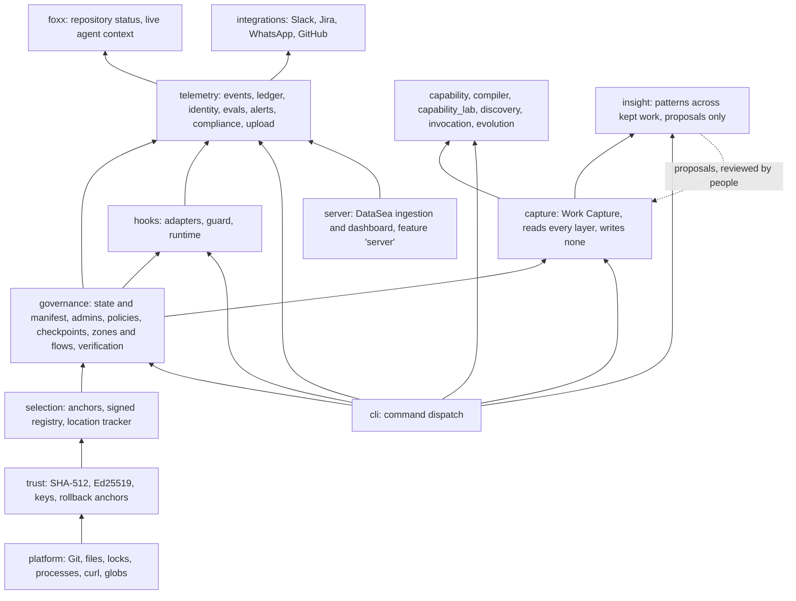
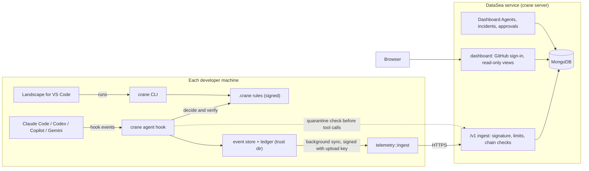
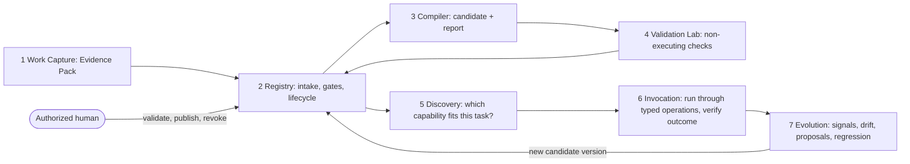
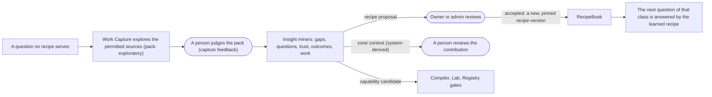

# Landscape of Agents: Product and Technical Overview

This document describes everything that exists in this repository today: what the product is, why
it is built the way it is, every concept it introduces, how each part works inside, how the parts
connect, what is live and what is still a demonstration, and where the honest limits are. It is
written to be read start to finish by someone who has never seen the project, and to be handed to
anyone (or any tool) that needs a complete picture of the current state.

- **Version described:** Crane `0.4.28` ([Cargo.toml](../../Cargo.toml)), Landscape for VS Code `0.4.4`
  ([extensions/foxx/package.json](../../extensions/foxx/package.json)).
- **Related documents:** the [README](../../README.md) (the vision in one page), the
  [GUIDE](../surfaces/cli.md) (every command and setting), [DASHBOARD.md](../../DASHBOARD.md) (the complete event
  specification), [SECURITY.md](../../SECURITY.md) (the threat model), and
  [CONTRIBUTING.md](../../CONTRIBUTING.md) (how to build and test).

---

## Contents

1. [The product in one page](#1-the-product-in-one-page)
2. [The problem and the insight behind the product](#2-the-problem-and-the-insight-behind-the-product)
3. [What exists today: the four surfaces](#3-what-exists-today-the-four-surfaces)
4. [A day with the product: one story from start to finish](#4-a-day-with-the-product-one-story-from-start-to-finish)
5. [Vocabulary: every term, defined](#5-vocabulary-every-term-defined)
6. [Architecture](#6-architecture)
7. [How it works inside: the governance core](#7-how-it-works-inside-the-governance-core)
8. [How it works inside: runtime enforcement](#8-how-it-works-inside-runtime-enforcement)
9. [How it works inside: evidence, telemetry, and the hosted service](#9-how-it-works-inside-evidence-telemetry-and-the-hosted-service)
10. [The Landscape editor extension](#10-the-landscape-editor-extension)
11. [The Capability Compiler: learning reusable skills from verified work](#11-the-capability-compiler-learning-reusable-skills-from-verified-work)
12. [Every state machine in one place](#12-every-state-machine-in-one-place)
13. [Where data lives](#13-where-data-lives)
14. [Quality, testing, release, and deployment](#14-quality-testing-release-and-deployment)
15. [What is real, what is a demonstration, and known limitations](#15-what-is-real-what-is-a-demonstration-and-known-limitations)
16. [What the product measures, and why it matters to a business](#16-what-the-product-measures-and-why-it-matters-to-a-business)

---

## 1. The product in one page

**Landscape of Agents** is a set of guardrails, context, and evidence for AI coding agents such as
Claude Code, Codex, GitHub Copilot CLI, and Gemini CLI. It sits between those agents and the code
they change, and it does three things:

| Idea | What it means in practice |
|---|---|
| **Richer context** | Code that matters carries signed guidance. The moment an agent touches it, the agent is told what it needs to know, so it stops guessing and stops spending tokens rediscovering the same constraints. |
| **Better guardrails** | Rules are written in a small language, **AgentScript**, and cryptographically signed by people. Every tool call an agent makes is checked *before* it runs and verified *after* it runs, against the real files on disk, not against what the agent says it did. |
| **Stronger observability** | Every decision becomes tamper-evident evidence. A hosted dashboard shows, for one developer or a whole organization, which agent did what, what was refused and why, what it cost, and whether the evidence chain is intact. |

On top of that foundation, the repository contains a seven-stage pipeline, the **Capability
Compiler**, that turns *verified* completed work into reusable, governed procedures ("capabilities")
an organization can safely give back to agents.

The product is delivered through four surfaces:

1. **Crane**, the command-line program (written in Rust), which is the rule-maker, the referee in the
   agent's hooks, and the evidence recorder.
2. **Landscape for VS Code**, the editor extension, for marking code, drawing zones and flows, and
   watching what context agents receive.
3. **The DataSea dashboard and ingestion service**, a hosted service where evidence from every
   teammate's machine is collected and shown.
4. **The landing page** at [agentslandscape.cloud](https://agentslandscape.cloud), which shows releases and
   collects feedback.

---

## 2. The problem and the insight behind the product

### 2.1 The problem

AI agents now read, write, and run code faster than anyone can review it. They are capable, but:

- **They work from whatever context they happen to see.** The fact that "the fee calculation is
  audited and must never change" lives in someone's head or a wiki page the agent never opens.
- **A prompt is a request, not a rule.** Telling an agent "do not touch payments" is advice. Nothing
  stops it, and nothing records whether it complied.
- **Their claims are not evidence.** An agent saying "tests pass, done" is not proof that tests ran.
- **When something goes wrong, nobody can reconstruct what happened.** Which agent, which session,
  which tool call, under which rules?

The familiar results are wasted tokens, confident changes to code that should never move (the
README calls this "AI psychosis"), and incidents nobody can explain afterwards.

### 2.2 The insight

The product rests on a handful of principles that appear in every part of the code. Understanding
them makes the rest of this document predictable.

1. **Rules are signed, not prompted.** Authority comes from a signature by a trusted person's key,
   never from text an agent can read or write. If the rules are edited without a signature, the
   system stops agent changes until a human signs again.
2. **Decide from the real state, never from the agent's claims.** A proposed file edit is *simulated*
   on the file's actual current text before it is allowed. After a tool runs, the actual files are
   re-checked.
3. **Fail closed.** Whenever Crane cannot decide (unreadable rules, a broken signature, a malformed
   marker, an error in the hook), the answer is "deny", never "allow".
4. **Only people change the rules.** No `crane` command runs inside an agent session, and the hooks
   deny any agent shell command or script that invokes `crane`.
5. **Unknown is not zero, and absence is not success.** A missing measurement is shown as
   "unmeasured", never as 0. A missing test report means "unknown", never "tests failed" and never
   "tests passed".
6. **Restrictions only add up.** Zones and flows can only make things stricter. Where several
   overlap, the strictest wins.
7. **Local evidence is authoritative; the hosted service is for visibility.** Enforcement never waits
   for the network. Uploads happen in the background.
8. **Learning is gated by people.** The capability pipeline may observe, propose, and check, but only
   an authorized human can publish what agents will be allowed to reuse.

---

## 3. What exists today: the four surfaces

| Surface | What a person does with it | Where it lives | Status |
|---|---|---|---|
| **Crane CLI** | Set up a repository, sign rules, protect and target code, define zones and flows, install agent hooks, validate and test policies, run Work Capture and the capability pipeline | [src/](../../src) | Live, released for Linux, Windows, macOS |
| **Crane hooks** (part of the CLI) | Nothing; they run automatically on every agent action | [src/hooks/](../../src/hooks) | Live for Claude Code, Codex, Copilot CLI, Gemini CLI, plus a generic profile |
| **Landscape for VS Code** | Do all of the above from the editor; see the governance graph; see live agent context next to the code | [extensions/foxx/](../../extensions/foxx) | Live on the VS Code Marketplace (`agentscript.foxx`) and Open VSX |
| **DataSea service and dashboard** | Sign in with GitHub, see every teammate's agents, decisions, incidents, tokens, compliance; configure Dashboard Agents; approve quarantines and links | [src/server/](../../src/server) (`crane server`, cargo feature `server`) | Live, hosted on Render with MongoDB |
| **Landing page** | Download releases, send feedback | [landing/](../../landing) | Static site (Render Blueprint in [render.yaml](../../render.yaml)) |
| **Capability Compiler** (components 1–7) | Investigate work, compile, validate, discover, invoke, and evolve capabilities | [src/capture/](../../src/capture), [src/capability/](../../src/capability), [src/compiler/](../../src/compiler), [src/capability_lab/](../../src/capability_lab), [src/discovery/](../../src/discovery), [src/invocation/](../../src/invocation), [src/evolution/](../../src/evolution) | Fully implemented and tested logic; most external connectors are deterministic fixtures (see §15) |
| **Insight** (component 8) | See patterns across all kept work (evidence gaps, unanswered questions, trust, outcomes, recurring agent work) and turn them into proposals people review | [src/insight/](../../src/insight) | Implemented and tested over Work Capture's store (see §11.5) |

A note on names, because several exist for historical reasons:

| Visible name | Internal name kept in code | Why it is kept |
|---|---|---|
| Landscape of Agents (the product and organization) | repository `Landscape`, org `Landscape-Of-Agents` | — |
| Crane (the CLI) | `crane` | — |
| Landscape (the VS Code extension) | `foxx` (folder, command ids, Marketplace id `agentscript.foxx`) | Renaming ids would break installed extensions |
| DataSea (dashboard and event store) | MongoDB database `foxx` | Renaming would orphan stored data |
| AgentScript (the policy language) | `.crane` files | — |

---

## 4. A day with the product: one story from start to finish

This story is used throughout the document. Each step names the part of the system that handles it.

1. **The owner sets up the repository.** Priya runs `crane repo --https https://github.com/acme/payments`
   to connect the clone to GitHub ([src/github/](../../src/github)), then `crane init`. Crane creates
   the `.crane/` folder and Priya's **signing key** in her **trust directory** (`~/.crane-trust`),
   outside the repository ([src/cli/governance/init.rs](../../src/cli/governance/init.rs)). She is now
   the **owner**. She runs `crane checkpoint baseline` to record the current commit as trusted.
2. **She protects the fee rule.** `crane protect app/payments.py start-line 12 end-line 30 context
   "Fees are audited; keep the rate."` Crane checks those lines are unchanged since the checkpoint,
   inserts two comment **anchors** around them, gives the block an 8-character **identifier** such as
   `K7M2P9RX`, adds `preserve K7M2P9RX;` to a policy, and signs a **selection record**
   ([src/selection/create.rs](../../src/selection/create.rs)).
3. **She marks the refund code for rewriting.** `crane target app/refunds.py start-line 5 end-line 18
   change_type logical_bn context "Refunds must be partial-aware."` The policy now says the agent
   *must* change that business logic.
4. **She draws a zone.** In VS Code she selects `app/payments/**`, opens Landscape, and makes it a
   **zone** `payment-core` with criticality `critical` and autonomy ceiling `assisted`. Landscape
   writes `.crane/governance.yaml` and runs `crane governance sign`
   ([src/cli/governance/zones.rs](../../src/cli/governance/zones.rs)).
5. **She installs the hooks.** `crane agent install --profile claude` registers Crane in Claude Code's
   hook configuration ([src/hooks/install.rs](../../src/hooks/install.rs)).
6. **A teammate joins.** Ravi clones the repository and runs `crane init`. Crane shows Priya's key
   fingerprint and asks Ravi to compare it with Priya's `crane admin list`. He confirms, and his
   machine now trusts the rules. He runs `crane agent link` and approves the link on the dashboard,
   so his machine's uploads are attributed to his GitHub account.
7. **An agent works.** Ravi asks Claude Code to "make refunds partial-aware".
   - At **session start**, Crane grants the session 100 **autonomy credits**, attests the starting
     state, and gives the agent the policy context ([src/hooks/runtime/session.rs](../../src/hooks/runtime/session.rs)).
   - The agent edits `app/refunds.py`. **Before** the edit runs, Crane simulates it, sees it
     changes the *targeted* block (allowed) and not the preserved one, notes the file is in zone
     `payment-core` whose ceiling is `assisted`, and answers **"ask a human"**. Ravi approves. Credits
     are reserved ([src/hooks/enforce.rs](../../src/hooks/enforce.rs), [src/hooks/runtime/tools.rs](../../src/hooks/runtime/tools.rs)).
   - The agent then tries to "tidy up" the fee calculation. The simulation shows the edit would
     change preserved block `K7M2P9RX`. **Denied**, and the agent is told why and shown the context
     "Fees are audited; keep the rate."
   - The agent tries `sed -i` on `app/payments.py` through the shell. Shell analysis sees a
     mutating command on a file holding preserved selections. **Denied.**
   - **After** each tool call, Crane re-checks protected blocks on disk. Everything is intact.
   - At **stop**, Crane reconciles every change of the session. At **session end**, it attests the
     final state.
8. **Evidence flows.** Every step above was written as a hash-chained **event** on Ravi's machine and
   uploaded in the background, signed with his machine's **upload key**
   ([src/telemetry/ingest.rs](../../src/telemetry/ingest.rs)).
9. **The team looks.** On the dashboard, Priya sees Ravi's session, the two denials, the approval,
   tokens per tool call, the credit balance, and compliance posture ([src/server/dashboard/](../../src/server/dashboard)).
10. **A monitor fires.** A **Dashboard Agent** Priya configured ("more than 3 denials in zone
    payment-core within 30 minutes") opens an **incident**. Priya requests a **quarantine** of that
    session, confirms through GitHub that she administers the repository, and from then on every
    tool call in that session is denied.
11. **The work becomes knowledge.** Later, Work Capture investigates the change and produces an
    **Evidence Pack** showing CI passed but no test report exists. The capability pipeline can turn
    the verified parts of this work into a reusable *candidate* procedure, which stays a candidate
    until an authorized human validates and publishes it (§11).

---

## 5. Vocabulary: every term, defined

The terms are grouped by area, in roughly the order you meet them.

### 5.1 Repository and trust

- **Repository identity.** A SHA-512 digest of the repository's root commits and its normalized
  origin remote ([src/governance/workspace.rs](../../src/governance/workspace.rs)). It is the same for SSH
  and HTTPS spellings, and everything Crane signs is bound to it, so signed rules cannot be copied into
  another repository.
- **`.crane/` directory.** Committed with the code. It holds the rules: policies, the selection
  registry, checkpoints, configuration, `governance.yaml`, context bindings, the audit chain, and the
  signed manifest. It is treated as **untrusted until its signatures verify**.
- **Trust directory.** `CRANE_HOME`, by default `~/.crane-trust`, *outside every repository*
  ([src/trust/mod.rs](../../src/trust/mod.rs)). It holds signing keys, pinned trusted keys, rollback anchors,
  integration secrets, alert rules, and the runtime evidence. Agents are refused access to it.
- **Signing key.** An Ed25519 key that signs the rules. At rest it is sealed: with the Windows Data
  Protection API by default on Windows, or with a passphrase (Argon2id + XChaCha20-Poly1305) typed on
  the console for each signing command when `CRANE_KEY_PROTECTION=prompt`. The hooks never unseal it
  ([src/trust/keys.rs](../../src/trust/keys.rs)).
- **Upload key.** A separate Ed25519 key per machine (`installation.key`), created automatically, used
  only to sign uploads to the hosted service. It grants no authority over rules.
- **Owner.** The key that ran `crane init` first in a repository.
- **Admin.** Another key the owner lists in a signed **admin statement**. Admins may sign rules.
  Every change to the list raises an **epoch**, and machines reject an older list, so a removed admin
  cannot restore a list that still names them ([src/governance/admins.rs](../../src/governance/admins.rs)).
- **Manifest.** A signed document covering, by digest, every piece of governance state: the
  selection registry, checkpoints, configuration, context bindings, `governance.yaml`, and the audit
  chain head ([src/governance/state.rs](../../src/governance/state.rs)). Each change produces a new
  manifest whose **generation** is one higher.
- **Rollback anchor.** The highest manifest generation this machine has seen, kept in the trust
  directory. A `.crane/` folder with an older generation is a rollback and is rejected.
- **Rebind.** Proving that a repository moved (transfer or rename) and re-signing its rules for the
  new identity: `crane repo rebind OLD_REMOTE` ([src/governance/rebind.rs](../../src/governance/rebind.rs)).

### 5.2 Selections and policies

- **Checkpoint.** A trusted baseline: a recorded Git commit. Checkpoints form an insert-only,
  hash-chained list ([src/governance/checkpoints.rs](../../src/governance/checkpoints.rs)).
- **Selection.** A block of lines a person chose to govern. It has an 8-character **identifier** (a
  lookup key only, not an authority) and a signed **selection record** in `.crane/registry.json`
  ([src/selection/registry.rs](../../src/selection/registry.rs)).
- **Anchor (marker).** The two comment lines Crane inserts around a selection, in the file's own
  comment syntax ([src/selection/anchors.rs](../../src/selection/anchors.rs)). Anchors move with the code.
  Malformed, duplicated, unmatched, or unregistered markers are reported, never trusted.
- **The three digests of a selection record.** (1) The *content digest* of the exact selected bytes;
  (2) the *origin-binding digest* of repository identity, checkpoint, blob, original path and range,
  and content; (3) the *record digest* of the record's canonical JSON, which is what gets signed.
- **Location tracker.** Finds where each selection is now, through edits above or below it and file
  renames, without changing its identifier ([src/selection/tracker.rs](../../src/selection/tracker.rs)). A
  selection that cannot be found unambiguously is **UNRESOLVED**, which fails closed.
- **AgentScript.** The policy language, in `.crane/policies/*.crane`
  ([src/governance/policy.rs](../../src/governance/policy.rs)):

  ```text
  policy payments {
      preserve K7M2P9RX;                         // agents may not change it
      target   4QZ8M2LD change_type logical_bn;  // agents must rewrite it, with this kind of change
  }
  ```

  A policy passes only if every command in it passes.
- **Preserve.** The selection must stay exactly as it was at the checkpoint.
- **Target.** The selection must be changed, and the change must be of a stated **change type**:
  `logical_bn` (business logic), `logical_cn` (loops or branches), `logical_sn` (structure), or
  `semantic` (names or comments). Whitespace-only changes never satisfy a target.
- **Change classification.** How Crane measures what kind of change happened. The before and after
  text are lexed into identifiers, literals, operators, and punctuation (comments separated), then
  compared on deterministic features: whitespace, comments, business tokens (literals, operators,
  called names), complexity (loop and branch keywords), and shape (the token stream with identifiers
  numbered by first appearance, so a consistent rename keeps the shape). Crane measures; it does not
  judge intent ([src/governance/changes.rs](../../src/governance/changes.rs)).
- **Policy context.** A text file bound to a policy and given to the agent when a session starts.
  Context is guidance, never authorization ([src/governance/context.rs](../../src/governance/context.rs)).

### 5.3 Zones, flows, and context packs (the "Landscape")

Defined in `.crane/governance.yaml` ([src/governance/zones.rs](../../src/governance/zones.rs)):

- **Zone.** A persistent governance boundary over repository resources: paths (globs), files,
  directories, symbols, selections, or exact source blocks between `@crane:zone:ID:start` and
  `@crane:zone:ID:end` markers.
- **Flow.** An execution path: entry points (such as `app/service.py:submit`) and the functions they
  call, discovered by a lexical, language-aware call graph whose every edge is marked **inferred**
  ([src/governance/flows.rs](../../src/governance/flows.rs)). A flow can also be an ordered sequence of zones,
  called its **stages**.
- **Context pack.** Reusable, versioned guidance attached to zones and flows. Every flow must have
  context, or signing is refused.
- **Criticality.** `routine`, `sensitive`, `critical`, or `restricted`. It adds credit cost per edit
  (sensitive +1, critical +3, restricted +5), and restricted code always needs a human.
- **Autonomy ceiling.** The most autonomy an agent may have inside the entity: `observe` (no
  changes), `assisted` (every change needs approval), `delegated` (changes allowed within policy), or
  `autonomous` (no stricter than delegated in 0.4).
- **Overlap rule.** Where several zones and flows cover the same code, the strictest ceiling and the
  highest criticality apply. Restructuring the repository can never broaden authority.
- **Status.** Only entities with status `active` are enforced. `proposed` ones are shown for review.
- **Governance graph.** Zones, flows (with stages in order), and selections (nested under their
  parent) as a directed acyclic graph, plus which agents recently acted in each
  ([src/governance/graph.rs](../../src/governance/graph.rs)). An edge that would close a cycle is left out
  and reported.

> **Two meanings of "flow".** In this document a *flow* (lowercase, as above) is a governance flow in
> `governance.yaml`. The event specification also numbers its scenarios **F00–F36** and calls them
> "flows" (for example *F05: before each tool call*). Those are always written with their number.

### 5.4 Agents at runtime

- **Hook.** A program an agent tool runs at fixed lifecycle points. Crane's single hook entry point is
  `crane agent hook --event EVENT --profile PROFILE` ([src/hooks/runtime/mod.rs](../../src/hooks/runtime/mod.rs)).
  The events are `SESSION_START`, `PROMPT_SUBMIT`, `PRE_TOOL_USE`, `PERMISSION_REQUEST`,
  `POST_TOOL_USE`, `STOP`, and `SESSION_END`.
- **Adapter.** Translates one agent tool's hook payloads into **provider-neutral actions**, and
  renders Crane's answer in that tool's protocol. It makes no decisions
  ([src/hooks/adapter/](../../src/hooks/adapter): `claude.rs`, `codex.rs`, `copilot.rs`, `gemini.rs`).
- **Guard.** The provider-neutral decision engine ([src/hooks/enforce.rs](../../src/hooks/enforce.rs)).
- **Session, task, agent identifiers.** Crane issues its own identifiers (`ses_…`, `tsk_…`,
  `agt_…`, `ins_…`), derived deterministically so every hook process of one session maps to the same
  records. Identifiers the provider reports are stored beside them with their **provenance**
  (`PROVIDER`, `ENVIRONMENT`, `GENERATED`) and never overwritten ([src/telemetry/identity.rs](../../src/telemetry/identity.rs)).
- **Autonomy mode.** The session's mode: `observe`, `assisted`, `delegated` (default), or
  `autonomous`. It can only make decisions stricter.
- **Autonomy credits.** A budget of *risk-bearing authority*, kept apart from tokens and money. By
  default a session gets 100 credits for 8 hours, with an alert at 20. Default costs: read 0, write 2,
  writing a file that holds selections +3, running a shell command 3, network +5, any other tool 2,
  and 10 revoked as a penalty after a violation ([src/governance/config.rs](../../src/governance/config.rs)).
  A balance never grants permission or overrides a denial. An empty balance only turns an allowed
  action into "ask a human".
- **Safety state.** `ACTIVE` (normal), `DEGRADED` (a violation was detected after a file edit, so
  mutating actions need approval), or `QUARANTINED` (a confirmed bypass or repeated attempts against
  Crane, so mutating actions are denied).

### 5.5 Decisions and how facts are known

These vocabularies are deliberately separate, so a denied attack is never confused with a breach
([src/telemetry/model.rs](../../src/telemetry/model.rs)):

| Vocabulary | Question it answers | Values |
|---|---|---|
| **Decision** | What did Crane allow? | `ALLOW`, `REQUIRE_APPROVAL`, `DENY`, `QUARANTINE`, `ERROR` |
| **Execution outcome** | What happened when it ran? | `SUCCESS`, `FAILURE`, `PARTIAL`, `UNKNOWN` |
| **Assessment** | Did it comply? | `COMPLIANT`, `VIOLATION`, `SUSPICIOUS`, `UNRESOLVED` |
| **Enforcement outcome** | How did the control perform? | `PREVENTED`, `DETECTED_AFTER_EFFECT`, `BYPASS_CONFIRMED`, `COVERAGE_GAP`, `NOT_APPLICABLE` |
| **Known as** | How is this fact known? | `OBSERVED`, `INFERRED`, `ESTIMATED`, `UNSUPPORTED`, `REDACTED`, `UNOBSERVED`, `LOST` |

- **Bypass.** A protected resource changed *without* passing through the enforcement boundary, for
  example a shell command that rewrote a preserved block. It is detected after the effect and
  quarantines the session.
- **Coverage gap.** An action that could not be observed or decided, reported as such, never as
  "fine".

### 5.6 Evidence and the hosted service

- **Event.** One recorded fact with a versioned envelope and 13 attribute groups (action, repository,
  session, agent, resource, response, assessment, decision, eval, severity, bindings, telemetry,
  other), fully specified in [DASHBOARD.md](../../DASHBOARD.md).
- **Event chain.** Each event on a machine stores the digest of the previous one, so an edited,
  removed, or reordered event breaks the chain ([src/telemetry/events.rs](../../src/telemetry/events.rs)).
- **Ledger.** The append-only, hash-chained record of credit movements (grant, reserve, consume,
  release, revoke, expire) with balances before and after and an idempotency key
  ([src/telemetry/ledger.rs](../../src/telemetry/ledger.rs)).
- **Eval.** A number shown on the dashboard, computed only from events. A number with no events
  behind it is `null`, never zero ([src/telemetry/evals.rs](../../src/telemetry/evals.rs)).
- **Severity.** `INFO`, `LOW`, `MEDIUM`, `HIGH`, `CRITICAL`, assigned by four rules: failure streak,
  outcome, threshold, or fixed.
- **DataSea.** The name for the evidence store: locally, the event store in the trust directory's
  runtime folder; remotely, the MongoDB collections behind the hosted service.
- **Installation.** One machine, identified by the public half of its upload key.
- **Dashboard Agent.** A repository-scoped monitor on the dashboard: a metric, a threshold, a lookback
  window, and assignments to zones, flows, or selections. When it fires, it opens an **incident**.
- **Quarantine (remote).** An admin-approved rule on the service that makes local hooks deny matching
  tool calls (by provider agent id, Crane session id, or exact tool name within a session).

### 5.7 The capability pipeline

- **Work episode.** One unit of work (usually one task) that evidence is collected for.
- **Evidence Pack.** The bounded, integrity-sealed answer of a Work Capture investigation:
  evidence excerpts, entities and relations, assertions with their supporting and contradicting
  evidence, missing evidence *and why it is missing*, warnings, and a digest manifest.
- **Assertion.** A claim such as `ci_passed` for a commit, with three-valued truth (`yes`, `no`,
  `unknown`) and the evidence on each side.
- **Capability.** A reusable, versioned, governed *description* of a procedure, with where it applies,
  what it depends on, its steps, and how its claims are verified. A capability is never executable by
  itself.
- **Candidate / validated / published.** The lifecycle stages of a capability version (§11.3).
- **Intake.** The traceable handoff from an Evidence Pack to the capability registry.
- **Lab report, discovery report, invocation record, evolution signal.** The records produced by
  components 4, 5, 6, and 7 (§11).

---

## 6. Architecture

### 6.1 The layers

Crane is one Rust binary built in layers. Each layer may use the ones below it, never the ones above
([src/main.rs](../../src/main.rs)):



### 6.2 The system across machines



### 6.3 Repository map

| Path | Responsibility | Read first |
|---|---|---|
| [src/platform/](../../src/platform) | Git without a shell, atomic files and locks, time-limited processes, curl configured on stdin, globs | `git.rs`, `files.rs` |
| [src/trust/](../../src/trust) | Digests, signatures, key storage | `crypto.rs`, `keys.rs` |
| [src/selection/](../../src/selection) | Anchors, the signed registry, tracking, creation | `create.rs`, `registry.rs` |
| [src/governance/](../../src/governance) | State, manifest, admins, policies, change classification, zones and flows, verification, rebind | `state.rs`, `verify.rs`, `zones.rs` |
| [src/hooks/](../../src/hooks) | Adapters, guard, shell and script analysis, runtime | `enforce.rs`, `runtime/tools.rs` |
| [src/telemetry/](../../src/telemetry) | Events, specification projection, identity, ledger, evals, alerts, rules, compliance, redaction, upload | `events.rs`, `spec.rs`, `ingest.rs` |
| [src/foxx/](../../src/foxx) | Repository status upload, live agent context for the editor, task and session views | `live.rs`, `status.rs` |
| [src/integrations/](../../src/integrations) | Slack, Jira, WhatsApp, GitHub providers | `mod.rs` |
| [src/github/](../../src/github) | The repository connection and granted read privileges | `mod.rs` |
| [src/cli/](../../src/cli) | Command dispatch and command audit | `mod.rs` |
| [src/server/](../../src/server) | The hosted service: signed ingest, limits, store, dashboard | `mod.rs`, `ingest.rs`, `dashboard/mod.rs` |
| [src/capture/](../../src/capture) … [src/evolution/](../../src/evolution) | Capability Compiler components 1–7 | each `mod.rs` |
| [src/insight/](../../src/insight) | Insight (component 8): read model, miners, proposals, kept reports | `mod.rs`, `miners.rs` |
| [extensions/foxx/](../../extensions/foxx) | Landscape for VS Code (TypeScript) | `src/extension.ts` |
| [landing/](../../landing) | Landing page | `public/index.html` |
| [tests/](../../tests) | End-to-end tests across commands, hooks, and the service | `common/mod.rs` |

---

## 7. How it works inside: the governance core

### 7.1 Every rule change goes through one door

Every command that changes governance (`init`, `checkpoint`, `protect`, `target`, defaults, policy
moves, context bindings) goes through one function, `commit()` in
[src/governance/state.rs](../../src/governance/state.rs). Its algorithm:

1. **Verify the current state first.** If the existing rules do not verify, nothing new is signed on
   top of them.
2. **Apply the change.**
3. **Append an audit entry** to `.crane/audit.jsonl`, a hash-chained, append-only trail
   ([src/governance/audit.rs](../../src/governance/audit.rs)).
4. **Sign a new manifest** covering every governance file by digest, with generation + 1.
5. **Update this machine's rollback anchor.**

Because the manifest covers everything and the rollback anchor remembers the latest generation,
`integrity()` can detect four kinds of tampering: **modification** (a digest no longer matches),
**deletion** (a covered file is missing), **rollback** (an older generation than this machine has
seen), and **fork** (two different states claiming the same generation).

### 7.2 Creating a selection

`crane protect` and `crane target` run [src/selection/create.rs](../../src/selection/create.rs):

1. Take the line range the person gave. **This is the only time a line number is ever used.**
2. Resolve it against the trusted checkpoint with a line diff (Myers' algorithm,
   [src/governance/diff.rs](../../src/governance/diff.rs)) that ignores existing anchors. **Every selected
   line must be unchanged since the checkpoint**, so nobody can protect code that was already
   tampered with.
3. Generate a unique 8-character identifier.
4. Insert the two anchor comments around the range.
5. Append the `preserve` or `target` command to the policy.
6. Build the selection record with its three digests and sign it through `commit()`.
7. If any step fails, restore the source and policy files. Source files only ever change by the two
   inserted comment lines.

### 7.3 Verifying the rules

[src/governance/verify.rs](../../src/governance/verify.rs) is shared by `crane validate`, `crane test`,
`crane policy NAME status`, and the runtime hooks. It never trusts a single source:

1. Verify the signed state (§7.1).
2. Check that policy commands agree with the signed registry: an identifier in a policy must name a
   signed record.
3. Resolve every selection from the anchors in the working tree (the location tracker). A selection
   that does not resolve **fails closed**.
4. Judge each command from the actual file content against the checkpoint baseline:
   - `preserve`: the content digest must match the signed one.
   - `target`: the content must have changed, and the change classification (§5.2) must show the
     declared change type.
5. A policy passes only if every one of its commands passes.

`crane test .` additionally runs optional smoke-test commands from `.crane/config.json`, each with a
time limit, and an enforcement self-test.

### 7.4 Zones and flows

- An admin edits `.crane/governance.yaml` (directly or through Landscape), then runs
  `crane governance sign`. Until it is signed, an edited file **fails verification and agent changes
  stop**, so nobody can loosen a zone unnoticed.
- Source markers (`@crane:zone:ID:start` / `:end`) must resolve to a declared entity, occur once as a
  matching pair, and nest properly. The blocks present at signing are recorded. A block added,
  removed, or moved afterwards fails validation. Agents can never edit a marker.
- Flow discovery builds an index of function definitions and calls. A call matching no definition is
  external or dynamic; a call matching several is ambiguous and not followed (unless exactly one is in
  the caller's own file); files in unsupported languages are counted as not analyzed. **Nothing is
  fabricated to make a graph look complete.**
- On every tool call that reaches an active zone, flow, or selection, its guidance is sent to the
  agent and shown in the agent window and in the editor.

### 7.5 Teams

- **Joining:** a teammate's `crane init` shows the owner key fingerprint and asks for confirmation.
  Until confirmed, rules cannot be verified and agent changes are blocked. CI can trust the owner
  without a prompt through `CRANE_TRUSTED_PUBLIC_KEYS`.
- **GitHub vouches for the owner key:** `crane admin register` leaves a request with a one-time code;
  a GitHub admin of the repository confirms it on the dashboard; teammates then see "confirmed by
  @admin".
- **Concurrent rule changes:** if two admins change the rules on different branches, Git conflicts in
  `.crane`. One side is kept for the whole directory, `crane init` accepts that signed state, and the
  other change is re-applied with Crane.

---

## 8. How it works inside: runtime enforcement

### 8.1 The hook lifecycle

```mermaid
sequenceDiagram
  participant A as Agent tool
  participant H as crane agent hook
  participant G as Guard + rules
  participant E as Event store + ledger
  A->>H: SESSION_START
  H->>G: verify rules, attest starting state
  H->>E: grant credits, record session start
  H-->>A: policy context for the agent
  A->>H: PROMPT_SUBMIT
  H->>E: record (prompt not stored; suspicious prompts flagged)
  loop every tool call
    A->>H: PRE_TOOL_USE (proposed action)
    H->>G: decide (see 8.2)
    H->>E: decision event, reserve credits
    H-->>A: allow / ask a human / deny with reason and context
    A->>H: POST_TOOL_USE (what ran)
    H->>G: verify actual effects (see 8.3)
    H->>E: verification event, consume or release credits
  end
  A->>H: STOP
  H->>G: reconcile every change of the session
  A->>H: SESSION_END
  H->>E: attest end state, expire credits
```

### 8.2 The decision before a tool call

For every proposed action, the adapter produces a provider-neutral action
([src/hooks/action.rs](../../src/hooks/action.rs)), and the guard applies these checks **in order**
(DASHBOARD.md F05; [src/hooks/enforce.rs](../../src/hooks/enforce.rs)):

1. **Integrity.** The rules must verify. If not: deny (`INTEGRITY_FAILED`).
2. **Safety state.** A quarantined session's mutating actions are denied, and a degraded session's
   need approval. The service's active quarantines are checked too.
3. **Protection of Crane's own files.** Writing `.crane/`, the trust directory, or the agent tool's
   hook settings is denied. These denials are **final even if the agent asks for approval**.
4. **Shell command analysis** ([src/hooks/shell.rs](../../src/hooks/shell.rs)). A command that names
   protected metadata, runs any `crane` command, or mutates a file holding preserved selections is
   denied. Analysis is lexical and conservative: it reports what a command *names*, not what it would
   do.
5. **Script pre-check** ([src/hooks/scripts.rs](../../src/hooks/scripts.rs)). Before `python x.py`,
   `node -e …`, `bash x.sh`, `npm run NAME` and similar run, Crane reads the code and looks for the
   clearly dangerous: naming Crane's files, changing preserved files, running downloaded or decoded
   code, encoded PowerShell, reading secrets while using the network, rewriting Git history, deleting
   whole trees. The worst are denied; the risky need approval.
6. **Edit simulation.** A file edit is applied *in memory* to the file's current text. It is denied if
   it would change a preserved selection, or add, remove, or alter a marker.
7. **Zone and flow limits.** The strictest ceiling and highest criticality among the entities the
   action touches apply: `observe` denies, `assisted` and `restricted` ask a human.
8. **Autonomy mode.** The session mode can only make the result stricter.
9. **Credits.** The action's cost is computed. If the balance cannot cover it, an allowed action
   becomes "ask a human". Otherwise the credits are reserved.

The result is **allow**, **ask a human**, or **deny**, with a reason the agent is shown. If anything
fails while deciding, the answer is deny (`HOOK_ERROR`). Each decision event carries the same
tool-call id as the verification that follows it.

Actions whose effects cannot be known in advance (most shell commands, other tools) are allowed only
so that the *after* check can judge them.

### 8.3 The verification after a tool call

After the tool ran (DASHBOARD.md F06; [src/hooks/runtime/tools.rs](../../src/hooks/runtime/tools.rs)):

1. **Pair** the result with its decision, or record that there was none (a coverage gap).
2. **Charge or release credits:** consumed if it ran, released if it failed or never reported back.
3. **Attribute** the files a shell or other tool changed (working-tree diff).
4. **Re-check the protected blocks** on disk.
5. If a **file edit** produced a violation, the session becomes **degraded** and credits are revoked
   (enforcement `DETECTED_AFTER_EFFECT`).
6. If protected code changed through a **shell or other tool**, that is a **confirmed bypass**, and the
   session is **quarantined** (enforcement `BYPASS_CONFIRMED`, severity `CRITICAL`).
7. The agent is told to repair or restore.

### 8.4 Stop and end

At `STOP`, Crane reconciles every change of the session against the rules. At `SESSION_END`, it
attests the final state and expires unused credits. A session with no hook activity for 120 minutes
and no signed end is flagged as **stale** on the service: the agent was stopped, its hooks removed,
or its evidence is not arriving.

### 8.5 The limit, stated plainly

From [src/trust/mod.rs](../../src/trust/mod.rs): an agent with an unrestricted shell running as the same
operating-system user can read files that user can read. The hooks deny every tool call that *names*
the trust directory or `.crane`, and post-action verification catches changes, but only an execution
boundary that mediates all file access (a sandbox, a container, or a separate user) can guarantee
confidentiality of the trust directory. Passphrase key protection (`CRANE_KEY_PROTECTION=prompt`)
does stop such a process from *signing*, because nothing can answer the console prompt for it.

---

## 9. How it works inside: evidence, telemetry, and the hosted service

### 9.1 Events

Every hook phase and every Crane command produces events ([src/telemetry/events.rs](../../src/telemetry/events.rs)):

- The envelope holds `event_id`, `event_name`, the F-number flow, `occurred_at`, `schema_version`,
  `sequence`, `previous_digest`, `digest`, and `origin` (`MACHINE`, `SERVICE`, `DERIVED`, `WORKFLOW`).
- Each event is **projected** into its specification form with all 13 attribute groups when it is
  appended, so the specification view is covered by the event's own digest
  ([src/telemetry/spec.rs](../../src/telemetry/spec.rs)).
- Events are **redacted before they are written** ([src/telemetry/redact.rs](../../src/telemetry/redact.rs)):
  credentials, tokens, private keys, and password assignments become `[REDACTED:kind]`. Raw tool
  payloads and prompts are never stored at all.
- Events are deduplicated by idempotency key, so a retried hook cannot record twice.
- The 37 scenarios F00–F36 cover everything from dashboard sign-in (F00), setup (F01), and joining
  (F02) through session start (F03), prompts (F04), decisions (F05), verification (F06), stop (F07),
  end (F08), upload (F09), stale sessions (F10), hook failures (F11), tampering (F12), commands
  (F13), alerts (F14), up to credits (F27), the extension (F31), releases (F33), and agent network
  use (F36). See [DASHBOARD.md](../../DASHBOARD.md) for every event.

### 9.2 Token usage

Model token usage is read from the agent's own transcript when the provider supplies one (Claude Code
passes its path to every hook). Only the numbers are read: input, output, cache read, cache creation,
and the model name. A tool call is attributed an equal share of the turn that issued it. Providers
whose transcripts give nothing (Codex) are shown as **unmeasured**, never estimated
([src/telemetry/usage.rs](../../src/telemetry/usage.rs)).

### 9.3 Alerts and rules

- **Built-in alerts** ([src/telemetry/alerts.rs](../../src/telemetry/alerts.rs)): low credits, bypass
  attempts and confirmed bypasses, violations, quarantine, coverage gaps, failed verification,
  suspicious prompts. Each is deduplicated with a cooldown and delivered to Slack and WhatsApp when
  configured, by a detached `curl` that reads its URL and body from stdin, so credentials never appear
  in a command line. Delivery never changes a decision.
- **Custom rules** ([src/telemetry/rules.rs](../../src/telemetry/rules.rs)), made by a person with
  `crane alert add`: any eval, a comparison with a threshold over a time window, optional filters,
  and channels. Rules fire, remind after a cooldown while still firing, and resolve when the value
  returns. They live in the trust directory, out of an agent's reach.

### 9.4 Compliance evidence

[src/telemetry/compliance.rs](../../src/telemetry/compliance.rs) defines controls, each with an objective,
an enforcement rule, the required evidence, a verification method, and the F-flows its evidence comes
from. A control is evaluated only from evidence Crane actually holds:

- `SATISFIED` needs positive evidence;
- `PARTIAL` means partial coverage;
- `NO_EVIDENCE` means nothing proves it either way;
- `NOT_APPLICABLE` means there is nothing to apply it to (for example, no preserve rules defined).

Framework mappings (OWASP LLM and agentic guidance, NIST AI RMF, SOC 2, ISO/IEC 27001:2022, GDPR) show
which requirements the evidence *supports*; they are explicitly not certification. Network egress is
not a control, because hooks cannot observe it; it is reported as inferred observability.

### 9.5 Upload

[src/telemetry/sync.rs](../../src/telemetry/sync.rs) and [src/telemetry/ingest.rs](../../src/telemetry/ingest.rs):

- Data leaves the machine when it is complete: a tool call when it ends, a session when it ends, a
  command when it finishes, and everything else every 60 seconds.
- A sync runs as a **detached** `crane agent sync` process, so a hook never waits for the network
  and a slow or unreachable service never weakens enforcement.
- A sync first asks the service how far each local stream already reached it, then sends everything
  newer in batches: events, ledger entries, governance changes, alerts, sessions, tasks, selection
  records, the signed manifest, and every two minutes the **repository status** (policy results,
  integrity, compliance inputs, connection, non-secret integration settings,
  [src/foxx/status.rs](../../src/foxx/status.rs)).
- Every request is signed with the machine's upload key. `CRANE_INGEST_URL=off` keeps everything
  local.

### 9.6 The DataSea service

`crane server` ([src/server/mod.rs](../../src/server/mod.rs)) is the only component that holds database
credentials.

**Ingest (machines):**
- Every `/v1` request carries the installation's public key, a timestamp within five minutes, and a
  signature over method, path, timestamp, and body digest.
- The public key *is* the identity: every stored record is tagged with it, and an installation can
  only add to and read its own records. The only thing a machine may read back is the list of active
  quarantines for its hooks.
- The service checks that every upload **continues the machine's event chain** where it left off,
  and records a critical alert for a rewrite, a gap, or a fork.
- **Limits** ([src/server/limits.rs](../../src/server/limits.rs)) protect the shared database: 120
  requests a minute per machine, 2,000 records per kind per upload, 250,000 stored events and 50
  repositories per machine, and no uploads above 450 MB. A refused upload stays on the machine and is
  retried. Events are retained 30 days by default.

**Dashboard (people)** ([src/server/dashboard/](../../src/server/dashboard)):
- Sign-in with GitHub OAuth (scope `read:org`). The service keeps no GitHub token; it sets an
  eight-hour signed session cookie.
- A viewer sees a repository only if its **verified** remote is `github.com/OWNER/NAME` and `OWNER`
  is the viewer or one of their organizations. A repository appears only after an upload *proves* its
  remote, so nobody can attach uploads to someone else's repository.
- Evidence views read MongoDB through a **read-only handle** that cannot insert, update, or delete,
  and pipelines that would write are refused ([src/server/dashboard/data.rs](../../src/server/dashboard/data.rs)).
- A repository's view merges every selected member's records. Each member's event chain and ledger
  are verified separately, then merged in time order.
- Pages: **Monitor** (overview, event explorer, timeline), **AI agents** (agents, tool calls,
  sessions, with a profile for each), **Investigate** (logs, traces, topology, distributions, texts),
  **Operate** (alerting, credits), **Govern** (audit trail, governance with zones, flows, and call
  graphs, compliance), **Organization** (repositories, settings), and **Dashboard Agents** with
  incidents. A global filter over any attribute (AND, OR groups, NOT) can be saved and shared as a
  link.
- **The only writes** are narrow and repository-scoped: GitHub-confirmed approvals (linking a machine
  to a person, confirming the owner key, granting credits), Dashboard Agent configuration and
  incidents, quarantine requests, and flow-context proposals ([src/server/dashboard/approve.rs](../../src/server/dashboard/approve.rs)).

**Dashboard Agents and incidents:**
1. A person configures a monitor: a metric (critical events, denials, prompt-injection signals,
   bypass attempts, tool failures, event volume), a threshold, a lookback window, and assignments.
2. The service evaluates enabled monitors after each successful upload and in a 60-second recovery
   sweep. A repository lease prevents duplicate work across service instances.
3. Crossing the threshold opens an incident (idempotently).
4. From an incident, a person can annotate, mitigate, request a quarantine, or propose incident
   context for a flow.
5. A **fresh GitHub check of repository-admin access** is required before a quarantine becomes active
   or is released, or before proposed flow context becomes visible to agents.
6. Local hooks query the service before every tool call. Matching calls are denied, and a service
   error also denies (unless uploads are switched off, in which case local rules still apply).
7. Notifications go to Slack and email (Resend) from the service. A missing or failed delivery is
   recorded as such, never as a successful send.

**Data for agents:** `GET /api/agent-context` returns compact, filtered event context (at most 500
events) in the `foxx-agent-context/v1` format, and `GET /api/events.csv` the same as CSV, both under
the viewer's own permissions.

**Clearing data:** `crane data clear` lets a human CODEOWNER (checked by the service against a direct
entry in the default branch's `CODEOWNERS`) permanently delete a repository's hosted records.

### 9.7 Integrations

`crane integrate slack|jira|whatsapp|github` stores non-secret settings in
`integrations/NAME.json` and credentials in `secrets/NAME.json` (owner-only) in the trust directory,
never in the repository, events, logs, or dashboard ([src/integrations/mod.rs](../../src/integrations/mod.rs)).
Security alerts go to Slack and WhatsApp, and to the Jira issue in `CRANE_TASK_ID`. A GitHub
workflow ([.github/workflows/pr-notify.yml](../../.github/workflows/pr-notify.yml)) posts pull-request
activity to Slack and comments on the Jira issue named in the PR.

---

## 10. The Landscape editor extension

Landscape for VS Code ([extensions/foxx/](../../extensions/foxx)) is the editor side of Crane. It talks
to Crane **only through the CLI** (`crane validate --json`, `crane test . --json`, `crane protect`,
…) and never reads the trust directory, keys, or secrets ([src/core/crane.ts](../../extensions/foxx/src/core/crane.ts)).
It is disabled in untrusted workspaces because it runs the CLI.

| Part | What it does | Source |
|---|---|---|
| **Panel** | Select code, press the fox icon (Ctrl+Alt+F), search for an action (preserve, target, zone, flow, context), see the explicit plan of every step, run it with a live timeline, then undo or open the file | [panel.ts](../../extensions/foxx/src/panel.ts) |
| **Sidebar** | Crane's status (and how to fix an unusable Crane), health counts, every selection with where it is and whether it passes, zones and flows, agents working in each, the most serious findings | [sidebar.ts](../../extensions/foxx/src/sidebar.ts) |
| **Governance graph** | Zones, flows, and selections on a canvas. Drag from one zone onto another to make it a flow's next stage; links that would create a cycle are refused while dragging, then checked again by Crane before signing | [graphView.ts](../../extensions/foxx/src/graphView.ts), [core/graph.ts](../../extensions/foxx/src/core/graph.ts) |
| **Governance editing** | Edits `governance.yaml` preserving comments and layout. New zones and flows start as `proposed`; every edit is previewed as a diff, validated, and signed by Crane, and reverted if that fails | [core/governance.ts](../../extensions/foxx/src/core/governance.ts) |
| **Diagnostics and CodeLens** | Validation findings and failing or unresolved policy commands appear in the editor. Decorations never modify source files | [extension.ts](../../extensions/foxx/src/extension.ts) |
| **Live agent context** | While an agent works in governed code, the context it received is highlighted next to that code, in the Overview, and in the status bar | [core/live.ts](../../extensions/foxx/src/core/live.ts), [src/foxx/live.rs](../../src/foxx/live.rs) |
| **Setup** | Connects the clone, runs `crane init`, and walks a joining teammate through confirming the owner key | [core/setup.ts](../../extensions/foxx/src/core/setup.ts) |

---

## 11. The Capability Compiler: learning reusable skills from verified work

### 11.1 Why it exists

Guardrails stop bad actions. They do not make agents better at good ones. Every time an agent solves
a problem, the knowledge of *how* is lost when the session ends. The Capability Compiler turns
*verified* completed work into **capabilities**: reusable, governed procedures that future agents can
be offered, with an exact record of where they apply and what evidence supports them.

The danger is obvious: if agents could teach themselves, they could also teach themselves the wrong
thing. So the pipeline is built around one rule: **every component may observe, propose, and check,
but only an authorized human publishes, and nothing ever executes what a capability describes
unless an explicitly registered, typed operation does it under checks.**

### 11.2 The loop



### 11.3 The seven components

**Component 1. Work Capture & Evidence Ingestion** ([src/capture/](../../src/capture)).
Collects evidence about one work episode from registered sources (Git, DataSea events, Landscape
zones and flows, Crane policies and validation; GitHub, CI, deployments, logs, and metrics through
fixtures today), using a versioned **Evidence Recipe** with branch conditions, required evidence,
and budgets. It normalizes and redacts every record, links records into an evidence graph with a
closed relation vocabulary (each edge marked observed, declared, inferred, or reviewed), derives
assertions (`ci_passed`, `tests_passed`, `deployment_succeeded`, `change_verified`) that keep
disagreeing evidence on both sides, and seals a bounded **Evidence Pack** with a digest manifest. Every
gap is reported with its reason: the source answered "nothing exists" (`empty`), the source broke
(`unavailable`), access was refused (`denied`), it was never asked (`not_queried`), or the answer could
not be read (`parse_failed`). Investigations can be **replayed** to see whether sources changed
(`exact`, `diverged`, `unverifiable`). Agents may only *propose* context, and accepting it takes a
different human. Commands: `crane capture demo|sources|investigate`.

**Component 2. Capability Model & Registry** ([src/capability/](../../src/capability)).
Defines the capability schema (provenance, applicability, dependencies, execution contract,
verification contract), accepts the **intake** from an Evidence Pack (recomputing the pack manifest,
resolving every reference under the submitter's access, comparing zone, flow, and policy versions with
the current ones), validates through six gates (structural, provenance, applicability, verification,
governance, publication), and stores immutable versions. Two validation profiles exist:
`conservative` (default) and `low-risk-technical`. Technical evidence (CI, tests, code) **never**
verifies a business invariant. Publishing needs a human holding the Publisher role who is not the
author. `crane capability stale` marks a validation stale when anything it rested on changed, which
removes the version from eligibility until revalidated.

Lifecycle:

| From | To |
|---|---|
| `candidate` | `needs_evidence`, `validating`, `rejected` |
| `needs_evidence` | `validating`, `rejected` |
| `validating` | `validated`, `needs_evidence`, `candidate`, `rejected` |
| `validated` | `published`, `validating`, `needs_evidence`, `deprecated`, `revoked`, `rejected` |
| `published` | `deprecated`, `revoked` |
| `deprecated` | `revoked` |

**Component 3. Capability Compiler** ([src/compiler/](../../src/compiler)).
Turns one completed episode into a capability *candidate* plus a separate compilation report. Steps
come only from observed records (tool calls, commits, CI runs, deployments); technical claims only
from supported Work Capture assertions; environments are exactly the observed ones; risk can be raised,
never lowered; model-proposed steps are accepted only if they cite readable evidence and stay labelled
as hypotheses. Every statement keeps its basis (`observed`, `declared`, `derived`, `inferred`,
`hypothesis`, `unknown`). **Event order is chronology, never causation**, and one episode never proves
applicability beyond what it observed. Outcomes: `candidate_generated`, `needs_more_evidence`,
`insufficient_reusable_signal`, `compilation_failed`, `compilation_blocked`.

**Component 4. Capability Validation Lab** ([src/capability_lab/](../../src/capability_lab)).
Deterministic, **non-executing** checks of one exact candidate version: preflight (digest, state,
matching compilation report, blocking gaps carried as `blocked`), conformance (every compiled step
re-derived from its cited record), scenarios from an approved typed test plan (`applicability`,
`stale_dependency`, `missing_evidence`, `negative_case`), and invariants (claims recomputed,
contradictions fail, stale dependencies fail, single-episode generalization stays inconclusive). Each
check is `passed`, `failed`, `not_run`, `blocked`, or `inconclusive`. A lab report changes no lifecycle
state; it is a record others can reference. A passing check proves only what it tested.

**Component 5. Capability Discovery & Applicability** ([src/discovery/](../../src/discovery)).
Given a task, finds published capabilities and explains every decision. Candidates pass fixed gates
in order (eligibility, validation currency checked live, exact applicability, zone and flow scope,
dependencies, lab reports), and only then are ranked. **Unknown is never a match**, and an empty
environment list means *no known environment*, never "everywhere". Outcomes: `recommended`,
`no_match`, `insufficient_context`, `blocked`. There is no semantic or fuzzy matching.

**Component 6. Capability Invocation & Outcome** ([src/invocation/](../../src/invocation)).
Invokes one exact, published version through **explicitly registered, typed operations** chosen by a
reviewed *binding set* (step → operation). Everything is rechecked immediately before execution.
Medium-or-higher risk and every state-changing operation need approval from another person, bound to
the plan digest. Uncertain effects move the invocation to `reconciliation_required` until checked
against the authoritative system. Only verified required postconditions make `succeeded`. It never
runs recorded tool calls, arbitrary commands, or model output. Lifecycle: `requested`, `authorizing`,
`preflighting`, `plan_ready`, `awaiting_approval`, `executing`, `verifying`, then `succeeded`,
`failed`, `partially_verified`, `unknown`, `blocked`, or `abandoned`.

**Component 7. Capability Evolution & Regression** ([src/evolution/](../../src/evolution)).
Reads invocation outcomes (read only), classifies them (`verified_success`,
`declared_success_unverified`, `failed_verification`, …), collapses retries and resubmissions into one
observation, partitions trials by comparable context, and detects signals (`repeated_failure`,
`verification_gap`, `dependency_drift`, …) using deterministic qualification rules (by default 3
independent trials, or 5 for high or unknown risk; at least 75% failures; no contradictions; context
must not explain the failures). A qualified signal yields a **minimal, typed change set**. Allowed:
documenting, tightening exclusions, adding an unresolved verification requirement, re-pinning a zone
or flow, raising risk. Always refused: editing a policy, lowering risk, removing a claim, broadening
scope, adding steps. The change set is stored as a new candidate version, checked for regressions
against its parent, and packaged as a review packet. It never publishes anything.

### 11.4 Shared design rules across the pipeline

- Every record is versioned and digested, and stores verify digests on load.
- Every store is a locked, atomically replaced document, so concurrent writers lose nothing and an
  interrupted write leaves the previous state intact.
- Identical inputs return the stored result (idempotency), and changed inputs create a new linked
  version.
- References point to records by identifier and version; nothing is copied or rewritten across
  components.
- Roles come from Crane's keys (owner or signed admin), never from what the caller claims. Agents can
  only contribute.

### 11.5 Insight: learning across work (component 8)

The seven components each reason about one pack, one episode, or one capability. **Insight**
([src/insight/](../../src/insight)) reasons across all of them, so the system learns from the work it
observes instead of only answering the questions someone wrote a recipe for.



- **Cold start.** On a new codebase the five built-in recipes answer what they cover. Every other
  question is explored instead of refused: the plan is derived from the registry and each source's
  discovery, it is validated, digested, audited, and replayable like any recipe, and its pack is
  `exploratory`, never `sufficient`.
- **Learning.** Explorations that people judge sufficient become a proposed `learned-CLASS` recipe
  (the steps that found evidence, requiring what every judged exploration found and what the feedback
  said was missing). Evidence gaps and outcome patterns of a zone become system-derived context for
  it. Recurring agent tool sequences point to a capability candidate. Trust patterns point the owner
  to a zone's agent permissions.
- **Guarantees.** Insight writes nothing it reads. It counts only what the viewer could open,
  suppresses counts below 3, states every rate with its denominator and its unknowns, never claims a
  cause, and versions its miners. Nothing it proposes takes effect until a person accepts it through
  a review step that already existed (the contribution ledger, the new recipe ledger with owner or
  admin review, or the compiler and the registry's gates).

---

## 12. Every state machine in one place

| Object | States | Moved by | Defined in |
|---|---|---|---|
| Governance state | generation 1, 2, 3, … (each a signed manifest) | `commit()` | [state.rs](../../src/governance/state.rs) |
| Selection | resolved / UNRESOLVED; record generations | location tracker, Crane commands | [tracker.rs](../../src/selection/tracker.rs) |
| Zone / flow | `proposed` → `active` | an admin, through `governance sign` | [zones.rs](../../src/governance/zones.rs) |
| Agent session safety | `ACTIVE` → `DEGRADED` → `QUARANTINED` | violations, bypasses, remote quarantine | [telemetry/model.rs](../../src/telemetry/model.rs) |
| Agent state (telemetry) | `INACTIVE`, `ACTIVE`, `DEGRADED`, `QUARANTINED`, `STALE`, `ENDED`, `ERROR` | hook runtime, service | [DASHBOARD.md](../../DASHBOARD.md) |
| Tool call | decision (`ALLOW`/`REQUIRE_APPROVAL`/`DENY`/`QUARANTINE`/`ERROR`) → verification | guard, runtime | [enforce.rs](../../src/hooks/enforce.rs) |
| Credits | grant → reserve → consume or release; revoke; expire | hook runtime | [ledger.rs](../../src/telemetry/ledger.rs) |
| Alert rule | ok → firing → (reminding) → resolved | background sync | [rules.rs](../../src/telemetry/rules.rs) |
| Quarantine (remote) | pending → active → release pending → released | dashboard, GitHub-confirmed admin | [approve.rs](../../src/server/dashboard/approve.rs) |
| Dashboard Agent | `active`, `idle`, `inactive`, `sleep` | dashboard user | [GUIDE](../surfaces/cli.md#dashboard-agents) |
| Work Capture investigation | `sufficient`, `incomplete`, `budget_exhausted`, `rejected`, `exploratory` (no recipe served the question) | broker | [capture/ingest/pack.rs](../../src/capture/ingest/pack.rs) |
| Recipe proposal | proposed → accepted (a new, pinned RecipeBook version) / rejected | Insight proposes; the owner or an admin decides | [capture/broker/proposals.rs](../../src/capture/broker/proposals.rs) |
| Context contribution | proposed → accepted / rejected / superseded / expired | proposer, reviewer (a different human) | [contributions.rs](../../src/capture/ingest/contributions.rs) |
| Work episode | open → closed with outcome (`succeeded` needs evidence) | recorder or a human | [episode.rs](../../src/capture/ingest/episode.rs) |
| Capability version | candidate → … → published → deprecated → revoked (§11.3) | registry, Publisher role | [lifecycle.rs](../../src/capability/lifecycle.rs) |
| Lab check | `passed`, `failed`, `not_run`, `blocked`, `inconclusive` | lab | [capability_lab/](../../src/capability_lab) |
| Invocation | requested → … → succeeded / failed / unknown / … (§11.3) | engine, approver | [invocation/lifecycle.rs](../../src/invocation/lifecycle.rs) |
| Evolution signal | detected → qualifying → qualified / insufficient → investigating → proposal / no change; dismissed; superseded | engine, Validator role | [GUIDE](../surfaces/cli.md#signals-and-qualification) |
| Evolution proposal | draft → candidate_created → regression_pending → passed / failed / inconclusive; abandoned; superseded | engine | [GUIDE](../surfaces/cli.md#proposals-and-the-candidate) |

---

## 13. Where data lives

| Location | What | Who writes it | Protected by |
|---|---|---|---|
| `.crane/registry.json`, `map` | Signed selection records, identifier → origin digest | Crane commands | Ed25519 signatures, manifest |
| `.crane/policies/*.crane` | AgentScript policies | Crane commands, admins | manifest |
| `.crane/checkpoints.json` | Trusted baselines (insert-only chain) | `crane checkpoint` | hash chain, manifest |
| `.crane/config.json` | Defaults, admin statement, autonomy model, test commands | Crane commands | manifest |
| `.crane/governance.yaml` | Zones, flows, context packs | admins, Landscape | `governance sign`, manifest |
| `.crane/context.json` | Policy context bindings (with file digests) | Crane commands | manifest |
| `.crane/audit.jsonl` | Governance change history | `commit()` | hash chain, manifest |
| `~/.crane-trust/` | Signing keys, pinned keys, rollback anchors, upload key, integration secrets, alert rules | Crane only | outside the repository; agents refused |
| `~/.crane-trust/…/runtime/` | Event store, credit ledger, sessions, alerts, sync state, capture (with recipe proposals) / capability / compiler / lab / discovery / invocation / evolution stores, insight reports | hooks, Crane | hash chains, digests, locks |
| MongoDB (`foxx` database) | Every installation's uploaded records, repository status, Dashboard Agents, incidents, approvals | the service only | signed requests, read-only dashboard handle |

---

## 14. Quality, testing, release, and deployment

- **Tests.** Unit tests sit next to the code, and end-to-end tests in [tests/](../../tests) drive real
  commands and hooks through a shared fixture (`tests/common`), covering CLI basics, selections,
  policies, zones, teams, hooks, telemetry, alerting, repository and integrations, every capability
  component, and the hosted service (the last two suites need a local MongoDB). The extension's
  editor-independent logic is tested with `node --test`, and a test checks that every webview script
  parses.
- **CI** ([.github/workflows/ci.yml](../../.github/workflows/ci.yml)): formatting, Clippy with warnings as
  errors (with and without the `server` feature), the test suite with uploads off, the service tests
  against MongoDB, a smoke test script, and the extension's tests and packaging.
- **Conventions.** Every Rust function and type has a `/** */` doc comment with Input/Output (or
  Fields/Variants). Errors are sentences a person can act on. Enforcement fails closed.
- **Release** ([.github/workflows/release.yml](../../.github/workflows/release.yml)): tagging `vX.Y.Z`
  builds Crane for Linux, Windows, and macOS, packages Landscape with the same version, and publishes it
  to the VS Code Marketplace and Open VSX when the extension changed.
- **Deployment.** The service ships as a container ([Dockerfile](../../Dockerfile)) running `crane server`,
  hosted on Render with `CRANE_MONGODB_URI` as a secret. The landing page is a Render static site
  ([render.yaml](../../render.yaml)) that reads releases from GitHub in the browser, so new releases appear
  without redeploying.

---

## 15. What is real, what is a demonstration, and known limitations

### 15.1 Maturity by part

| Part | Real today | Demonstration or missing |
|---|---|---|
| Signed rules, selections, policies, zones, flows, teams | Fully working | — |
| Hook enforcement (4 agent tools + generic) | Fully working, fail-closed | Confidentiality of the trust directory against a same-user shell needs a sandbox (§8.5) |
| Telemetry, upload, hosted dashboard, Dashboard Agents, quarantine | Fully working, hosted | The built-in ingest URL still points at the Render host while the custom domain is being set up |
| Landscape for VS Code | Published | — |
| Work Capture | Live connectors for Git, DataSea, Landscape, Crane, and GitHub (pull requests, commit files, check runs) | Deployments, logs, and metrics are fixtures only; GitHub has no test-report API |
| Capability Registry, Compiler, Lab, Discovery | Fully implemented and tested logic over real stores | Fed mostly by fixture-based episodes until hosted connectors exist |
| Invocation | Engine, plans, approvals, ledger, reconciliation | Only a read-only `git.commit` adapter is registered; durable transactions need an external runtime behind `TransactionRuntime` |
| Evolution | Full signal, drift, proposal, regression logic | Live outcome history is thin (few real invocations); the demo is synthetic and labelled so; no review-request mechanism |
| Insight | Explorations, feedback, five miners, recipe and context proposals with review, kept reports | Reads Work Capture's store only (not yet the registry, the invocation ledger, or evolution); capability and permission patterns are reported for people, not handed off automatically |

### 15.2 Known limitations worth fixing

- **Work Capture** (component 1): the defects found in its review are resolved; see
  [WORK_CAPTURE_FIXES.md](work-capture-fixes.md) for each one and the few left by design. What remains:
  when several commits are known, a step checks the first and warns about the others (it does not
  run once per commit); the store still reads and merges every file on save (it skips writing files
  that did not change); a source that cannot honor a deadline (Crane's own verification) is read
  once per investigation but cannot be interrupted.
- **Insight** (component 8) mines Work Capture's store only; outcome patterns need recorded episode
  outcomes, which are still recorded by hand (`crane capture outcome`); a recurring tool sequence is
  pointed at the compiler, which compiles one episode at a time.
- Some declared states are reserved and not produced: assertion `contradicted` and `superseded` in
  Work Capture (marking an old assertion would change the copy capability intake compares), and
  `submitted_for_review` in Evolution.
- Token usage is measured only where the agent tool provides a transcript with usage (Claude Code).
- Hooks cannot observe network egress; it is reported as inferred, not enforced.
- Shell and script analysis is lexical. It stops the obvious and common cases before they run, and
  post-action verification catches the rest after the effect.

---

## 16. What the product measures, and why it matters to a business

### 16.1 What it measures

Everything below comes from events, and every number with no events behind it is `null`, never zero:

- **Control effectiveness:** allowed actions, approvals requested, denials by rule, bypass attempts,
  confirmed bypasses, violations detected after the effect, coverage gaps, unattributed changes.
- **Agent behavior:** tool calls by tool and agent, latency and duration percentiles, session health
  (active, degraded, quarantined, stale), network destinations named.
- **Cost:** model tokens per tool call and turn (where measurable), and autonomy credits granted,
  consumed, revoked, and remaining.
- **Integrity:** evidence chain continuity per machine, governance integrity, policy pass and fail.
- **Compliance posture:** each control's outcome with its evidence and framework mappings.
- **Learning quality (capability pipeline):** Evidence Pack sufficiency and the reasons for missing
  evidence, intake completeness, gate results, lab outcomes, discovery outcomes, verified versus
  declared invocation outcomes, qualified evolution signals.

### 16.2 Why it matters

- **Fewer incidents.** The code that must not change is protected by a check that runs before every
  edit and a verification after it, decided from the real files. This is not a reminder in a prompt.
- **Less waste.** Agents receive the right context the moment they touch governed code, instead of
  burning tokens rediscovering constraints, and token use is measured per tool call.
- **Autonomy that is earned, not assumed.** Credits, autonomy ceilings, and criticality let an
  organization give agents more freedom in routine code and less in critical code, and widen it as
  evidence shows they behave.
- **Audit and compliance without extra work.** Every decision is tamper-evident evidence mapped to
  common frameworks, which is the raw material for change-management and AI-governance audits.
- **Team-wide visibility with strict privacy.** One dashboard shows every teammate's agents, while
  secrets are redacted before storage, raw prompts are never stored, and viewing can never change the
  evidence.
- **Better decisions, not just more context.** The capability pipeline separates what is *proven*
  from what is *declared*, *inferred*, or *unknown*, at every step. Agents and people can act on
  verified procedures, see exactly which gaps remain, and see why a capability does or does not
  apply. Because nothing an agent writes becomes trusted knowledge without human review, the system
  learns without letting agents rewrite their own rules.
