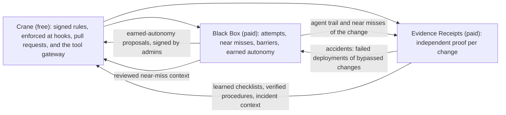

# Landscape of Agents: Products, Customers, and Strategy

This document keeps only the products that others cannot easily copy. An earlier version listed
seventeen products across two parts; most of them were reasonable, but most were also features an
agent vendor, a CI platform, or an analytics company could ship within a year. What remains is three
products, each resting on something this system holds and others structurally cannot.

Grounding: [OVERVIEW.md](../architecture/overview.md) (what exists), [TERMINOLOGY.md](../TERMINOLOGY.md) (every term),
[FLOWS.md](../architecture/flows.md) (every flow). Market statements reflect trends known at the time of writing
(October 2026); competitor names are examples of categories, and each should be checked before being
used externally.

## Contents

1. [The copyability test](#1-the-copyability-test)
2. [The market movements this strategy assumes](#2-the-market-movements-this-strategy-assumes)
3. [The verdict on every earlier product](#3-the-verdict-on-every-earlier-product)
4. [Product 1: Crane, the neutral rule layer (free)](#4-product-1-crane-the-neutral-rule-layer-free)
5. [Product 2: Crane Black Box, the flight recorder and near-miss system (paid flagship)](#5-product-2-crane-black-box-the-flight-recorder-and-near-miss-system-paid-flagship)
6. [Product 3: Evidence Receipts, independent proof for every change (paid)](#6-product-3-evidence-receipts-independent-proof-for-every-change-paid)
7. [What the moat is made of, and what would erode it](#7-what-the-moat-is-made-of-and-what-would-erode-it)
8. [What we will not build, and why](#8-what-we-will-not-build-and-why)
9. [How the three products reinforce each other](#9-how-the-three-products-reinforce-each-other)
10. [The data the products read](#10-the-data-the-products-read)
11. [The honesty rules every number follows](#11-the-honesty-rules-every-number-follows)
12. [Pricing, sequencing, and first customers](#12-pricing-sequencing-and-first-customers)

---

## 1. The copyability test

A product stays only if copying it requires at least two of the following, which a competitor cannot
acquire by shipping a feature:

| Property | What it means | Why others cannot simply add it |
|---|---|---|
| **Neutrality across agent vendors** | one rulebook and one record for Claude Code, Codex, Copilot, Gemini, and whatever comes next | an agent vendor governing or auditing its competitors is not credible, and auditing itself is a conflict of interest |
| **Decision-time position** | the system sees each action *before* it runs, against the rules, and verifies it *after* | observability and analytics tools see the result, not the attempt; prevented actions never reach them |
| **People-signed, repository-bound rules** | authority is a signature by a trusted person's key, bound to one repository, versioned with the code | prompt rules and vendor settings are editable text; signing and rollback protection are an architecture, not a setting |
| **Tamper-evident evidence with honest unknowns** | hash-chained events, sealed packs, and "unknown, because…" as a first-class answer | dashboards built on activity data cannot retrofit a chain of custody or reasons for absence |
| **Accumulated history** | months of attempts, near misses, gaps, and outcomes per repository | cannot be bought or rebuilt after the fact; it starts only when the product is installed |

Anything that passes on only one property, or on features alone (a nicer dashboard, a cost chart, a
forecast), is copyable and is not a product here.

---

## 2. The market movements this strategy assumes

1. **Agent vendors are building native governance.** Permissions, managed settings, hooks, and admin
   consoles keep improving inside each tool. Anything that is only a better per-tool permission prompt
   will be absorbed.
2. **Agents are moving to the cloud.** Background agents work in the vendor's environment and open pull
   requests. A local hook does not see those sessions; the pull request, the CI check, and the tool
   gateway (MCP) become the points of control.
3. **Agent observability is becoming a commodity.** OpenTelemetry conventions for AI telemetry and
   existing observability vendors make "another dashboard" a weak product.
4. **Delivery analytics are adding "AI impact" reports.** Activity-based AI metrics will be everywhere;
   evidence-based ones will not.
5. **AI regulation and standards are arriving.** EU AI Act obligations phase in, and ISO/IEC 42001 is
   being adopted; buyers need evidence of control, not policies on paper.
6. **Agent skills and tools are being standardized by the vendors.** A separate skill registry and
   runtime would compete with built-in ecosystems.

Every product below is designed to get *stronger* under these movements, not weaker.

---

## 3. The verdict on every earlier product

| Earlier product | Verdict | Why | Where its value went |
|---|---|---|---|
| Crane Guardrails | **Kept** (Product 1) | neutrality, decision-time, signed rules | Crane |
| Landscape for VS Code | Merged | an editor surface is copyable; it is the authoring tool for the rules | Crane |
| Developer Cockpit | Merged | personal views are copyable; private-by-default friction data is not | Crane (free personal view) |
| DataSea Agent Observability | Merged | dashboards are a commodity; the record behind them is not | Black Box (record) and OpenTelemetry export |
| Crane Black Box | **Kept** (Product 2) | decision-time, chain of custody, accumulated history, neutrality | Black Box |
| Agent Threat Ledger | Merged | security events without the decision point are copyable | Black Box security lens |
| Agentic Balance Sheet | Merged | an executive report is copyable; its evidence base is not | Black Box board report |
| Crane Assure | Merged | compliance exports are copyable; tamper-evident evidence is not | Black Box assurance export |
| Autonomy Coach and Insight | Merged | recommendations are copyable; recommendations from near-miss history signed into rules are not | Black Box earned autonomy |
| Agent FinOps | Merged (minor) | token cost is visible in vendor consoles | Black Box cost lens, unit cost per verified change only |
| Evidence Receipts | **Kept** (Product 3) | neutrality, honest unknowns, linked to the decision record | Receipts |
| Proof of Done | Merged | a tracker view is copyable; acceptance targets verified from code are not | Receipts feature rollup |
| Verification Debt Exchange | Merged | a backlog is copyable; reason-routed evidence gaps are not | Receipts debt view |
| First Five Minutes | Merged, later | incident tools will add AI summaries; the agent trail and evidence gaps of a change are not copyable | Receipts and Black Box incident view, after runtime connectors |
| Capability Hub | Repositioned (revised October 2026) | a general skill marketplace and agent runtime compete with vendor ecosystems; skills governed by signed rules, enforced at decision time, and verified after they act do not | Crane: governed skills and runbooks; Receipts: verified procedure export into vendor formats |
| Delivery Radar | Dropped | forecasting and approval queues will be built by project tools | — |

---

## 4. Product 1: Crane, the neutral rule layer (free)

1. **The product.** One rulebook for every coding agent, signed by people and enforced at every point
   where agents act.
   - **Rules.** `preserve` and `target` selections, zones and flows with criticality and autonomy
     ceilings, context packs, all in `.crane/`, signed and rollback-protected
     ([governance/](../../src/governance), [selection/](../../src/selection)).
   - **Enforcement points.**
     - *Local sessions*: hooks in Claude Code, Codex, Copilot CLI, and Gemini CLI decide before each
       tool call and verify after it ([hooks/](../../src/hooks)). Exists today.
     - *Pull requests*: `crane test .` as a required check, which also covers cloud agents whose
       sessions Crane never saw. The command exists; packaging it as a check is to build.
     - *Tool gateway*: an MCP gateway mode that puts tool calls through the same guard. To build.
     - *Cloud agent runtimes*: where a runtime honors repository hook settings and can run the Crane
       binary, the same hooks apply. To validate per vendor.
   - **Authoring.** Landscape for VS Code: select code, protect or target it, draw zones and flows, sign
     ([extensions/foxx/](../../extensions/foxx)).
   - **Governed skills and runbooks.** A skill is a capability: a versioned procedure with typed
     inputs, registered typed operations, preconditions, approval, verification, and recovery
     ([capability/](../../src/capability), [invocation/](../../src/invocation)). It is published only by
     a person other than its author, signed into the repository's shared skill store
     (`.crane/skills.json`), and executed only through Crane's invocation engine, where every
     operation is authorized before it runs and only verified outcomes count. A skill never grants
     itself authority, and a withdrawal reaches every machine with the repository. Runbooks compose
     skills without elevating any of them (to build). Drafts are made in plain forms on the dashboard
     as proposals; nothing they describe is authorized until a signer activates it (to build).
   - **Scope.** `crane scope` shows, explains, diffs, probes, and audits the effective boundary,
     decided by the same guard as the hooks ([scope/](../../src/scope)); agents receive the resolved
     boundary in their session context, never a Crane command.
   - **Personal view.** A private view of what one's own agents attempted and where rules helped or got
     in the way.
2. **End customers.** Every team that uses more than one agent tool, or expects to, on code that
   matters; platform teams rolling agents out to an organization.
3. **Why it is needed; competition.** Each agent vendor governs only its own agent, in its own format,
   and its settings are not signed or tied to specific code. Alternatives: vendor permissions and hooks,
   CODEOWNERS and branch protection, post-hoc scanners, prompt guardrail libraries. **What cannot be
   copied:** a vendor-neutral rule set that is signed by the organization's people, bound to the
   repository, precise to a code block, and enforced identically across vendors. Vendors have no reason
   to build rules that govern their competitors, and a rule set controlled by the customer is exactly
   what each vendor's lock-in strategy avoids.
4. **What keeps customers using it.** Rules accumulate in the repository with every signed change;
   removing Crane means losing enforcement across all agents at once. Switching agent vendors does not
   mean rewriting rules, which is the reason to adopt it before the vendor choice settles.
5. **Near-future implementations.**
   - The pull-request check and the MCP gateway mode (the two enforcement points cloud agents need).
   - A sandbox profile so the trust directory is confidential against the agent's own shell.
   - Passphrase key protection by default outside Windows.
   - New AgentScript verbs that only a decision-time system can enforce: "may change only together
     with a test change", "only these agents", time-bound targets.
   - A JetBrains authoring plugin on the same CLI contract.
6. **Subproducts.** An open AgentScript specification, so other tools can read (but not sign) the rules;
   shared policy templates for common risky code (billing, auth, migrations).
7. **Customer base, first customers, pricing.** Every engineering team using agents. First customers:
   5 to 10 design partners in regulated industries running at least two agent tools. **Free and open
   source** (Apache 2.0): neutrality must be inspectable, and the paid products depend on it being
   installed everywhere.
8. **Recurring.** Enforcement is continuous; recurrence comes from the paid products that read its
   record.
9. **Business and agentic intelligence.** Agents receive the exact context of the code they touch at
   the moment they touch it, from rules the organization signed, regardless of vendor. **To add:**
   reviewed knowledge from Black Box (near-miss context) and Receipts (incident and gap context) appended
   to that context, so every vendor's agent learns the same organizational lessons.
10. **Drawbacks, limitations, iterations.**
    - Cloud agents are covered only at the pull request until the gateway and runtime support exist; that
      is weaker than decision-time enforcement and must be described honestly.
    - Same-user shells can read the trust directory without a sandbox (documented in
      [SECURITY.md](../../SECURITY.md)).
    - Shell and script analysis is lexical; the after-check is the backstop.
    - Keys and signing are a real adoption cost.
11. **Radical improvement.** Publish AgentScript and the event specification as an **open standard for
    agent governance**, with Crane as the reference implementation. Reasoning: a neutral standard is the
    one thing an agent vendor cannot ship without ceding control, and the reference implementation of a
    standard is very hard to displace.

---

## 5. Product 2: Crane Black Box, the flight recorder and near-miss system (paid flagship)

1. **The product.** Aviation became safe by recording every flight and reporting near misses without
   blame. Black Box does this for AI agents, because Crane is present at every decision.
   - **The flight recorder.** For every agent session, a replayable, chain-verified timeline: each
     attempted action, the rule that applied, the decision, what really changed, credits and tokens, and
     the context the agent received. Built from F03 to F08 events and the credit ledger
     ([telemetry/](../../src/telemetry)).
   - **The near-miss register.** Every attempt classified from existing fields:

     | Class | Definition | Aviation analogue |
     |---|---|---|
     | Near miss | enforcement outcome `PREVENTED` on a preserved selection, a restricted zone, or Crane's own files | a loss of separation that was caught |
     | Incident | `DETECTED_AFTER_EFFECT`, session degraded | damage, contained |
     | Serious incident | `BYPASS_CONFIRMED`, session quarantined | a barrier failed |
     | Accident | a serious incident linked by Receipts to a failed deployment of the changed commit | harm reached production |

   - **Barrier analysis.** The guard checks in a fixed order (integrity, safety state, protected files,
     shell analysis, script pre-check, edit simulation, zone limits, autonomy mode, credits, then the
     after-check). Black Box reports which barrier stopped each near miss and how often an action passed
     every barrier before the after-check caught it: a measure of where the defense is thin that no one
     outside the decision point can compute.
   - **Counterfactual severity.** The criticality of the zone, the selection, file, line range, and
     policy the prevented edit would have changed (already named in the guard's denial), the change type
     it would have had (from running the change classifier on the simulated text), and the flows whose
     entry points reach that code. No content is stored.
   - **Earned autonomy.** Per zone, the evidence record (near misses, barrier failures, approvals always
     granted, outcomes) produces proposals to widen or narrow autonomy ceilings and credit costs. Each is
     a signed governance change an admin applies; widenings can carry an expiry, renewed only if the
     evidence still supports them. This absorbs Insight's trust patterns and the former Autonomy Coach.
   - **Role lenses on the same record.**
     - *Developers*: what my agents attempted and which rules saved me (private by default).
     - *Tech leads and engineering managers*: barriers per zone, approvals that are always granted,
       earned-autonomy proposals.
     - *Security*: attacks on the control plane, bypass attempts, injection signals, risky scripts,
       quarantines, chain breaks (the former Threat Ledger), with a SIEM export.
     - *Compliance*: a signed period export of controls, evidence references, and chain verification,
       mapped to OWASP LLM, NIST AI RMF, SOC 2, ISO/IEC 27001, ISO/IEC 42001, and EU AI Act obligations
       (the former Assure).
     - *CEO and board*: a monthly signed report: governed coverage, earned autonomy, near misses per
       thousand actions, barrier failures, accidents, and cost per verified change (the former Balance
       Sheet), every line linked to its evidence.
     - *On-call*: the agent trail of a change during an incident (with Receipts).
   - **Export, not a dashboard war.** Events are exportable to OpenTelemetry and SIEMs; the dashboard
     exists for what only this record can show.
2. **End customers.** Buyer: CTO or VP Engineering together with the CISO. Daily users: tech leads,
   platform and security teams. Report readers: compliance, the CEO, and the board. Strongest fit:
   fintech, healthtech, insurance, infrastructure, public sector, and any company that has had an agent
   incident.
3. **Why it is needed; competition.** After an agent incident the questions are "what happened" and
   "how often has this almost happened". Session logs inside each vendor, LLM tracing tools, SIEMs, and
   incident platforms see results or symptoms; none see the attempt against signed rules, and none
   classify near misses or measure barriers. **What cannot be copied:** the decision-time position,
   across vendors, with a chain of custody, and the history that accumulates from the day it is
   installed. A vendor could record its own agent's near misses, but an organization will not accept the
   vendor as the auditor of its own product.
4. **What keeps customers using it.** Safety history compounds and cannot be rebuilt; a year of near-miss
   data is the only baseline an organization has for agent risk. Once "near misses per thousand
   actions" is reported to the board and an audit relies on the export, both become fixtures.
5. **Near-future implementations.**
   - Structured counterfactual fields on decision events (from the denial's existing details, plus the
     change classifier from [governance/changes.rs](../../src/governance/changes.rs) on the simulated text).
   - A stable barrier code per guard check.
   - The near-miss classifier as a derived stream on the service, and the session replay viewer.
   - The earned-autonomy proposal object, signed through `crane governance sign`.
   - The signed compliance and board exports; OpenTelemetry and SIEM export.
   - Longer retention tiers (thirty days is too short for audits).
6. **Subproducts.**
   - **Industry near-miss index**: opt-in, anonymized aggregates across customers, published quarterly.
     It is reference data no one else can produce.
   - **Blameless near-miss review**: a weekly flow where a team marks each near miss as "worked as
     intended", "too strict", or "rule missing elsewhere"; reviewed outcomes become context for the zone.
7. **Customer base, first customers, pricing.** Base: every organization with agents on code that
   matters. First customers: the Crane design partners who have already seen a denial prevent damage.
   **Paid**, per active developer, with a free seven-day recorder for one repository; compliance and
   board exports as an enterprise tier.
8. **Recurring.** Weekly near-miss review, monthly leadership report, quarterly board summary, audit
   cycles, and continuous security export: calendar rituals, not dashboard visits.
9. **Business and agentic intelligence.**
   - Business: agent risk and autonomy become measured quantities with trends, comparable across teams;
     guardrail investment is justified by barrier performance; autonomy grows where evidence earns it.
   - Agentic: reviewed near misses become context delivered to every vendor's agent at session start, and
     the register then measures whether repeated attempts fall, which is a direct measure of agents
     learning the organization's rules.
10. **Drawbacks, limitations, iterations.**
    - Counterfactual fields and barrier codes are not emitted yet; severity is coarse until they are.
    - Network effects are not observable from hooks (sandbox needed).
    - Few rules mean few near misses, which can read as safety; reports must show governed coverage
      beside counts.
    - Blameless use is a precondition: person-level views must be opt-in, or developers will turn it off.
    - Cloud-agent sessions contribute only what the pull request shows until the gateway exists.
11. **Radical improvement.** Make Black Box the **exposure data for insuring AI-written software**.
    Insurers cannot price agent risk without data on attempts, barrier performance, and accidents per
    thousand actions; a signed, chain-verified record is that data. Reasoning: whoever holds the actuarial
    record of agent risk sets the terms of the market, and a product that lowers a premium sells itself
    to the CFO.

---

## 6. Product 3: Evidence Receipts, independent proof for every change (paid)

1. **The product.** Every pull request and deployment carries a receipt from an independent verifier:
   what is proven and by which evidence, what is contradicted, what is unknown and *why* (`empty`,
   `unavailable`, `denied`, `not_queried`, `parse_failed`), which zones and policies were touched, which
   rules applied and which near misses occurred while the change was made (from Black Box), and integrity
   (manifest digest, replay fidelity). Built on Work Capture ([capture/](../../src/capture)).
   - **The check.** Posted as a required check with a gate that routes rather than blocks: pass when
     sufficient and verified, block on any `no`, ask a person on any `unknown`. It covers every agent,
     local or cloud, because every change passes through the pull request.
   - **Feature rollup (for product managers).** Per tracker item (the external task key): proven,
     claimed, contradicted, unknown, with acceptance criteria checked as `target` selections (the former
     Proof of Done).
   - **Verification debt (for quality and tech leads).** Recurring gaps ranked by zone criticality and
     affected changes, each routed to the role that owns its reason (the former Debt Exchange, fed by
     Insight's evidence-gap patterns).
   - **Learning from questions.** Questions no checklist serves are explored; people's feedback becomes
     learned checklists after review ([insight/](../../src/insight), [capture/broker/proposals.rs](../../src/capture/broker/proposals.rs)),
     so receipts get more complete for each organization over time.
   - **Verified procedure export.** Work that is repeatedly verified (Insight's work patterns, compiled
     by the capability pipeline) is exported as a signed procedure in the vendors' own skill and tool
     formats, with its evidence and applicability attached. This replaces a separate registry and
     runtime; verification, the lab, and the human publication gate stay
     ([capability/](../../src/capability), [compiler/](../../src/compiler), [capability_lab/](../../src/capability_lab)).
   - **Incident view (later).** On a failed deployment: the investigation already run, the change's agent
     trail, its evidence gaps, and the flows its files reach (with Black Box), once runtime connectors
     exist.
2. **End customers.** Reviewers and tech leads who approve agent pull requests; release managers;
   product managers (feature rollup); quality and platform teams (debt); later on-call engineers.
3. **Why it is needed; competition.** As agents produce more pull requests than people can review, the
   question moves from "is this diff good" to "what is proven about this change". CI shows pass or fail
   with no state for "nobody checked"; AI code reviewers comment on the diff; provenance standards (SLSA,
   Sigstore) prove who built what. **What cannot be copied:** an independent, vendor-neutral verifier
   whose receipt joins the evidence (with reasons for every unknown) to the decision-time record of how
   the change was made and under which signed rules. A CI platform could post verification checks, but
   not the attempt history; an agent vendor could summarize its own work, but a receipt written by the
   party that did the work is not independent.
4. **What keeps customers using it.** Reviewers who rely on receipts approve agent work faster; removing
   them slows every merge. Learned checklists and verified procedures are organization-specific assets that
   accumulate. Receipts feed Black Box's accident classification and the board report.
5. **Near-future implementations.**
   - The receipt renderer and the check publisher (the main gap).
   - A test-report connector (CI artifacts) and deployment, log, and metrics connectors.
   - Automatic investigation on pull-request and deployment events under a service identity.
   - The tracker join for feature rollups and comments in Jira and Linear.
   - Per-commit verification for multi-commit pull requests.
   - Multi-episode compilation and export to vendor skill formats.
   - Proposed outcomes derived from verified assertions, so Insight's outcome patterns fill without
     manual entry.
6. **Subproducts.** A receipt API for review tools; a customer-facing changelog with proof for regulated
   vendors; a pre-deploy risk check (the incident investigation run in advance).
7. **Customer base, first customers, pricing.** Base: teams merging agent pull requests. First customers:
   Crane design partners, starting with one critical repository each. **Free for public repositories**
   (it spreads the format) and **paid per private repository or receipt volume**; feature rollups and
   procedure export in the business tier.
8. **Recurring.** Every pull request and deployment produces a receipt; usage scales with agent activity,
   which is growing.
9. **Business and agentic intelligence.**
   - Business: which changes are verified, which are not and why, and where verification investment
     closes the most risk; true feature status for product managers.
   - Agentic: an agent receives its own change's receipt at `STOP` (to build) and closes its evidence gaps
     before a person looks; learned checklists and verified procedures make each next change better
     evidenced and each next agent better equipped.
10. **Drawbacks, limitations, iterations.**
    - Without live test and deployment connectors, many receipts say "unknown" for those parts; this is
      honest but must be presented as the gap to close, not as failure.
    - The capture store must scale beyond local JSON lines for hosted, automatic investigations.
    - Outcomes are recorded by hand today.
    - Acceptance targets need a developer to bind criteria to code.
11. **Radical improvement.** Make **"unknown" a first-class merge state across the industry**: the open
    receipt format, free for public repositories, establishes that a change whose tests cannot be proven
    does not silently pass and does not block, but routes to a person, and that routing is measured.
    Reasoning: gates that block on every gap get switched off; gates that route keep running, and the
    routing data, joined to the decision record, is the product.

---

## 7. What the moat is made of, and what would erode it

| Commitment | Why it is the moat | What would erode it |
|---|---|---|
| **Neutrality** | the reason a customer accepts Crane as rule-keeper and auditor across vendors | building our own coding agent, or favoring one vendor |
| **People sign the rules** | authority that agents and vendors cannot rewrite | letting any automated path, including our own learning, change rules without a signature |
| **Decision-time presence** | the only source of attempts and barrier data | becoming a log collector that only reads results |
| **Chain of custody** | evidence that holds up in an audit or claim | any write path into evidence from viewing, or unsigned exports |
| **Honest unknowns** | trust in every number | estimating where data is missing, or a single "trust score" that hides its parts |
| **Local-first enforcement** | works offline and for customers who cannot send code anywhere | making enforcement depend on the hosted service |
| **History** | compounds from installation | short retention, or losing data on plan changes |

---

## 8. What we will not build, and why

- **Our own coding agent.** It would end neutrality, the property everything else depends on.
- **A general observability dashboard.** Commodity; export to OpenTelemetry instead.
- **A general skill marketplace or an agent runtime.** Vendors are standardizing these; we govern the
  skills an organization signs (who may publish them, what they may touch, what proves they worked)
  and export verified procedures into vendor formats. Crane executes a skill's registered, typed
  operations under its rules; it never runs a model or becomes an agent.
- **Project management and forecasting.** Project tools will build it with their own data.
- **Prompt and output guardrails for applications.** A different market (LLM application security) with
  established players; our position is code and actions, not text.
- **Cost-only analytics.** Token spend is in every vendor console; we report only cost per verified
  change, which needs our evidence.

---

## 9. How the three products reinforce each other

Crane produces the record; Black Box and Receipts turn it into safety, assurance, and proof; and what
they learn flows back into the rules and context every agent receives, always through a person's
signature or review.

---

## 10. The data the products read

| Record | What it knows | Code | Read by |
|---|---|---|---|
| Decision events (F05) | every attempt, the rule, the decision, the reason, zone and selection | [hooks/enforce.rs](../../src/hooks/enforce.rs), [telemetry/events.rs](../../src/telemetry/events.rs) | Black Box |
| Verification events (F06) | what really changed, violations, bypasses, coverage gaps | [hooks/runtime/tools.rs](../../src/hooks/runtime/tools.rs) | Black Box, Receipts |
| Identity | person, agent, session, task, external task key | [telemetry/identity.rs](../../src/telemetry/identity.rs) | both |
| Token usage and credit ledger | cost and risk-bearing authority | [telemetry/usage.rs](../../src/telemetry/usage.rs), [telemetry/ledger.rs](../../src/telemetry/ledger.rs) | Black Box |
| Governance state and audit | selections, targets, zones, flows, ceilings, rule changes | [governance/](../../src/governance), [selection/](../../src/selection) | both |
| Flow call graph | which entry points reach which code | [governance/flows.rs](../../src/governance/flows.rs) | both |
| Evidence Packs and audits | proven, contradicted, unknown and why | [capture/](../../src/capture) | Receipts |
| Episodes, outcomes, feedback | how work ended; whether evidence sufficed | [capture/ingest/episode.rs](../../src/capture/ingest/episode.rs) | both |
| Compliance controls | evidence per control | [telemetry/compliance.rs](../../src/telemetry/compliance.rs) | Black Box |
| Insight patterns | gaps, unanswered questions, trust, failure co-occurrences, recurring work | [insight/](../../src/insight) | both |
| Capability pipeline | compiled, lab-checked procedures | [capability/](../../src/capability) to [evolution/](../../src/evolution) | Receipts (export) |

---

## 11. The honesty rules every number follows

| Rule | Why | Where it already holds |
|---|---|---|
| No evidence means **unmeasured**, never zero | a false zero is a false all-clear | evals ([telemetry/evals.rs](../../src/telemetry/evals.rs)), Insight |
| Every rate shows **numerator, denominator, and unknowns** | rates hide their base | Insight `Counts` |
| Aggregates count only what the viewer could open; **minimum support 3** | aggregates must not leak a hidden record | Insight read model ([insight/read.rs](../../src/insight/read.rs)) |
| **Co-occurrence, never cause** | correlations presented as causes mislead | Insight outcome miner |
| Every number **links to its evidence** | trust in a report is trust in its drill-down | event digests, pack manifests |
| Definitions are **versioned** | a changed definition must not look like a changed trend | miners' version, checklist digests |
| Person-level views are **private by default** | surveillance ends adoption | to be enforced in Black Box lenses |

---

## 12. Pricing, sequencing, and first customers

| Product | Model | First buyer | Depends on |
|---|---|---|---|
| **Crane** | free, open source | developers, platform teams | — |
| **Crane Black Box** | paid per active developer; free 7-day recorder; enterprise tier for compliance and board exports | CTO with the CISO | Crane |
| **Evidence Receipts** | free for public repositories; paid per private repository or receipt volume; business tier for rollups and procedure export | tech leads, release managers | Crane, Work Capture |

**Sequencing.**

1. **Crane enforcement points for cloud agents**: the pull-request check, then the MCP gateway. Without
   them, the record misses the fastest-growing share of agent work.
2. **Black Box**: counterfactual fields, barrier codes, the near-miss classifier, the replay viewer. Its
   data exists today, and it is the most memorable demonstration of what only this system can do.
3. **Receipts**: the renderer and check publisher, then the test-report connector, then deployment and
   runtime connectors.
4. **Black Box exports** (compliance, board, SIEM) and earned autonomy, once a few weeks of history exist.
5. **Receipts' procedure export**, once multi-episode compilation exists.

**First customers.** Five to ten design partners in regulated industries that run at least two agent
tools and have a critical repository. The opening line: "Here is every time an agent almost changed your
fee rule this month, which barrier stopped it, and what is still unproven about the changes that
shipped." No vendor, CI platform, or analytics company can say that sentence about another company's
agents.
