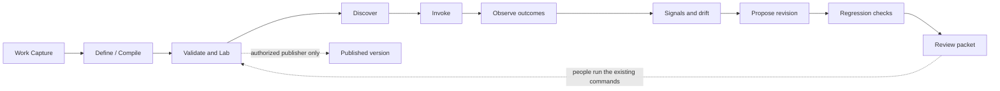
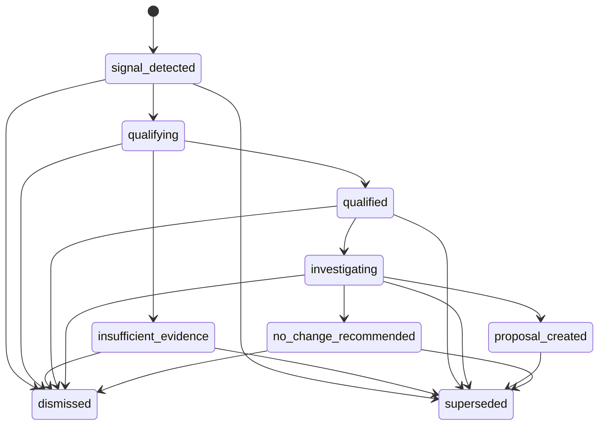
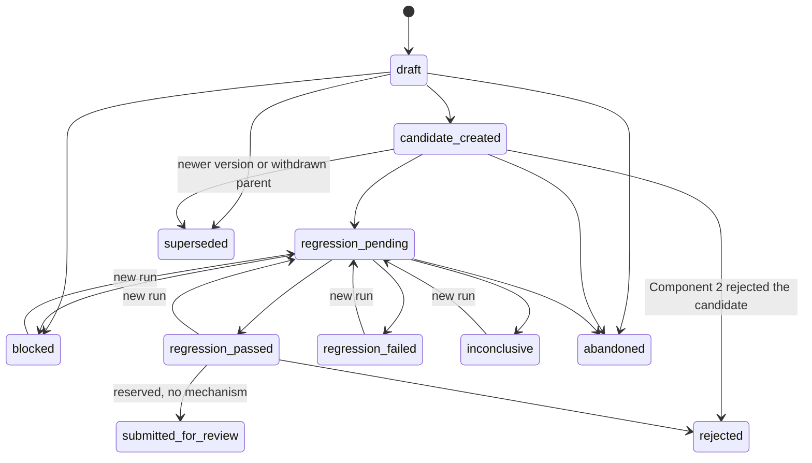
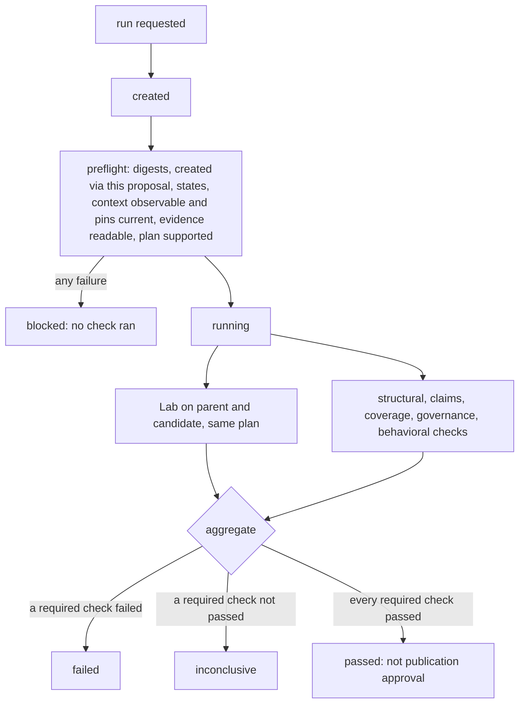
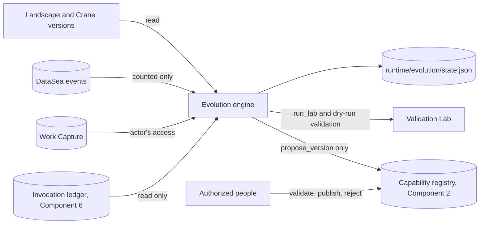

# Crane guide

How to install and use Crane, the Landscape extension, and the hosted dashboard. For the vision, see the
[README](../../README.md); to work on Crane, see [CONTRIBUTING](../../CONTRIBUTING.md); to report a
vulnerability, see [SECURITY](../../SECURITY.md).

## Install

Download Crane for Linux, Windows, or macOS from the
[latest release](https://github.com/Landscape-Of-Agents/Landscape/releases/latest), unpack it, and put
`crane` on your `PATH`. Or build it from source:

```bash
cargo install --path .        # requires Rust 1.89+ and Git
crane --version
```

`gh` is needed for `crane github`; `curl` for Slack, Jira, and WhatsApp delivery.

The **Landscape** VS Code extension sets up Crane, creates policies, and marks selections from the
editor: install it from the
[Marketplace](https://marketplace.visualstudio.com/items?itemName=agentscript.foxx)
(`code --install-extension agentscript.foxx`), or from the `.vsix` on each release.

## Quick start

```bash
crane repo --https https://github.com/OWNER/REPO    # connect the clone to its GitHub repository
crane init                                          # create .crane/ and a signing key
crane checkpoint baseline                           # trusted baseline = current HEAD

crane protect app/payments.py start-line 12 end-line 30 context "Fees are audited; keep the rate."
crane target  app/refunds.py  start-line 5 end-line 18 change_type logical_bn context "Refunds must be partial-aware."

crane validate          # integrity, syntax, and markers
crane test .            # run every preserve/target command
crane agent install --profile claude
```

Then open the dashboard at <https://dashboard.agentslandscape.cloud> and sign in with GitHub.

Commit `.crane/` with your code. Policies live in `.crane/policies/*.crane`:

```text
policy payments {
    preserve K7M2P9RX;
    target 4QZ8M2LD change_type logical_bn;
}
```

A policy passes only if every command passes. `change_type` is one of `logical_bn` (business
logic), `logical_cn` (loops or branches), `logical_sn` (structure), or `semantic` (names or
comments); whitespace-only changes never satisfy a target.

## Commands

| Area | Commands |
| --- | --- |
| Basic | `--version`, `init`, `checkpoint [NAME]`, `protect FILE ...`, `target FILE ...`, `--set default policy\|checkpoint NAME`, `parse file FILE`, `validate`, `test .`, `add policy-context file FILE [policy NAME]`, `policy-context NAME --view` |
| Repository | `repo --ssh\|--https\|--gh-cli REMOTE [privileges]`, `repo status`, `repo --view`, `repo del`, `repo rebind OLD_REMOTE`, `github`, `github days DAYS` |
| Policies | `create policy NAME FILENAME`, `add policy NAME marker MARKER`, `policy NAME status` |
| Runtime | `task current [ID]`, `task .`, `session current [ID]`, `session .` |
| Agents | `agent install\|uninstall\|hooks --profile claude\|codex\|copilot\|gemini`, `agent link` |
| Admins | `admin list`, `admin register`, `admin add PUBLIC_KEY [name NAME]`, `admin del PUBLIC_KEY` |
| Zones and flows | `governance sign`, `governance graph [--json]` (zones, flows, and selections as an acyclic graph, with the agents active in each) |
| Scope | `scope inspect [PATH ...]`, `scope resolve read\|write\|delete\|execute\|network TARGET [lines A-B] [mode MODE]`, `scope explain DECISION_ID\|TOOL_CALL_ID`, `scope diff [--record]`, `scope test`, `scope audit [session ID] [days N]` (all with `--json`; see [Scope](#scope-the-effective-boundary)) |
| Work Capture | `capture demo [--json]`, `capture sources [--json]`, `capture investigate [commit SHA] [task TASK_ID] [class CLASS] [recipe ID [version N]] [episode EPI] [--json]`, `capture replay QUERY_ID [--json]`, `capture verify PACK_ID`, `capture contribute FILE [--json]`, `capture review CONTRIBUTION_ID accept\|reject reason TEXT`, `capture outcome EPISODE OUTCOME [evidence ID,ID]`, `capture feedback PACK_ID sufficient yes\|no\|unknown [missing TYPE,TYPE] [notes TEXT]`, `capture ask FILE`, `capture question QUESTION_ID answer PACK_ID\|block\|unresolvable\|reopen`, `capture confirm RELATION_ID` |
| Insight | `insight report [--json]`, `insight reports [--json]`, `insight propose PATTERN_ID`, `insight recipes [--json]`, `insight review PROPOSAL_ID accept\|reject reason TEXT` |
| Capabilities | `capability demo`, `capability intake ...`, `capability create\|propose FILE`, `capability validate (ID [--dry-run] \| file FILE)`, `capability inspect\|versions\|list`, `capability publish ID version N reason TEXT`, `capability deprecate\|revoke\|reject ...`, `capability stale`, `capability shared [ID]` |
| Compiler | `compile demo [--json]`, `compile episode EPI pack PCK digest D capability ID name TEXT purpose TEXT task-class CLASS [intent FILE] [risk RISK] [profile NAME] [--json]` |
| Validation Lab | `lab demo [--json]`, `lab run ID [version N] [digest DIGEST] plan FILE [compilation REPORT_ID] [--json]`, `lab reports ID [version N] [--json]` |
| Discovery | `capability discover demo [--json]`, `capability discover task-class CLASS [environment ENV] [repository REPO] [preconditions ID,ID] [entities ID,ID] [pack PACK digest DIGEST] [--json]`, `capability discover reports [--json]` |
| Invocation | `capability invoke demo`, `capability invoke plan ID version N digest DIGEST bindings FILE key KEY ...`, `capability invoke approve\|run\|inspect\|reconcile\|abandon INVOCATION_ID ...`, `capability invoke list` |
| Evolution | `evolution demo`, `evolution analyze\|drift ID [version N]`, `evolution signals\|proposals`, `evolution signal inspect\|dismiss ...`, `evolution propose SIGNAL_ID [changes FILE]`, `evolution proposal inspect\|abandon ...`, `evolution regression plan\|run\|inspect\|history ID`, `evolution prepare-review PROPOSAL_ID` |
| Integrations | `integrate jira\|slack\|whatsapp\|github` |
| Skills | `skill create\|validate\|inspect\|test\|plan\|activate\|invoke\|retire\|revoke` (see [Command families](#command-families)) |
| Runbooks | `runbook create\|validate\|inspect\|activate\|plan\|test\|run\|status\|cancel\|resume\|revoke` |
| Controls | `permission`, `precondition`, `constraint`, `approval`, `isolation`, `verification`, `provenance`, `budget`, `recovery`, `revocation` |
| Selections | `selection protect\|target\|inspect\|validate\|repair` (`protect` and `target` are the same as above) |

`protect` and `target` require `context TEXT` (guidance agents receive whenever they touch the
selection; it is signed into the record). Options: `policy NAME`, `checkpoint NAME`,
`start-line N`, `end-line N`, `name LABEL`. Run `crane help` for details.

**Only people run Crane.** Every `crane` command refuses to run inside an AI agent session (the
hooks themselves excepted), and the hooks deny any agent shell command or script that invokes
`crane`, including `crane validate` and `crane --version`.

**Moving the repository.** After a transfer or rename (for example to another organization), the
repository identity changes with the remote, so `crane validate` reports the registry as belonging
to another repository. Update the remote (`git remote set-url origin NEW_URL`), then the owner runs
`crane repo rebind OLD_REMOTE` once: Crane proves the rules were signed for the old remote, carries
the trust over, and signs the selections, admin list and manifest again for the new identity.
Commit the result; teammates run the same command after pulling, then `crane repo --https NEW_URL`.

## Teams

The person who runs `crane init` first is the **owner**; `crane init` prints the owner key.

1. **Teammates join.** On their machine: `crane repo --https URL`, then `crane init`. Crane shows
   the owner key's fingerprint and asks whether to trust it; compare it with the owner's
   `crane admin list`. Until the key is trusted, the rules cannot be verified and agent changes are
   blocked. After it is, enforcement works normally. Teammates who are not admins cannot change
   the rules.
2. **More admins.** A teammate sends the key `crane init` printed for them; the owner runs
   `crane admin add KEY name NAME` and commits `.crane`. Admins can then protect, target,
   checkpoint, and change policies from their own machines. Every teammate trusts them through
   the owner's signature. `crane admin del KEY` removes an admin; machines that saw the removal
   reject an older admin list.
3. **Two admins changed the rules on different branches.** Git reports a conflict in `.crane`.
   Keep one side for the whole directory (`git checkout --theirs .crane`), commit, run
   `crane init` to accept that signed state, then re-apply your change with crane.

CI machines can trust the owner without a prompt: set `CRANE_TRUSTED_PUBLIC_KEYS` to the owner key.

**GitHub vouches for the owner key.** The owner runs `crane admin register` (a new repository's
`crane init` offers it) and opens the printed address; a GitHub admin of the repository confirms
the key there. A teammate's `crane init` then shows "confirmed by @admin" next to the fingerprint,
or a warning when the repository's key is not the confirmed one. Also protect `.crane` on GitHub:
add `/.crane/ @OWNER` to `CODEOWNERS` and require code-owner review on the default branch.

**Machines are linked to people.** Each teammate runs `crane agent link` once per machine and opens
the printed address; GitHub must show them access to the repository. Once any machine is linked,
the dashboard shows only linked machines by default, so an upload key nobody linked (anyone can
create one for a public repository) cannot pass as a teammate.

## Zones, flows, and context packs

Optional `.crane/governance.yaml` adds boundaries that only ever restrict:

```yaml
version: 1
zones:
  - id: payment-core
    selectors: { paths: ["app/payments/**"] }
    criticality: critical          # routine | sensitive | critical | restricted
    autonomy_ceiling: assisted     # observe | assisted | delegated | autonomous
flows:
  - id: checkout
    entry_points: ["app/service.py:submit"]   # files reached by its calls are covered
    autonomy_ceiling: delegated
context_packs:
  - id: payment-invariants
    version: 1
    content: ["Payment processing must be idempotent."]
```

After editing the file, an admin runs `crane governance sign` (Landscape does this for you). The file is
covered by the signed manifest, so an edit nobody signed fails `crane validate` and stops agent
changes until it is signed or restored. Criticality adds credit cost per edit (sensitive +1,
critical +3, restricted +5), and restricted code always needs human approval.

Zones and flows can also name exact source blocks with comment markers. Use the file's ordinary
comment syntax and the governance entity's ID:

```python
# @crane:zone:payment-core:start
def capture(order):
    ...
# @crane:zone:payment-core:end
```

```javascript
// @crane:flow:checkout:start
function submit(order) {
  ...
}
// @crane:flow:checkout:end
```

For block-comment languages, wrap the marker text in the language's normal block comment (for
example `<!-- @crane:zone:payment-core:start -->`). Source markers must resolve to a declared zone
or flow, occur once as a matching start/end pair, and be properly nested; malformed, crossed,
duplicate, and orphan markers prevent governance validation/signing. Markers are signed with
`crane governance sign`: the zone and flow blocks present at signing are recorded in the signed
configuration, and a block added, removed, or moved to another file afterwards fails validation and
stops agent changes until an admin signs again. Every flow needs context: at least one context pack
with content or files (`context_packs: [ID]`), or signing is refused. An entity's source block
enforces limits only when a proposed edit intersects the lines between its markers. Existing path,
file, directory, symbol, selection, flow-entry, and flow-include selectors retain their existing
file-level behavior. Marker edits themselves are always denied to agents.

On every tool call that reaches an active zone, flow, or selection, Crane sends its attached
guidance to the agent and displays it in the agent window. Selection notices include the relevant
policy context files; zone and flow notices include their context packs.

## Scope: the effective boundary

`crane scope` shows what agents may do in the repository, decided by the same guard the hooks use,
so the command line and the hooks never disagree. Every scope command only reads the rules.

- `scope inspect [PATH ...]`: whether the signed rules verify, whether zones and flows resolve, which
  agent hooks are installed, what is always denied, every governed file with its ceiling,
  criticality, zones, flows, and selections, and what is unresolved (stale selectors, unresolved
  selections, overlaps). With paths, the read, write, and delete decision for each.
- `scope resolve ACCESS TARGET [lines A-B] [mode MODE]`: decides one proposed action. The target is
  resolved to what it really is (through `..` and symlinks; Crane metadata, the trust directory,
  hook settings, another worktree, outside the repository; tracked, untracked, ignored, or in a
  nested repository), and the answer names each rule with its Crane operation domain (scope,
  permission, constraints, approval, isolation, provenance, budgets, revocation) and lists what
  Crane cannot enforce for it (shell effects before they run, the network, files outside the
  repository). The decision is recorded with the rule versions and the file's content digest.
- `scope explain ID`: explains a recorded decision, or a hook's decision by its tool call id, and
  says whether it still applies; a changed file or re-signed rules make it stale.
- `scope diff [--record]`: compares the boundary with the baseline recorded when the rules were last
  signed (`governance sign`, `protect`, `target`) and fails when it widened. Zones select files by
  path, so renaming a governed file out of a zone's selector widens the boundary without anyone
  signing anything; the diff reports it by content ("moved to app/books.py, which no zone, flow, or
  selection governs"). `--record` accepts the current boundary as the new baseline.
- `scope test`: positive and adversarial probes: traversal, absolute, case, and symlink spellings of
  preserved files, marker removal, deletion, shell changes, Crane metadata and commands, every
  restricting zone and flow, and session states (observe, assisted, degraded, quarantined, no
  credits, failed integrity, unresolved zones). It fails when a probe shows the boundary does not
  hold. Documented limits (a file named through a shell variable, the network, writes outside the
  repository, other worktrees) are reported as `GAP`, never as enforced.
- `scope audit [session ID] [days N]`: compares the boundary with this machine's recorded attempts
  and effects: decisions by rule and domain, bypasses and coverage gaps after the effect, tool calls
  never verified, ungoverned files agents changed, and writes outside the repository.

Repository scope is not a sandbox. Shell commands, processes, credentials, the network, and files
outside the repository are not confined; `scope inspect` and every `scope resolve` say so.

Agents never run `crane scope`. At session start they receive the resolved boundary instead: the
files where active zones and flows restrict changes, with each file's rule. A write into another
worktree of the same repository is denied (`OTHER_WORKTREE_WRITE`), because that worktree's
protected code cannot be checked from this session.

## Command families

The skill, runbook, selection, and control commands share one result model. Add `--format json`
(or `--json`) for the machine-readable envelope: `schema_version`, `command`, `request_id`,
`status`, `decision` (when one was made), `reason_codes`, `summary`, `refs` (such as `skill_ref`,
`run_ref`, `approval_ref`, `budget_reservation_ref`, `policy_digest`), and `data`. The text output
is a view of the same object.

| Exit code | Status |
| --- | --- |
| 0 | `ok` or `passed` |
| 3 | `denied`, `failed`, or `blocked` |
| 4 | `approval_required` |
| 5 | `unknown` or `unresolved` (never treated as success) |
| 1 | usage or internal error |

| Family | Commands |
| --- | --- |
| `skill` | `create --from-template T --name N [--department D] [--id ID]`, `validate S[@N] [--dry-run]`, `inspect S[@N]`, `test S[@N] --suite PLAN`, `plan S@N --bindings F [--input F] [--confirm IDS]`, `activate S@N --review-ref R [--acknowledge CODES]`, `invoke S@N --bindings F [--input F] --idempotency-key K`, `retire S@N --reason T`, `revoke S@N --reason T` |
| `runbook` | `create (--file F \| --from-template linear --name N --skills S@N,... --bindings F,...)`, `validate RB[@N]`, `inspect RB[@N]`, `activate RB@N --review-ref R`, `plan RB[@N] [--input F]`, `test RB[@N]`, `run RB@N [--input F] [--confirm IDS] --idempotency-key K`, `status RUN`, `cancel RUN --reason T`, `resume RUN [--from-step STEP]`, `revoke RB@N --reason T` |
| `permission` | `inspect --skill S`, `check --operation ADAPTER/OPERATION --resource REF [--skill S]`, `test --skill S` |
| `precondition` | `inspect --skill S [--step STEP]`, `validate --skill S`, `evaluate --skill S [--step STEP] [--confirm IDS]`, `test --skill S` |
| `constraint` | `inspect --skill S`, `validate --skill S`, `test --skill S` |
| `approval` | `request --run ID [--step STEP]`, `status REF`, `approve REF`, `deny REF --reason T`, `revoke REF --reason T`, `test` |
| `isolation` | `profiles`, `inspect --skill S`, `validate --skill S [--environment PROFILE]`, `test --profile PROFILE` |
| `verification` | `inspect --skill S \| --run INV`, `evaluate --skill S \| --run INV`, `report --run INV`, `test --skill S` |
| `provenance` | `inspect --run ID`, `verify --run ID`, `export --run ID --destination stdout\|runtime`, `test [--run INV]` |
| `budget` | `inspect --run RUN \| --skill S`, `evaluate --run RUN --operation STEP`, `reserve --run RUN --operation STEP --idempotency-key K`, `settle --reservation ID --outcome O`, `release --reservation ID --reason T`, `test` |
| `recovery` | `inspect --run ID`, `reconcile --run ID [--step STEP]`, `resume --run ID [--from-step STEP]`, `abort --run ID --reason T`, `test` |
| `revocation` | `inspect --skill S \| --runbook RB \| --run RUN \| --actor KEY`, `revoke --target skill:S@N\|runbook:RB@N\|approval:REF --reason T`, `test` |
| `selection` | `protect ...`, `target ...`, `inspect ID`, `validate [ID]`, `repair ID [--proposal PATH:LINE]` |

References: a skill is `ID` or `ID@N` (an exact version where it changes something); an approval is
`INVOCATION_ID@PLAN_DIGEST` or `RUN_ID:STEP@DIGEST`; a resource is `repo:PATH` (or a plain path) or
`NAMESPACE:ID` for a business system. Like every Crane command, these run only for a person; agents
receive their read-only view of the boundary in their session context.

What each family guarantees: [features/controls.md](../features/controls.md). Skills and runbooks:
[features/skills.md](../features/skills.md), [features/runbooks.md](../features/runbooks.md).

## Work Capture and Evidence Packs

Work Capture is the first part of the Capability Compiler: it collects evidence about a work
episode (a task and the change, CI, deployment, and agent activity around it) and packages it as a
bounded, traceable **Evidence Pack**. It reads Landscape, DataSea, and Crane as sources and never
writes to them.

```bash
crane capture demo                 # failed-deployment investigation from fixtures (no credentials)
crane capture sources              # this repository's live sources and their health
crane capture investigate task tsk_... commit HEAD --json
crane capture investigate class pull-request-review --json   # or recipe ID [version N]
crane capture replay QUERY_ID      # re-run a recorded investigation and report what changed
crane capture verify PACK_ID       # check a kept Evidence Pack against its manifest
crane capture outcome EPISODE succeeded evidence EVD_ID,EVD_ID
crane capture investigate class release-notes --json        # no recipe serves it: an exploration
crane capture feedback PACK_ID sufficient yes missing test_report notes "also needs the tests"
```

**A question no recipe serves is explored, not refused.** When the class matches no recipe (and the
request names neither a recipe nor a plan), the broker asks every permitted source to discover what
it holds, then builds a bounded plan from the registry: one query per resource type and evidence
type the actor may receive, filtered by every scope value already known. The plan is a recipe like
any other (validated, digested, audited, replayable), and the same registry and request always give
the same plan. Because an exploration cannot know what "complete" means, it requires nothing, and
its pack is `exploratory`, never `sufficient`. `feedback` records whether a pack served the person
who used it, and what was still missing; Insight learns recipes from that feedback (see below).

`investigate` uses the live connectors (the local Git repository, DataSea's local event store,
`.crane/governance.yaml`, and the AgentScript policies with the current validation report). For a
repository connected to GitHub (`crane repo`), it also reads pull requests, commit files, and check
runs through the GitHub CLI. It keeps everything under the trust directory's `runtime/capture`
folder. Deployments, logs, and metrics have no live connector yet; the demo covers them with
deterministic fixture connectors. A task can be named by Crane's id (`tsk_...`) or by the tracker
key in `CRANE_TASK_ID`. `episode EPI` continues an earlier work episode, and a replay always stays
in its original's episode.

Built-in recipes: `failed-deployment` v1 and v2 (v2 binds its conditions to the deployment under
investigation and fetches schema evidence when the change touches `migrations/`), `local-change`
v1, `deployment-discovery` v1 (the deployments of an environment), and `pr-review` v1. A published
recipe version never changes; a change is a new version.

People act on context: `contribute FILE` proposes context (it stays proposed), `review` accepts or
rejects someone else's proposal (only the repository owner or an admin may), `ask` and `question`
track a question until a kept pack answers it, and `confirm RELATION_ID` records a reviewed
relation beside the original. `outcome` records a work episode's outcome; `succeeded` and
`partially_verified` need evidence of that episode, and changing someone else's outcome takes the
owner or an admin. No capture command runs inside an AI agent session.

The code lives in `src/capture`, split into four categories plus the broker:

| Module | Responsibility |
| --- | --- |
| `resources` | Resource registry (only compiled-in connector types; credentials as `env:NAME` references; explicit scopes with no wildcards), the connector contract (`discover`, `fetch`, `query`, `get_metadata`, `health_check`, with structured `ok`/`partial`/`unavailable`/`unauthorized`/`rate_limited`/`invalid_query`/`timeout`/`failed` outcomes), scope resolution, and connectors |
| `format` | Raw artifacts (content hash, redaction, `blob:` storage reference), the versioned Evidence Record (`observed_at` separate from `ingested_at`), and five typed parsers that report `parsed`/`partially_parsed`/`failed` |
| `correlate` | Entities, the controlled relation vocabulary (`CONTAINS` ... `SUPERSEDES`, each `observed`/`declared`/`inferred`/`reviewed`), bounded traversal and Context Views, and assertions with lineage |
| `ingest` | Eligibility-first evidence selection, context contributions, work episodes, questions, feedback, outcomes, and the Evidence Pack |
| `broker` | Versioned Evidence Recipes and the Evidence Query Broker |

**Recipes.** A recipe is a versioned, immutable list of steps. Each step names a resource kind, an
operation, an evidence type, and parameters that are literals or exactly one `{variable}` from the
resolved scope. A step runs only when its branch predicate (`exists`, `missing`, `field_equals`,
`scope_known`, `all`, `any`, `not`) holds for the evidence retrieved so far. A recipe also declares
required evidence (optionally conditional), stopping rules, and limits. The built-in
`failed-deployment` v1 retrieves the deployment's logs and metrics only if the deployment failed,
and schema evidence only if a migration ran. If a step needs a scope value that is unknown, it
reports *not queried* and never widens the query. A proposed plan (for example from a model) is
validated as a recipe before anything runs.

**The broker** resolves scope and authorization before any query. A request that explicitly names
a repository, environment, or resource the actor may not access is rejected without contacting any
source. The broker validates each query against the resource, enforces step, record, payload, and
time budgets, then ingests, normalizes, and correlates the results and derives assertions
(`ci_passed`, `tests_passed`, `deployment_succeeded`, and `change_verified` derived from those
three). The audit record (`audit.jsonl`) holds the exact recipe and digest, policy decisions,
branch decisions, every query with its parameters, source snapshot, records, errors, and timing,
the budget used, and the metrics. A replay re-runs the recorded recipe against the current sources
and reports `exact`, `diverged`, or `unverifiable` (when a source cannot identify its snapshot).

**Evidence Pack** fields: `pack_id`, `episode_id`, `investigation`, `status`
(`sufficient`/`incomplete`/`budget_exhausted`/`rejected`/`exploratory`), `scope` (with zone and flow versions and
facts learned from evidence), `evidence` (bounded excerpts plus artifact references), `entities`,
`context_view`, `assertions` (supporting and contradicting evidence, derivation, lineage),
`contributions` (`task_local` kept apart from `reusable`), `missing_evidence` (each with a state:
`empty`, `unavailable`, `denied`, `not_queried`, `parse_failed`), `sources`, `retrieval`,
`warnings` (access, freshness, completeness, uncertainty, conflict, budget, truncation), `limits`,
`manifest` (a digest of every included item), `size_bytes`, and `created_at`.

**Trust boundaries.** Missing evidence stays unknown: a missing test report never means
"tests failed", and a missing metric is never zero. When evidence disagrees, the assertion is left
unresolved and both sides are kept. Copies of one artifact count as one piece of support. Agents
may only *propose* context (namespace `agent-proposed`). Accepting a contribution takes a
different human with review permission, so nobody can approve their own. Hypotheses never become
observations. A constraint proposal that relaxes or removes a policy is refused, and an accepted
one still has to go through Crane's signed policy workflow. Source content is treated as data and
is redacted before storage. A record marked secret keeps only its reference.

## Insight: learning from work

Insight ([src/insight/](../../src/insight)) finds patterns across everything Work Capture kept, and
turns them into proposals that people review. It writes nothing it reads, and nothing it finds
changes a recipe, a context, a capability, or a policy until a person accepts the proposal.

```bash
crane insight report               # patterns under your own access, kept in runtime/insight
crane insight propose PATTERN_ID   # a recipe proposal, or context for a zone (stays proposed)
crane insight recipes              # recipe proposals and their status
crane insight review PROPOSAL_ID accept reason "this is what we check"   # owner and admins only
```

Five deterministic, versioned miners run over the packs, investigations, episodes, and evidence
the person running Crane may see:

| Miner | Pattern | Where it can lead |
| --- | --- | --- |
| `evidence-gaps` | evidence a zone's investigations keep lacking, by reason (empty, unavailable, denied, not queried, parse failed) | system-derived context for the zone, reviewed in the contribution ledger |
| `questions` | a question class no recipe serves: how often it was asked, explored, and judged sufficient | a learned recipe, reviewed by the owner or an admin |
| `trust` | how often a zone's investigations were sufficient, beside the outcomes of its work | the owner or an admin (the zone's agent permissions) |
| `outcomes` | a zone or top directory whose work fails clearly more often than all work | context for the zone; a co-occurrence, never a cause |
| `work` | an agent tool sequence that recurs across work episodes | a capability candidate compiled from one succeeded episode (`crane compile episode`) |

Every pattern carries its counts, its denominator, and the cases that could not be judged, plus the
episodes, packs, and evidence it rests on. A count below 3 is suppressed and never shown, so a
pattern cannot single out one record. Packs and evidence are counted only when the viewer could
open them (the same eligibility check Work Capture applies), so a staging-only person never sees
production's rates. A report names its miners' version and is kept with a digest; a changed report
is refused when read.

**The learning loop.** A question with no recipe is explored. People judge the explorations with
`crane capture feedback`. When two explorations of a class are judged sufficient, `insight report`
shows a `question` pattern that leads to a recipe, and `insight propose` builds `learned-CLASS`
from the steps that found evidence in those explorations. It requires what every one of them found,
plus what the feedback said was still missing. The proposal is made by the system actor
`crane-insight`, so the owner or an admin can review it. Accepting it publishes the recipe as a new
version, pinned like the built-in ones, which can never change. From then on the class is served
by that recipe, and Insight stops reporting it as unanswered. A learned recipe never displaces a
built-in one: one the RecipeBook cannot take is refused at review, and `insight recipes` lists any
that a later release shadows.

## Capability Registry

The Capability Registry is the second part of the Capability Compiler. It defines what a reusable
capability is, accepts a traceable handoff from Work Capture, validates and stores immutable
versions, and governs their lifecycle. It does not execute procedures or compile capabilities from
evidence. Drafts are created explicitly (`manual` or `fixture`); `compiler` is reserved for the
future compiler. The code lives in `src/capability` (`model`, `intake`, `validate`, `lifecycle`,
`registry`, `query`, `refs`).

```bash
crane capability demo                                     # deterministic, from fixtures
crane capture investigate --json                          # produces a pack, digest, episode
crane capability intake episode EPI pack PCK digest D intent intent.json risk low profile low-risk-technical
crane capability create capability.json profile low-risk-technical
crane capability validate change-summary --dry-run        # reports only
crane capability validate change-summary                  # records the run, moves the state
crane capability publish change-summary version 1 reason "..." [acknowledge CODE,CODE]
```

**Capability schema (v1).** `capability_id` names the concept. `version` (1, 2, ...) names one
immutable definition. `schema_version` names the representation, and the three are never
interchangeable. A definition has these sections:

| Section | Contents |
| --- | --- |
| Provenance | creation method, author, and the source intakes, episodes, and Evidence Pack digests |
| Applicability | purpose, task classes, environments, preconditions, required state, exclusions, inputs and outputs, assumptions, risk, review level |
| Dependencies | typed references with a required or optional flag and a version constraint (`exact`, `at_least`, `unpinned`) |
| Execution contract | typed steps with ids, kinds, inputs, outputs, preconditions, and claims verified; effects, state transitions, side effects, recovery |
| Verification contract | claims with a status (`declared`, `observed`, `derived`, `verified`, `unresolved`), evidence and assertion references, method, environment; business invariants with their authority |

An empty environment list means *no known environment*, never "everywhere". Wildcards are
rejected. Dependencies are references, so the registry never copies Landscape, DataSea, or Crane
data and never substitutes another version.

**Intake.** The caller supplies only the episode, the pack, the digest it expects, and the
enterprise intent: the objective, acceptance criteria, invariants, and measures, each marked
`explicitly_mapped`, `human_confirmed`, `inferred_unverified`, or `unmapped`. Crane then:
- recomputes the pack's manifest
- resolves every evidence record and assertion for the submitter's own access
- compares zone, flow, and policy versions with the current ones
- records completeness and uncertainty as separate lists: missing evidence and why, unavailable and
  unauthorized sources, parse failures, conflicts, stale revisions, unresolved mappings, and
  unresolved assumptions

A claimed explicit mapping without an authority is treated as inferred. The same request
submitted twice returns the same intake, and reusing a key for different content is a conflict.
An `incomplete` intake is stored for review, but storage is not readiness. There are two
validation profiles:
- `conservative` (default, any risk): requires an authoritative objective and invariants and
  complete evidence.
- `low-risk-technical` (low risk only): requires technical acceptance criteria, and missing
  evidence must be a declared limitation.

**Validation gates.** Gates 1 to 5 run in a validation run; gate 6 runs at publication.

| Gate | Checks |
| --- | --- |
| 1 Structural | schema, ids, lineage, and procedure and reference consistency |
| 2 Provenance | intake readiness under the same profile, pack digests, episodes; claims may cite only evidence from their packs |
| 3 Applicability | explicit scope, environments within the verified scope, assessed risk, pinned and resolvable dependencies, no cycles among required capability dependencies |
| 4 Verification | each claim's status is *recomputed*: a hypothesis, an unknown or conflicted assertion, missing evidence, or an unknown environment leaves it `unresolved`, and technical evidence (CI, tests, code, tool calls) never verifies a business invariant |
| 5 Governance | review level for the risk, no policy changes (those go through Crane's signed workflow), low-risk capabilities must not change state |
| 6 Publication | every gate passed, every warning acknowledged explicitly, validation current (not stale), a human publisher holding the Publisher role who is not the author |

**Lifecycle.**

| From | To |
| --- | --- |
| `candidate` | `needs_evidence`, `validating`, `rejected` |
| `needs_evidence` | `validating`, `rejected` |
| `validating` | `validated`, `needs_evidence`, `candidate`, `rejected` |
| `validated` | `published`, `validating`, `needs_evidence`, `deprecated`, `revoked`, `rejected` |
| `published` | `deprecated`, `revoked` |
| `deprecated` | `revoked` |

Changes are new versions linked to their predecessor. A new version starts as a candidate and
inherits no validation. Deprecated and revoked versions stay in history but are never eligible
for new use. `capability stale` compares each validation's recorded basis (pack digests, zone,
flow, and policy versions, dependency versions) with the current state and marks it stale without
rewriting it, which removes a published version from eligibility until it is revalidated.
Invocation outcomes are recorded beside a version and never change it.

**Shared skill store.** The registry lives on each machine, so publishing, deprecating, and revoking
also sign the version into `.crane/skills.json` (its exact definition, digest, and state, covered by
the manifest). Commit `.crane` to share it. Every machine with the repository then honors a
withdrawal: invocation preflight blocks a version the store deprecated or revoked, or published
with another digest, and blocks every invocation if the store fails verification. Editing the store
by hand fails `crane validate` (`skills_store_changed`). `capability shared [ID]` lists it.

**Roles.** Roles are decided by Crane, not by the caller:
- Anyone running Crane may submit intakes, store candidates, and validate.
- Publishing, rejecting, deprecating, and revoking need this machine's signing key to be the
  repository owner's or a signed admin's.
- Agents can only contribute.

Every refused privileged operation is recorded. The registry is one versioned document
(`runtime/capability/registry.json`). Each change is a locked, reloaded, atomically replaced
transaction, so concurrent writers lose nothing and an interrupted write leaves the previous
document intact.

## Capability Compiler

The compiler (`src/compiler`) turns the evidence of one completed work episode into a capability
candidate in the Capability Registry's schema, plus a separate compilation report. It owns no
store. It submits the intake through the registry (integrity, authorization, references,
idempotency), checks the candidate with the registry's gates as a dry run, and stores it only as a
`candidate`. Compiling never validates for the record, publishes, executes, or changes policy.

```bash
crane compile demo
crane compile episode EPI pack PCK digest D capability ID name TEXT purpose TEXT task-class CLASS       [intent FILE] [risk RISK] [profile NAME] [--json]
```

| Outcome | Meaning |
| --- | --- |
| `candidate_generated` | stored; every required claim maps to evidence |
| `needs_more_evidence` | stored, with blocking gaps (missing, contradicted, untested, unknown outcome) |
| `insufficient_reusable_signal` | the episode failed or shows no observed action; nothing stored |
| `compilation_failed` | invalid request, or the candidate fails the structural gate; nothing stored |
| `compilation_blocked` | authorization, integrity, references, or an observed policy change; nothing stored |

**Where the parts of a candidate come from:**
- **Steps:** each comes from one observed record (a tool call, commit, approval, CI run, test report,
  deployment, or check). Its kind is inferred by fixed rules; an unrecognized command counts as a
  change.
- **Technical claims:** come only from supported Work Capture assertions.
- **Business invariants:** verified only by a check record that names the invariant and reports
  that it held, under an authoritative mapping.
- **Acceptance criteria:** stay declared.
- **Environments:** exactly the observed ones. Generalizing beyond the one episode is an
  unresolved assumption.
- **Risk:** raised when the procedure changes state, never lowered.
- **Model-proposed steps:** accepted only if they cite readable evidence of the pack, do not touch
  policy, and fit the risk; they stay hypotheses.

**The report** records:
- the compiler, schema, and report versions
- lineage: intake, pack and digest, investigation, recipe, and source references
- the extraction method and the candidate digest
- the basis of every step, claim, and applicability element (`observed`, `declared`, `derived`,
  `inferred`, `hypothesis`, `unknown`)
- gaps, warnings, unresolved questions, and the dry-run gate results

Reports are appended to `runtime/compiler/reports.jsonl`. Compiling the same inputs again reuses the
stored version; changed inputs become a new linked version.

## Capability Validation Lab

The lab (`src/capability_lab`) runs deterministic, non-executing checks of one exact candidate
version. It checks the candidate against its compilation report, its cited evidence, an approved
test plan, and the current Landscape and Crane versions, and it writes a versioned,
integrity-protected report.

```bash
crane lab demo
crane lab run ID [version N] [digest DIGEST] plan FILE [compilation REPORT_ID] [--json]
crane lab reports ID [version N]
```

**What it checks:**
- **Preflight:** the stored definition matches the requested digest; rejected and revoked versions
  are not examined; the compilation report recomputes to its digest and names this exact version.
  The compiler's blocking gaps are carried as `blocked`, never passed, so candidates compiled with
  `needs_more_evidence` can be examined without bypassing them.
- **Conformance:**
  - Every compiled step is re-derived from its cited record with the compiler's rule and must
    match. Steps kept as changes only because their command was unrecognized are inconclusive, and
    so are proposed steps.
  - Each claim's recorded basis is checked against its sources.
- **Scenarios:** a test plan holds only a closed set of typed checks (`applicability`,
  `stale_dependency`, `missing_evidence`, `negative_case`). Each is evaluated against the
  candidate's contracts; nothing is executed.
- **Invariants:**
  - Claims are recomputed with the registry's rule.
  - A claim resting on contradictory evidence fails.
  - Required business invariants must verify.
  - Stale or missing required dependencies fail.
  - The single-episode generalization stays inconclusive.

**Results.** Each check is `passed`, `failed`, `not_run`, `blocked`, or `inconclusive`, with
counterexamples kept. The overall status is the worst one, and `lab run` exits with an error when
a check failed. Reports reference the candidate digest, the compilation report, the test plan and
its scenarios, the evidence, the environment, and the governance versions. They state their
limitations: chronological order is not causation, branch notes are untested, and some steps were
assumed changes.

**Storage and authority.** Reports are appended to `runtime/capability_lab/reports.jsonl` and
verified on load. They change no lifecycle state and no eligibility: Component 2 keeps validation
and publication authority and has no interface that consumes lab results. Lab reports are found by
exact version with `crane lab reports`. A passing check proves only what it tested.

## Capability discovery

Discovery (`src/discovery`) finds published capabilities for a task and explains every decision.
It is read-only over the registry, the Lab, and Work Capture: it never changes a definition,
lifecycle state, validation, or eligibility, and it executes and composes nothing.

```bash
crane capability discover demo
crane capability discover task-class CLASS [environment ENV] [repository REPO] [preconditions ID,ID]
               [entities ID,ID] [pack PACK digest DIGEST] [--json]
crane capability discover reports
```

**Context.** The requester must hold a registry role, and the Work Capture access policy must be
their own. An Evidence Pack given as context must exist, recompute to its digest, and be readable
by the requester; its environment, repository, and zone and flow versions become observed context.
A declared value that contradicts an observed one stays unknown.

**Gates.** Candidates come from the registry's own queries. Each passes these gates in order:

| Gate | Requirement | If it fails |
| --- | --- | --- |
| Eligibility | a published, currently eligible version (not revoked, deprecated, or stale) | rejected |
| Validation currency | nothing the version was validated against has changed, checked live even if not yet marked | blocked |
| Applicability | Component 2's exact matcher says yes | rejected on no, unresolved on unknown |
| Scope | the task's zone and flow versions equal the pinned ones | rejected on a mismatch, unresolved if unknown |
| Dependencies | every required dependency resolves now | blocked |
| Lab reports | no lab report for the exact digest failed | blocked |

Unknown conditions never count as satisfied, and an empty environment list means no known
environment. Inconclusive lab reports are shown but never counted as success.

**Ranking.** Ranking (v1) applies only to candidates that passed every gate. It orders them by a
passed lab report, then fewer unverified assumptions, lower risk, the higher version, and finally
the capability id.

**Outcomes.** A discovery returns `recommended`, `no_match`, `insufficient_context` (only unknowns
stand in the way), or `blocked` (the request was refused, or every applicable candidate is blocked).

**Reports.** Reports record the request, the resolved context with each value's basis, the registry
generation and governance versions, every candidate's digest, conditions, lab reports,
disposition, and ranking reasons, and what stayed unresolved. They are integrity-protected and
appended to `runtime/discovery/reports.jsonl`.

## Capability invocation

The invocation engine (`src/invocation`) invokes one exact, published capability version through
explicitly registered, typed operations. It verifies the actual outcome with independently
obtained evidence and records every step in an integrity-protected ledger. It never changes a
definition, lifecycle state, validation, or policy, and it never runs recorded tool calls,
arbitrary commands, or model output.

```bash
crane capability invoke demo
crane capability invoke plan ID version N digest DIGEST bindings FILE key KEY [inputs FILE]
      [environment ENV] [repository REPO] [task TASK] [preconditions ID,ID] [discovery ID] [--execute]
crane capability invoke approve INVOCATION_ID plan-digest DIGEST
crane capability invoke run|inspect|reconcile INVOCATION_ID
crane capability invoke abandon INVOCATION_ID reason TEXT
crane capability invoke list
```

**Plans.** The capability schema describes steps, not operations, so a reviewed *binding set* maps
each step to a registered operation (adapter, operation, typed parameters) and each claim to a
verification method. A plan is blocked when:
- a step has no binding, or its operation's kind or effect class does not match the step;
- a parameter is mistyped or refers to Crane policy;
- a required input is missing;
- the compilation report shows a proposed step, an unrecognized command, or a procedure branch
  (plans are strictly linear);
- a verification method reuses one of the plan's own operations.

**Preflight and execution.** Before any effect, and again immediately before execution, the engine
rechecks:
- identity and digest, eligibility, and staleness (checked live)
- lab reports for the exact digest (a failed one blocks)
- dependencies, exact applicability, and confirmed preconditions
- policy, required evidence, and adapter health

A discovery report is advisory only. Medium or higher risk and every state-changing operation need
an approval from another person of the required review level, bound to the plan digest and scope;
a changed plan invalidates it.

**Effects and reconciliation.** Dispatch intent is persisted before state-changing operations.
- A timeout before dispatch (or of a read-only operation) may be retried within the limit.
- Any other uncertain effect moves the invocation to `reconciliation_required`. Reconciliation
  against the authoritative system resumes execution, proceeds to verification, or leaves the
  invocation `unknown` until an authorized person reconciles again or abandons it.
- Compensation is recorded separately and never treated as proof that an effect did not happen.

**Lifecycle and outcomes.** The lifecycle is `requested`, `authorizing`, `preflighting`,
`plan_ready`, `awaiting_approval`, `executing`, `verifying`, then `succeeded`, `failed`,
`partially_verified`, `unknown`, `blocked`, or `abandoned`. Every transition is validated and
recorded. Only verified required postconditions make `succeeded`; missing or contradictory evidence
never does.

**Ledger and events.** The ledger is `runtime/invocation/ledger.json`, one locked, atomically
replaced document with per-record digests and idempotency keys. Lifecycle events go to DataSea's
event log as `capability.invocation.STATE`. The outcome is also recorded in the capability's
invocation history.

**Adapters and limits.** Locally, only a read-only `git.commit` adapter is registered; the demo uses
deterministic fixture systems. Durable transactions, compensation, and recovery belong to an
external transaction runtime that this repository does not contain. Operations that require one
are blocked until it is integrated behind the `TransactionRuntime` interface.

## Capability evolution

The evolution engine (`src/evolution`) closes the capability lifecycle. It reads invocation
outcomes, detects evidence-backed signals and dependency drift, proposes minimal revisions, and
checks them for regressions against their parent. It **proposes and reports only**: it never
publishes, validates, approves, deprecates, revokes, or rejects a capability, never edits policy,
and never executes what a capability describes.

```bash
crane evolution demo                                  # 15 deterministic, synthetic cases
crane evolution analyze ID [version N]                # never creates a candidate
crane evolution drift ID [version N]
crane evolution signals|proposals [capability ID] [status STATUS]
crane evolution signal inspect SIGNAL_ID | signal dismiss SIGNAL_ID reason TEXT
crane evolution propose SIGNAL_ID [changes FILE]
crane evolution proposal inspect PROPOSAL_ID | proposal abandon PROPOSAL_ID reason TEXT
crane evolution regression plan|run|history PROPOSAL_ID | regression inspect RUN_ID
crane evolution prepare-review PROPOSAL_ID            # a review packet; nothing is delivered
```



**Modules.**
- `outcomes` reads Component 6's ledger read-only and normalizes each record into an observation.
- `patterns` detects and qualifies signals with deterministic rules.
- `drift` checks pinned dependencies.
- `proposals` builds change sets, runs the gate, and assembles the candidate.
- `regression` plans and runs regression checks.
- `reports` is the evolution store.
- `workflow` holds the operations.
- `demo` is the synthetic demonstration.

### Outcomes and independent observations

Each invocation record is classified without changing it:

| Class | When |
| --- | --- |
| `verified_success` | succeeded, and every required bound claim has a verified result |
| `declared_success_unverified` | recorded as succeeded without full verification |
| `failed_verification` | an independent postcondition check failed |
| `verified_failure` | an operation failed definitively per its system of record |
| `partially_verified` / `contradicted` | as named |
| `unknown` / `reconciliation_unresolved` / `abandoned` | as named |
| `blocked_before_execution` / `in_progress` | not trials |

Only failures and successes that the evidence establishes are counted.

Several things never add independent observations:
- Retries are attempts inside one record.
- A resubmission of the same trial (same exact version, task, environment, repository, and inputs
  under a new idempotency key) collapses into one observation.
- DataSea lifecycle events are counted for correlation only.

Evidence is read through the actor's own Work Capture access. Restricted and missing references are
counted and never retrieved.

### Signals and qualification

Trials of the exact digest are partitioned by comparable context: environment, repository, and the
governance versions current when they ran. Incomparable contexts are never pooled.

Within one context:

| Observations | Signal |
| --- | --- |
| Two or more established failures | `repeated_failure` |
| One established failure | `diagnostic_failure` (never a pattern) |
| Gaps | `verification_gap` |
| Contradictions without failures | `contradictory_outcomes` |
| Only verified successes | `verified_success_pattern` (no change) |

Across the capability as a whole:
- `dependency_drift`: an observed changed or missing pin.
- `context_unavailable`: current versions cannot be read.
- `no_longer_eligible`: the version is withdrawn.

Qualification rules are deterministic decision rules, not statistical confidence:
- **Independent count.** The defaults are 3, or 5 for high, critical, or unknown risk. The
  thresholds are configurable.
- **Verified outcomes only.**
- **Comparable context.**
- **No contradictions.**
- **Failure share.** At least 75% by default.
- **Context does not explain the failures.** This fails when a failure names unavailable
  infrastructure, or when the trials ran under changed dependency versions.
- **Evidence readable.**

Any rule that is not met leaves the signal `insufficient_evidence`. A hypothesis never claims
causality.



Analyses are idempotent. Identical inputs return the stored report and signals; the report identity
covers:
- version and digest
- detector version
- thresholds
- the observation set
- governance versions
- lifecycle state

A different evidence set produces new signals and supersedes the open ones of the same kind and
context. Their history is kept. Dismissing a signal needs the Validator role, so agents cannot
dismiss.

### Proposals and the candidate

A qualified signal yields a minimal, typed change set:

| Signal | Change |
| --- | --- |
| `repeated_failure` | a known failure case and negative case |
| `verification_gap` | an evidence requirement (unresolved assumption) |
| zone or flow drift | a re-pin to the observed current version |
| policy drift | `change_policy`, which is always refused |

Suggestions in `changes FILE` use the same typed changes. They are hypotheses, and the gate checks
them like any other change.

**The gate.** Every change must cite the signal's own evidence.

These changes are allowed:
- documenting text (failure cases, limitations, open questions)
- tightening exclusions by `task_class`, `environment`, or `entity`
- a verification requirement whose method was observed verifying, added as unresolved
- re-pinning a zone or flow to its current version
- rewording a step, with its kind unchanged
- raising risk

These changes are always refused:
- editing or re-pinning a policy
- lowering risk or review level
- removing a claim
- authoring a claim's status as verified
- broadening environments or task classes
- adding steps

**The candidate.** The parent must be the latest version and must not be withdrawn. The candidate is
the parent's content with the allowed changes, as version `latest + 1` with predecessor `parent`. It
keeps the parent's provenance references, its change reason names the proposal, and its creation
method is `manual`. Component 2's `propose_version` stores it as a `candidate`. The parent is never
modified.

**Crash recovery.** The exact candidate definition is saved in the draft before it is stored. After
a crash, a retry finds that exact digest instead of creating a duplicate. Proposing the same signal
and change set again returns the same proposal.



`submitted_for_review` is reserved. Crane has no review-request mechanism, so `prepare-review` only
writes a review packet, which lists the existing commands an authorized person runs. It requires the
latest run to have passed and to still match the current candidate digest and governance versions.
The candidate keeps its registry state, and nobody is notified.

### Regression



The plan is a Lab test plan that uses only supported scenario kinds and is parsed by the Lab's own
parser:

| Scenario | Checks |
| --- | --- |
| `verified-context-N` | contexts where the parent verifiably succeeded must still apply |
| `unknown-environment` | an unknown environment never matches |
| `environment-N` | each environment decides as the change set intends |
| `pin-N` | every required pin resolves now |
| `evidence-N` | withholding a verified claim's evidence type leaves it unresolved (kept only when this holds for the parent) |
| `negative-N`, `failure-N` | the parent's negative cases and the recorded failures are declared |

The engine adds these checks:
- **Structural:** identity and linkage, provenance, only the declared changes, and Component 2's
  dry-run gates (which record nothing) compared to the parent.
- **Claims:** claims are preserved and recomputed from evidence. Nothing becomes verified through
  authorship.
- **Coverage:** required claims and the verification method are kept.
- **Governance:** nothing is weakened, and the publication boundary is held.
- **Behavioral:** this passes only when the execution contract is identical to the parent's. A
  changed procedure is `inconclusive`, because the Lab cannot execute either version.

Lab check comparisons work as follows:
- A comparison establishes non-regression relative to the parent, not the tested property.
- A Lab check that is not passed for both versions keeps its status and does not decide the
  aggregate.
- A blocked preflight is reported as such; it never claims that tests ran.

Every run is a new immutable record linked to the previous one, with `inputs_changed`. Its two Lab
reports are appended to the Lab's report store.

### Storage, authority, and boundaries



The store is `runtime/evolution/state.json`. It is one locked, atomically replaced document holding
analyses, signals, proposals, plans, and runs:
- Every record has a digest that is verified on load. A mismatch fails with `integrity_mismatch`,
  and nothing is repaired.
- Analyses, plans, and runs are immutable.
- Signals and proposals only move forward.
- The store is separate from the registry and the ledger, and is never authoritative capability
  state.

**Roles.**
- Any registry role may analyze, propose, and run regressions. That includes agents, as
  contributors.
- Analysis is authorized before anything is read.
- An actor sees only the invocations Component 6 shows it: its own, or all of them for validators.

**Exit codes.** These exit non-zero after printing the record:
- a non-passed regression
- a blocked proposal
- a demo mismatch

**Limitations.**
- Locally, only the read-only Git adapter produces invocations, so live outcome history is thin.
  The demo is fully synthetic and labelled as such.
- Nothing executes procedures, so behavioral equivalence of a changed procedure stays
  `inconclusive`.
- The compiler builds candidates only from work episodes and cannot express a revision. Revisions
  therefore use Component 2's `propose_version` directly, with creation method `manual`, and Lab
  step conformance (which needs compiler output) does not apply to them.
- There is no review-request mechanism.
- A future verification or transaction adapter plugs in behind Component 6's existing adapter and
  `TransactionRuntime` interfaces. The evolution engine only reads their results, so the authority
  model does not change.

## Integrations and alerts

- `crane integrate slack|jira|whatsapp|github` stores settings outside the repository and can test
  the connection. Security alerts go to Slack and WhatsApp, and to the Jira issue in
  `CRANE_TASK_ID`.
- `.github/workflows/pr-notify.yml` posts pull-request activity to Slack and comments on the Jira
  issue named in the PR title or branch. Set the repository secrets `SLACK_WEBHOOK_URL`,
  `JIRA_BASE_URL`, `JIRA_EMAIL`, and `JIRA_API_TOKEN`.

## Dashboard

One dashboard for individuals and teams: <https://dashboard.agentslandscape.cloud>. Sign in with
GitHub, then choose an account, a repository, and optionally one team member.

- **Personal account:** the repositories your GitHub account owns.
- **Organization:** the organization's repositories with every teammate's activity, and a member
  filter. Organizations appear when they allow this app (organization settings, third-party
  access).
- **Views:** overview, agents and sessions, the action graph of every session, the event timeline
  with filters, governance (policies, selections, checkpoints, audit trail), the autonomy ledger,
  every metric with how it is known, compliance controls, alerts, members, health, session reports,
  and evidence bundles.
- **Stale sessions:** a session with no hook activity for `CRANE_STALE_SESSION_MINUTES` (120) and
  no signed end is flagged and alerted: the agent was stopped, its hooks removed, or its evidence
  is not arriving.
- **Broken evidence chains:** the service checks that every upload continues the machine's event
  chain where it left off, and records a critical alert for a rewrite, a gap, or a fork.
- **Scoped access:** telemetry and evidence views read MongoDB through a handle that cannot write.
  Dashboard writes are limited to repository-scoped agent/incident actions and GitHub-confirmed
  approvals. Signed machine requests can read only active quarantine rules needed by local hooks;
  they cannot read telemetry or incident records. Dashboard API access requires a signed-in person
  with access to the selected repository. A repository appears only after an upload proves its
  GitHub remote, so nobody can attach their uploads to someone else's repository.

### Dashboard Agents

Dashboard Agents are repository-scoped monitors configured in the Dashboard Agents page. Each rule
has a name and purpose, one or more `all`, `flow`, `zone`, or `selection` assignments, a supported
event metric, a threshold, and a lookback window. Supported metrics are critical events, denials,
prompt/injection signals, bypass attempts, tool failures, and event volume. `active` monitors all
matching evidence; `idle` considers only HIGH and CRITICAL evidence; `inactive` and `sleep` pause
evaluation. The service evaluates enabled agents after successful telemetry uploads and runs a
60-second recovery sweep (also on startup); dashboard page views only read results. A repository
lease prevents duplicate work across service instances, and threshold incidents are persisted
idempotently.

An incident can produce a pending quarantine request for a provider agent ID, a Crane session ID,
or an exact provider tool name. A fresh GitHub authorization check must confirm repository-admin
access before a request becomes active or a quarantine is released. Active quarantines persist until
an admin approves release. Local hooks query the signed ingestion service before every tool call;
matching calls are denied, and a service/policy error also denies the call. With
`CRANE_INGEST_URL=off` the service never sees the machine's agents, so the quarantine check is
skipped and the local rules still apply. Tool quarantines match
the exact provider tool name only within the incident's Crane session.

Incident response/decision context can be proposed for a flow. It contains the incident reason,
event references, and 3A timeline, and is visible to agents through the Dashboard Agents API only
after a fresh GitHub-confirmed repository admin approves it. Dashboard Agent notifications are
delivered by the hosted service (not a developer's local integration): configure Slack and Resend
email credentials in the Render service environment as listed below. Recipients are the configured
email distribution list, which should include the responsible agent creators and repository owners.
Delivery outcomes are recorded in the service event log; missing or failed delivery configuration is
not represented as a successful send.

The Incidents view supports status/severity/text filtering, human notes, mitigation, quarantine
requests, flow-context proposals, and a chronological 3A record that includes linked quarantine and
context approval decisions. Flow-context proposals include the incident evidence and the related
response-action audit trail captured when proposed. The Agent Activity view traces agent
creation/edits, state changes, evaluations, incident actions, and policy actions; detailed activity
records are retained for 30 days.

Signed-in clients can read the agent view with
`GET /api/dashboard-agents?repository=REPOSITORY_ID` and make bounded changes with JSON
`POST /api/dashboard-agents?repository=REPOSITORY_ID`. POST actions include `save-agent`,
`set-state`, `evaluate`, `open-incident`, `annotate-incident`, `resolve-incident`,
`request-quarantine`, `request-quarantine-release`, and `propose-flow-context`. Admin approvals use
the short-lived signed `/auth/agent-action` GitHub OAuth flow and support approval or rejection of
quarantine, release, and flow-context requests. The OAuth token is used once to check repository
permissions and is not stored. The API returns active/proposed quarantines and proposed or approved
flow context along with agent data.

For the hosted service, set these variables under **Render → Environment**. Never commit their
values or paste them into issue/chat messages:

| Variable | Purpose |
| --- | --- |
| `CRANE_DASHBOARD_AGENT_SLACK_WEBHOOK_URL` | Slack incoming webhook URL (`https://hooks.slack.com/services/...`) |
| `CRANE_DASHBOARD_AGENT_RESEND_API_KEY` | Resend API key used to send incident email |
| `CRANE_DASHBOARD_AGENT_EMAIL_FROM` | Verified sender address configured in Resend |
| `CRANE_DASHBOARD_AGENT_EMAIL_TO` | Comma-separated notification recipients; configure the responsible agent creators/repository owners or their team list |

When both notification providers are unset, incident creation still succeeds and the service records
that delivery is not configured. A configured provider failure is recorded as a failed delivery and
does not roll back the incident.

### Filtered dashboard data for agents

Signed-in users and agents acting with the same browser session can request compact, filtered
event context:

```text
GET /api/agent-context?repository=REPOSITORY_ID&since=...&until=...&filter=...
GET /api/events.csv?repository=REPOSITORY_ID&since=...&until=...&filter=...
```

Both routes require the existing `foxx_session` cookie and enforce the viewer's repository and
member permissions. `agent-context` returns minified JSON in the `foxx-agent-context/v1` format:
component metadata, the applied filter (identity values shortened for display), bounded summary
counts, token totals, and at most 500 newest matching events. Timestamps are integer Unix
milliseconds. The request filter uses the dashboard's normal `filter` JSON clauses (AND by default,
same-group OR, and optional NOT); component metadata can be supplied as `section`, `subsection`,
`component`, `kind`, and `context`. `events.csv` returns at most 500 newest matching event rows as
RFC 4180 CSV. These endpoints return filtered data only; they do not provide access to data outside
the selected repository/member scope. Dashboard component “AI” controls open the corresponding
filtered context and API URL for copying or download.

## Telemetry upload (DataSea service)

Crane uploads events, metrics, sessions, tool calls, alerts, and governance history to the Landscape
ingestion service (`https://agentscript-service.onrender.com`), which stores them in MongoDB.
Nothing needs to be set up: uploads happen when a tool call ends, when a session ends, after every
command, and every 60 seconds. Hooks never wait for the network, and the local evidence stays
authoritative when the service is unreachable.

- Tool-call telemetry retains the exact tool name reported by Claude, Codex, Copilot, Gemini, or
  an MCP server instead of collapsing unrecognized names to `OTHER`. Crane does not ask a separate
  model to guess a tool's identity. Token measurements are observed only when a provider supplies a
  readable transcript with usage; unsupported providers are shown as unmeasured, never estimated.
- From a repository clone, a human CODEOWNER can permanently clear its hosted records with
  `crane data clear`. The command requires GitHub CLI authentication (`gh auth login`) and an exact
  typed confirmation. The service independently checks the caller's GitHub identity against a
  direct account entry in the default-branch `CODEOWNERS` file, then deletes that repository's
  records across all members and installations. Team entries alone do not authorize this command.
  The supplied GitHub token is used for that check only and is not stored. Future uploads will
  create new repository records again.

- Each request is signed with the machine's own upload key (`~/.crane-trust/installation.key`,
  created automatically). Its public key identifies the installation, and an installation can only
  add to and read its own records. Every teammate's machine uploads, not only the one that ran
  `crane init`, and the upload key grants no authority over the repository's rules.
- Crane never holds database credentials. Only the service has the MongoDB connection string.
- Each machine also reports its repository status (policy results, integrity, compliance inputs,
  connection, non-secret integration settings) every two minutes or on `crane agent sync`, for the
  dashboard's governance and compliance views.
- **Limits** protect the shared database: 120 requests a minute per machine, at most 2,000 records
  of each kind per upload, 250,000 stored events and 50 repositories per machine, and no uploads
  while the database is over 450 MB. A refused upload stays on the machine and is retried.
- Set `CRANE_INGEST_URL=off` to keep everything local, or set it to your own service.

Run the service yourself:

```bash
docker build -t crane-ingest .
docker run -p 8080:8080 -e CRANE_MONGODB_URI='mongodb+srv://...' crane-ingest
# or: cargo run --release --features server -- server --listen 0.0.0.0:8080
```

For dashboard sign-in, create a GitHub OAuth app (GitHub, Settings, Developer settings, OAuth
Apps) with the callback URL `https://your-host/auth/callback`, and set `CRANE_GITHUB_CLIENT_ID` and
`CRANE_GITHUB_CLIENT_SECRET` on the service. The public address is detected (or set
`CRANE_PUBLIC_URL`), and the session key is created and kept in the database.

Put it behind HTTPS, then point Crane at it with `CRANE_INGEST_URL=https://your-host`, or build
with `CRANE_DEFAULT_INGEST_URL=https://your-host` to change the default (the release workflow reads
the repository variable `CRANE_INGEST_URL`).

## Environment variables

All optional. Crane does not read `.env` files; set them in your shell or CI. Credentials for
Slack, Jira, WhatsApp, and GitHub are set with `crane integrate NAME` instead.

| Variable | Purpose | Default |
| --- | --- | --- |
| `CRANE_HOME` | Trust directory (keys, evidence, secrets); use an absolute path | `~/.crane-trust` |
| `CRANE_TRUSTED_PUBLIC_KEYS` | Trusted owner keys (hex, comma separated), for CI without the `crane init` prompt | none |
| `CRANE_GITHUB_HOSTS` | GitHub Enterprise hosts accepted by `crane repo` | `github.com` only |
| `CRANE_GH` | Path of the GitHub CLI | `gh` |
| `CRANE_TASK_ID`, `CRANE_TASK_NAME` | Link agent sessions to a tracker task (Jira alerts use the ID) | none |
| `CRANE_SESSION_ID` | Session id when the agent reports none | generated |
| `CRANE_ENVIRONMENT` | Environment label on events | `local` (`ci` when `CI` is set) |
| `CRANE_ALERTS_DRY_RUN` | `1` records alerts without delivering them | `0` |
| `CRANE_INGEST_URL` | DataSea ingestion service; `off` keeps telemetry local | the release's service |
| `CRANE_SYNC_SECONDS` | Periodic upload interval | `60` |
| `CRANE_KEY_PROTECTION` | Signing keys at rest: `prompt` (a passphrase typed on the console for every signing command), `plain` | Windows Data Protection on Windows, plain (owner-only file) elsewhere |
| `CRANE_STALE_SESSION_MINUTES` | `crane server`: minutes without hook activity before an unfinished session is stale | `120` |
| `CRANE_MONGODB_URI`, `CRANE_MONGODB_DB`, `CRANE_MONGODB_EVENT_RETENTION_DAYS` | `crane server` only (never on developer machines) | required, `foxx`, `30` |
| `CRANE_GITHUB_CLIENT_ID`, `CRANE_GITHUB_CLIENT_SECRET` | `crane server`: dashboard sign-in (GitHub OAuth app) | sign-in off |
| `CRANE_PUBLIC_URL` | `crane server`: public address, when it cannot be detected | `RENDER_EXTERNAL_URL` or the request host |
| `CRANE_SERVER_REQUESTS_PER_MINUTE`, `CRANE_SERVER_ADDRESS_REQUESTS_PER_MINUTE` | `crane server`: rate per machine and per client address | `120`, `600` |
| `CRANE_SERVER_MAX_BATCH_RECORDS`, `CRANE_SERVER_MAX_EVENTS_PER_INSTALLATION`, `CRANE_SERVER_MAX_REPOSITORIES_PER_INSTALLATION`, `CRANE_SERVER_MAX_STORAGE_MB` | `crane server`: upload limits | `2000`, `250000`, `50`, `450` |
| `CRANE_ALLOW_LOCAL_REMOTE`, `CRANE_TEST_MONGODB_URI` | Offline mirrors and the live ingestion test suite | unset |
